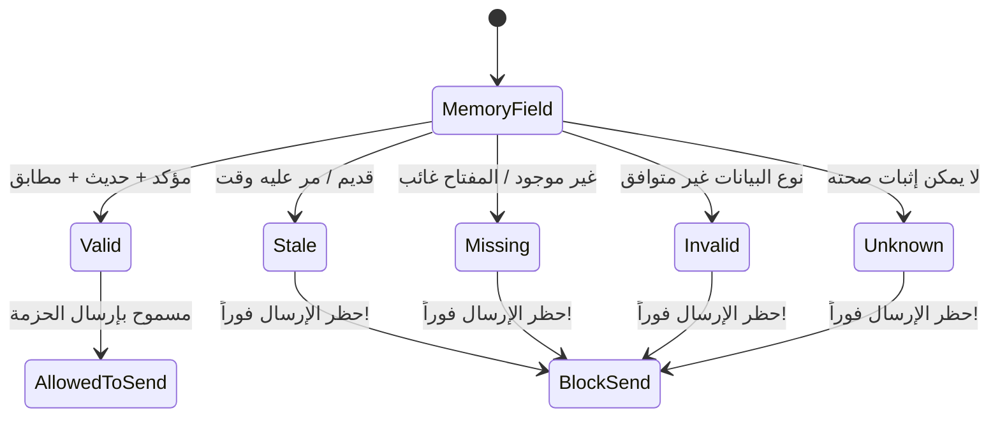

# 🛡️ معيار التحقق المسبق للشبكة وصلاحية الذاكرة (Preflight Validation & Memory Standard)

## 1. القاعدة الهندسية الذهبية (The Golden Engineering Rule)
> **"لا يجوز إطلاق أي طلب شبكي يعتمد نجاحه على شرط معين في حالة اللعبة قبل التحقق المؤكد والآلي من ذلك الشرط مسبقاً باستخدام مصدر موثوق وحديث من الذاكرة الحية (0-Network Pre-flight Check)."**

أي طلب شبكي يتم إرساله إلى خوادم اللعبة وهو فاقد لأحد شروطه المسبقة يُعد **خرقاً أمنياً خطيراً** يعرض حساب القلعة للاكتشاف والحظر المباشر (`BAN`)، ويصنف في تقارير التدقيق كـ `CRITICAL` أو `HIGH`.

---

## 2. جدول الفحص المسبق الإلزامي (The 10-Point Preflight Checklist)
لكل طلب شبكي يتم رصده في أي مهمة، يجب الإجابة عن الأسئلة العشرة التالية بدقة في تقرير المهمة:
1. **ما هي الشروط الرسمية التي تشترطها اللعبة قبل قبول هذا الطلب؟**
2. **أين توجد هذه الشروط تحديداً في سورس كود اللعبة (الملف والسطر والدالة)؟**
3. **ما هو مصدر كل شرط في كائن الذاكرة الحية (`conn.init_data`)؟**
4. **كيف يتم استخراج وقراءة قيمته في كود البوت؟**
5. **هل توجد آلية برمجية للتحقق من صلاحية البيانات وحداثتها وعدم تقادمها؟**
6. **ماذا يحدث في الكود عندما تكون بيانات الذاكرة مفقودة (`Missing` أو `None`)؟**
7. **ماذا يحدث في الكود عندما تكون بيانات الذاكرة قديمة (`Stale`)؟**
8. **ماذا يحدث إذا تغيرت حالة اللعبة بين لحظة التحقق ولحظة الإرسال (فجوة TOCTOU)؟**
9. **هل يوجد تحقق نهائي ومباشر يسبق استدعاء `safe_query`؟**
10. **هل يمكن من واقع الكود أن يُرسل الطلب رغم فشل أحد الشروط المسبقة؟**

---

## 3. مقياس تصنيف صلاحية الذاكرة الحية (5-Tier Memory State Taxonomy)
تُصنف كافة حقول الذاكرة المقروءة في أي مهمة وفق الدرجات الخمس التالية:

### التعريفات المعتمدة:
1. **`Valid` (صالح ومؤكد):** البيانات موجودة، ونوعها صحيح، ومحدثة من رد سيرفر حديث أو مزامنة مؤكدة، وقيمها منطقية وتطابق شروط اللعبة. **(الحالة الوحيدة المسموح بإرسال الحزمة معها)**.
2. **`Stale` (متقادم / قديم):** البيانات كانت صحيحة في وقت سابق (مثل لحظة تسجيل الدخول)، ولكن مرت أحداث أو عمليات قد تكون غيرتها دون إعادة مزامنة.
3. **`Missing` (مفقود):** المفتاح غير موجود أصلاً في `conn.init_data` أو قيمته `None` أو القاموس فارغ.
4. **`Invalid` (تالف / غير صالح):** القيمة موجودة ولكن بنية البيانات خاطئة (مثلاً: متوقع قاموس تفاصيل المعركة ووجد مصفوفة فارغة، أو متوقع رقم ووجد سلسلة نصية فارغة).
5. **`Unknown` (مجهول / غير مثبت):** بيانات لا يمكن التحقق من مصدرها أو دقتها برمجياً.

---

## 4. كشف ومعالجة فجوة TOCTOU (Time-of-Check to Time-of-Use)
تحدث مشكلة TOCTOU عندما يقوم البوت بفحص شرط معين (مثل توفر جندي أو فتح خريطة)، فيجده صالحاً، ولكن يفصل بين الفحص وبين إرسال الحزمة زمن أو عمليات أخرى قد تغير الحالة:
- **مصادر الخطر:**
  1. وجود استدعاء `asyncio.sleep()` طويل بين الفحص والإرسال.
  2. قيام مهمة أخرى تعمل بالتزامن باستهلاك الجنود أو الموارد.
  3. استلام حدث من السيرفر (Push Event) يفيد بهجوم خارجي أو انتهاء فعالية.
- **معيار التدقيق:**
  - إذا لم يوفر الكود إعادة فحص لحظية قبل إرسال الحزمة مباشرة، يُسجل خطر TOCTOU في التقرير مع تقدير احتمالية الحدوث.

---

## 5. تصنيف أسباب الفشل الشبكي (Failure Root Cause Taxonomy)
يتم تصنيف أي فشل محتمل في الحزم الشبكية وفق الفئات الست التالية:
1. **`FAILURE_PRECONDITION`:** فشل ناتج عن عدم توفر شروط اللعبة (مثل عدم كفاية النقاط، أو عدم فتح الخريطة).
2. **`FAILURE_MALFORMED_PAYLOAD`:** فشل ناتج عن خطأ في صياغة الحزمة أو أسماء الحقول أو أنواعها.
3. **`FAILURE_STALE_STATE`:** فشل ناتج عن الاعتماد على حالة قديمة في الذاكرة لم تعد تطابق السيرفر.
4. **`FAILURE_TOCTOU_RACE`:** فشل ناتج عن تغير حالة الحساب في الفترة الفاصلة بين الفحص والإرسال.
5. **`FAILURE_NETWORK_TIMEOUT`:** فشل ناتج عن انقطاع الاتصال أو بطء الشبكة أو انتهاء المهلة.
6. **`FAILURE_SERVER_PROTECTION`:** رفض الخادم للطلب بسبب آليات مكافحة البوتات أو السلوك المشبوه.
