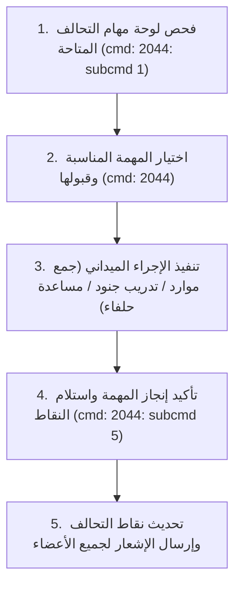

# قاموس مهام حشد التحالف وطريق المجد (Alliance Mobilization)

تعد فعالية **حشد التحالف (`Alliance Mobilization`)** الحدث الأهم في مسيرة التحالفات في **انتقام السلاطين (`and.onemt.war.ar`)**، حيث يتنافس أعضاء التحالف على سحب وإنجاز مهام جماعية وفردية لرفع تصنيف التحالف في دوري الممالك وفتح صناديق الجوائز الأسطورية.

---

## 1. دورة حياة مهمة الحشد البرمجية (Mobilization Task Lifecycle)

### الأوامر الرسمية لمحرك التحالف (`CMD_MOBILIZATION_MODULE = "2044"`):
- `REQ_MOBI_INIT = "1"`: استعلام بيانات اللوحة والمهام المتاحة.
- `REQ_MOBI_MISSION_COMPLETE = "5"`: إكمال المهمة المقبولة واستلام نقاطها.
- `REQ_MOBI_MISSION_RANKINFO = "9"`: استعلام تصنيف التحالف التراكمي.
- `REQ_MOBI_MISSION_GROUP_RANK = "10"`: استعلام ترتيب المجموعة.
- `REQ_MOBI_MISSION_RESET = "12"`: حذف وتجديد مهمة غير مرغوبة من اللوحة (لرتبة R4 و R5).

---

## 2. جدول جميع مهام حشد التحالف الـ 32 ونقاطها وأوامر أتمتتها

### [MOBILIZE-4101001] شحن 0.99 دولار
- **معرف نوع المهمة (TaskType)**: `4101001`
- **النقاط المكتسبة**: **`30 نقطة`**
- **المهلة المحددة للإنجاز**: `24 ساعة (0 ثانية)`
- **الكمية المطلوبة**: `0.99`
- **خوارزمية الأتمتة المباشرة**:
  1. الاستعلام عن لوحة المهام:
     `{"cmd": "2044", "subcmd": "1", "data": {}}`
  2. توجيه البوت لتنفيذ الهدف (جمع موارد الخريطة / تشغيل طابور التدريب / دعم التحالف).
  3. إنهاء المهمة والمطالبة بنقاطها فور الإنجاز:
     `{"cmd": "2044", "subcmd": "5", "data": {"tasktypeid": 4101001}} `

---
### [MOBILIZE-4101002] شحن 4.99 دولار
- **معرف نوع المهمة (TaskType)**: `4101002`
- **النقاط المكتسبة**: **`90 نقطة`**
- **المهلة المحددة للإنجاز**: `24 ساعة (0 ثانية)`
- **الكمية المطلوبة**: `4.99`
- **خوارزمية الأتمتة المباشرة**:
  1. الاستعلام عن لوحة المهام:
     `{"cmd": "2044", "subcmd": "1", "data": {}}`
  2. توجيه البوت لتنفيذ الهدف (جمع موارد الخريطة / تشغيل طابور التدريب / دعم التحالف).
  3. إنهاء المهمة والمطالبة بنقاطها فور الإنجاز:
     `{"cmd": "2044", "subcmd": "5", "data": {"tasktypeid": 4101002}} `

---
### [MOBILIZE-4101003] شحن 9.99 دولار
- **معرف نوع المهمة (TaskType)**: `4101003`
- **النقاط المكتسبة**: **`180 نقطة`**
- **المهلة المحددة للإنجاز**: `24 ساعة (0 ثانية)`
- **الكمية المطلوبة**: `9.99`
- **خوارزمية الأتمتة المباشرة**:
  1. الاستعلام عن لوحة المهام:
     `{"cmd": "2044", "subcmd": "1", "data": {}}`
  2. توجيه البوت لتنفيذ الهدف (جمع موارد الخريطة / تشغيل طابور التدريب / دعم التحالف).
  3. إنهاء المهمة والمطالبة بنقاطها فور الإنجاز:
     `{"cmd": "2044", "subcmd": "5", "data": {"tasktypeid": 4101003}} `

---
### [MOBILIZE-4101004] شحن 19.99 دولار
- **معرف نوع المهمة (TaskType)**: `4101004`
- **النقاط المكتسبة**: **`360 نقطة`**
- **المهلة المحددة للإنجاز**: `24 ساعة (0 ثانية)`
- **الكمية المطلوبة**: `19.99`
- **خوارزمية الأتمتة المباشرة**:
  1. الاستعلام عن لوحة المهام:
     `{"cmd": "2044", "subcmd": "1", "data": {}}`
  2. توجيه البوت لتنفيذ الهدف (جمع موارد الخريطة / تشغيل طابور التدريب / دعم التحالف).
  3. إنهاء المهمة والمطالبة بنقاطها فور الإنجاز:
     `{"cmd": "2044", "subcmd": "5", "data": {"tasktypeid": 4101004}} `

---
### [MOBILIZE-4101005] إجمالي استهلاك الذهب 500.0 ذهبة
- **معرف نوع المهمة (TaskType)**: `4101005`
- **النقاط المكتسبة**: **`30 نقطة`**
- **المهلة المحددة للإنجاز**: `24 ساعة (0 ثانية)`
- **الكمية المطلوبة**: `500.0`
- **خوارزمية الأتمتة المباشرة**:
  1. الاستعلام عن لوحة المهام:
     `{"cmd": "2044", "subcmd": "1", "data": {}}`
  2. توجيه البوت لتنفيذ الهدف (جمع موارد الخريطة / تشغيل طابور التدريب / دعم التحالف).
  3. إنهاء المهمة والمطالبة بنقاطها فور الإنجاز:
     `{"cmd": "2044", "subcmd": "5", "data": {"tasktypeid": 4101005}} `

---
### [MOBILIZE-4101006] إجمالي استهلاك الذهب 1000.0 ذهبة
- **معرف نوع المهمة (TaskType)**: `4101006`
- **النقاط المكتسبة**: **`60 نقطة`**
- **المهلة المحددة للإنجاز**: `24 ساعة (0 ثانية)`
- **الكمية المطلوبة**: `1000.0`
- **خوارزمية الأتمتة المباشرة**:
  1. الاستعلام عن لوحة المهام:
     `{"cmd": "2044", "subcmd": "1", "data": {}}`
  2. توجيه البوت لتنفيذ الهدف (جمع موارد الخريطة / تشغيل طابور التدريب / دعم التحالف).
  3. إنهاء المهمة والمطالبة بنقاطها فور الإنجاز:
     `{"cmd": "2044", "subcmd": "5", "data": {"tasktypeid": 4101006}} `

---
### [MOBILIZE-4101007] إجمالي استهلاك الذهب 2500.0 ذهبة
- **معرف نوع المهمة (TaskType)**: `4101007`
- **النقاط المكتسبة**: **`150 نقطة`**
- **المهلة المحددة للإنجاز**: `24 ساعة (0 ثانية)`
- **الكمية المطلوبة**: `2500.0`
- **خوارزمية الأتمتة المباشرة**:
  1. الاستعلام عن لوحة المهام:
     `{"cmd": "2044", "subcmd": "1", "data": {}}`
  2. توجيه البوت لتنفيذ الهدف (جمع موارد الخريطة / تشغيل طابور التدريب / دعم التحالف).
  3. إنهاء المهمة والمطالبة بنقاطها فور الإنجاز:
     `{"cmd": "2044", "subcmd": "5", "data": {"tasktypeid": 4101007}} `

---
### [MOBILIZE-4101008] إجمالي استهلاك الذهب 5000.0 ذهبة
- **معرف نوع المهمة (TaskType)**: `4101008`
- **النقاط المكتسبة**: **`300 نقطة`**
- **المهلة المحددة للإنجاز**: `24 ساعة (0 ثانية)`
- **الكمية المطلوبة**: `5000.0`
- **خوارزمية الأتمتة المباشرة**:
  1. الاستعلام عن لوحة المهام:
     `{"cmd": "2044", "subcmd": "1", "data": {}}`
  2. توجيه البوت لتنفيذ الهدف (جمع موارد الخريطة / تشغيل طابور التدريب / دعم التحالف).
  3. إنهاء المهمة والمطالبة بنقاطها فور الإنجاز:
     `{"cmd": "2044", "subcmd": "5", "data": {"tasktypeid": 4101008}} `

---
### [MOBILIZE-4101009] تراكم تدريب أي نوع من الجنود الى 4000.0 جندي
- **معرف نوع المهمة (TaskType)**: `4101009`
- **النقاط المكتسبة**: **`100 نقطة`**
- **المهلة المحددة للإنجاز**: `24 ساعة (0 ثانية)`
- **الكمية المطلوبة**: `4000.0`
- **خوارزمية الأتمتة المباشرة**:
  1. الاستعلام عن لوحة المهام:
     `{"cmd": "2044", "subcmd": "1", "data": {}}`
  2. توجيه البوت لتنفيذ الهدف (جمع موارد الخريطة / تشغيل طابور التدريب / دعم التحالف).
  3. إنهاء المهمة والمطالبة بنقاطها فور الإنجاز:
     `{"cmd": "2044", "subcmd": "5", "data": {"tasktypeid": 4101009}} `

---
### [MOBILIZE-4101010] تدريب 3000.0 جندي مشاة ذو أي مستوى
- **معرف نوع المهمة (TaskType)**: `4101010`
- **النقاط المكتسبة**: **`80 نقطة`**
- **المهلة المحددة للإنجاز**: `24 ساعة (0 ثانية)`
- **الكمية المطلوبة**: `3000.0`
- **خوارزمية الأتمتة المباشرة**:
  1. الاستعلام عن لوحة المهام:
     `{"cmd": "2044", "subcmd": "1", "data": {}}`
  2. توجيه البوت لتنفيذ الهدف (جمع موارد الخريطة / تشغيل طابور التدريب / دعم التحالف).
  3. إنهاء المهمة والمطالبة بنقاطها فور الإنجاز:
     `{"cmd": "2044", "subcmd": "5", "data": {"tasktypeid": 4101010}} `

---
### [MOBILIZE-4101011] تدريب 3000.0 فارس ذو أي مستوى
- **معرف نوع المهمة (TaskType)**: `4101011`
- **النقاط المكتسبة**: **`80 نقطة`**
- **المهلة المحددة للإنجاز**: `24 ساعة (0 ثانية)`
- **الكمية المطلوبة**: `3000.0`
- **خوارزمية الأتمتة المباشرة**:
  1. الاستعلام عن لوحة المهام:
     `{"cmd": "2044", "subcmd": "1", "data": {}}`
  2. توجيه البوت لتنفيذ الهدف (جمع موارد الخريطة / تشغيل طابور التدريب / دعم التحالف).
  3. إنهاء المهمة والمطالبة بنقاطها فور الإنجاز:
     `{"cmd": "2044", "subcmd": "5", "data": {"tasktypeid": 4101011}} `

---
### [MOBILIZE-4101012] تدريب 3000.0 رامي ذو أي مستوى
- **معرف نوع المهمة (TaskType)**: `4101012`
- **النقاط المكتسبة**: **`80 نقطة`**
- **المهلة المحددة للإنجاز**: `24 ساعة (0 ثانية)`
- **الكمية المطلوبة**: `3000.0`
- **خوارزمية الأتمتة المباشرة**:
  1. الاستعلام عن لوحة المهام:
     `{"cmd": "2044", "subcmd": "1", "data": {}}`
  2. توجيه البوت لتنفيذ الهدف (جمع موارد الخريطة / تشغيل طابور التدريب / دعم التحالف).
  3. إنهاء المهمة والمطالبة بنقاطها فور الإنجاز:
     `{"cmd": "2044", "subcmd": "5", "data": {"tasktypeid": 4101012}} `

---
### [MOBILIZE-4101013] تدريب 3000.0 عربة ذات أي مستوى
- **معرف نوع المهمة (TaskType)**: `4101013`
- **النقاط المكتسبة**: **`80 نقطة`**
- **المهلة المحددة للإنجاز**: `24 ساعة (0 ثانية)`
- **الكمية المطلوبة**: `3000.0`
- **خوارزمية الأتمتة المباشرة**:
  1. الاستعلام عن لوحة المهام:
     `{"cmd": "2044", "subcmd": "1", "data": {}}`
  2. توجيه البوت لتنفيذ الهدف (جمع موارد الخريطة / تشغيل طابور التدريب / دعم التحالف).
  3. إنهاء المهمة والمطالبة بنقاطها فور الإنجاز:
     `{"cmd": "2044", "subcmd": "5", "data": {"tasktypeid": 4101013}} `

---
### [MOBILIZE-4101014] مهمة حشد تحالف #4101014
- **معرف نوع المهمة (TaskType)**: `4101014`
- **النقاط المكتسبة**: **`20 نقطة`**
- **المهلة المحددة للإنجاز**: `24 ساعة (0 ثانية)`
- **الكمية المطلوبة**: `800.0`
- **خوارزمية الأتمتة المباشرة**:
  1. الاستعلام عن لوحة المهام:
     `{"cmd": "2044", "subcmd": "1", "data": {}}`
  2. توجيه البوت لتنفيذ الهدف (جمع موارد الخريطة / تشغيل طابور التدريب / دعم التحالف).
  3. إنهاء المهمة والمطالبة بنقاطها فور الإنجاز:
     `{"cmd": "2044", "subcmd": "5", "data": {"tasktypeid": 4101014}} `

---
### [MOBILIZE-4101015] تدريب 800.0 من الفرسان مستوى %{lv} أو أقل
- **معرف نوع المهمة (TaskType)**: `4101015`
- **النقاط المكتسبة**: **`20 نقطة`**
- **المهلة المحددة للإنجاز**: `24 ساعة (0 ثانية)`
- **الكمية المطلوبة**: `800.0`
- **خوارزمية الأتمتة المباشرة**:
  1. الاستعلام عن لوحة المهام:
     `{"cmd": "2044", "subcmd": "1", "data": {}}`
  2. توجيه البوت لتنفيذ الهدف (جمع موارد الخريطة / تشغيل طابور التدريب / دعم التحالف).
  3. إنهاء المهمة والمطالبة بنقاطها فور الإنجاز:
     `{"cmd": "2044", "subcmd": "5", "data": {"tasktypeid": 4101015}} `

---
### [MOBILIZE-4101016] تدريب 800.0 من الرماة مستوى %{lv} أو أقل
- **معرف نوع المهمة (TaskType)**: `4101016`
- **النقاط المكتسبة**: **`20 نقطة`**
- **المهلة المحددة للإنجاز**: `24 ساعة (0 ثانية)`
- **الكمية المطلوبة**: `800.0`
- **خوارزمية الأتمتة المباشرة**:
  1. الاستعلام عن لوحة المهام:
     `{"cmd": "2044", "subcmd": "1", "data": {}}`
  2. توجيه البوت لتنفيذ الهدف (جمع موارد الخريطة / تشغيل طابور التدريب / دعم التحالف).
  3. إنهاء المهمة والمطالبة بنقاطها فور الإنجاز:
     `{"cmd": "2044", "subcmd": "5", "data": {"tasktypeid": 4101016}} `

---
### [MOBILIZE-4101017] تدريب 800.0 من العربات مستوى %{lv} أو أقل
- **معرف نوع المهمة (TaskType)**: `4101017`
- **النقاط المكتسبة**: **`20 نقطة`**
- **المهلة المحددة للإنجاز**: `24 ساعة (0 ثانية)`
- **الكمية المطلوبة**: `800.0`
- **خوارزمية الأتمتة المباشرة**:
  1. الاستعلام عن لوحة المهام:
     `{"cmd": "2044", "subcmd": "1", "data": {}}`
  2. توجيه البوت لتنفيذ الهدف (جمع موارد الخريطة / تشغيل طابور التدريب / دعم التحالف).
  3. إنهاء المهمة والمطالبة بنقاطها فور الإنجاز:
     `{"cmd": "2044", "subcmd": "5", "data": {"tasktypeid": 4101017}} `

---
### [MOBILIZE-4101018] قم بتدريب 800.0 جندي مشاة ذو مستوى %{lv} أو ما فوق
- **معرف نوع المهمة (TaskType)**: `4101018`
- **النقاط المكتسبة**: **`30 نقطة`**
- **المهلة المحددة للإنجاز**: `24 ساعة (0 ثانية)`
- **الكمية المطلوبة**: `800.0`
- **خوارزمية الأتمتة المباشرة**:
  1. الاستعلام عن لوحة المهام:
     `{"cmd": "2044", "subcmd": "1", "data": {}}`
  2. توجيه البوت لتنفيذ الهدف (جمع موارد الخريطة / تشغيل طابور التدريب / دعم التحالف).
  3. إنهاء المهمة والمطالبة بنقاطها فور الإنجاز:
     `{"cmd": "2044", "subcmd": "5", "data": {"tasktypeid": 4101018}} `

---
### [MOBILIZE-4101019] قم بتدريب 800.0 فارس ذو مستوى %{lv} أو ما فوق
- **معرف نوع المهمة (TaskType)**: `4101019`
- **النقاط المكتسبة**: **`30 نقطة`**
- **المهلة المحددة للإنجاز**: `24 ساعة (0 ثانية)`
- **الكمية المطلوبة**: `800.0`
- **خوارزمية الأتمتة المباشرة**:
  1. الاستعلام عن لوحة المهام:
     `{"cmd": "2044", "subcmd": "1", "data": {}}`
  2. توجيه البوت لتنفيذ الهدف (جمع موارد الخريطة / تشغيل طابور التدريب / دعم التحالف).
  3. إنهاء المهمة والمطالبة بنقاطها فور الإنجاز:
     `{"cmd": "2044", "subcmd": "5", "data": {"tasktypeid": 4101019}} `

---
### [MOBILIZE-4101020] قم بتدريب 800.0 رامي ذو مستوى %{lv} أو ما فوق
- **معرف نوع المهمة (TaskType)**: `4101020`
- **النقاط المكتسبة**: **`30 نقطة`**
- **المهلة المحددة للإنجاز**: `24 ساعة (0 ثانية)`
- **الكمية المطلوبة**: `800.0`
- **خوارزمية الأتمتة المباشرة**:
  1. الاستعلام عن لوحة المهام:
     `{"cmd": "2044", "subcmd": "1", "data": {}}`
  2. توجيه البوت لتنفيذ الهدف (جمع موارد الخريطة / تشغيل طابور التدريب / دعم التحالف).
  3. إنهاء المهمة والمطالبة بنقاطها فور الإنجاز:
     `{"cmd": "2044", "subcmd": "5", "data": {"tasktypeid": 4101020}} `

---
### [MOBILIZE-4101021] قم بتدريب 800.0 عربة ذو مستوى %{lv} أو ما فوق
- **معرف نوع المهمة (TaskType)**: `4101021`
- **النقاط المكتسبة**: **`30 نقطة`**
- **المهلة المحددة للإنجاز**: `24 ساعة (0 ثانية)`
- **الكمية المطلوبة**: `800.0`
- **خوارزمية الأتمتة المباشرة**:
  1. الاستعلام عن لوحة المهام:
     `{"cmd": "2044", "subcmd": "1", "data": {}}`
  2. توجيه البوت لتنفيذ الهدف (جمع موارد الخريطة / تشغيل طابور التدريب / دعم التحالف).
  3. إنهاء المهمة والمطالبة بنقاطها فور الإنجاز:
     `{"cmd": "2044", "subcmd": "5", "data": {"tasktypeid": 4101021}} `

---
### [MOBILIZE-4101022] مهمة حشد تحالف #4101022
- **معرف نوع المهمة (TaskType)**: `4101022`
- **النقاط المكتسبة**: **`25 نقطة`**
- **المهلة المحددة للإنجاز**: `24 ساعة (0 ثانية)`
- **الكمية المطلوبة**: `300.0`
- **خوارزمية الأتمتة المباشرة**:
  1. الاستعلام عن لوحة المهام:
     `{"cmd": "2044", "subcmd": "1", "data": {}}`
  2. توجيه البوت لتنفيذ الهدف (جمع موارد الخريطة / تشغيل طابور التدريب / دعم التحالف).
  3. إنهاء المهمة والمطالبة بنقاطها فور الإنجاز:
     `{"cmd": "2044", "subcmd": "5", "data": {"tasktypeid": 4101022}} `

---
### [MOBILIZE-4101023] مهمة حشد تحالف #4101023
- **معرف نوع المهمة (TaskType)**: `4101023`
- **النقاط المكتسبة**: **`50 نقطة`**
- **المهلة المحددة للإنجاز**: `24 ساعة (0 ثانية)`
- **الكمية المطلوبة**: `600.0`
- **خوارزمية الأتمتة المباشرة**:
  1. الاستعلام عن لوحة المهام:
     `{"cmd": "2044", "subcmd": "1", "data": {}}`
  2. توجيه البوت لتنفيذ الهدف (جمع موارد الخريطة / تشغيل طابور التدريب / دعم التحالف).
  3. إنهاء المهمة والمطالبة بنقاطها فور الإنجاز:
     `{"cmd": "2044", "subcmd": "5", "data": {"tasktypeid": 4101023}} `

---
### [MOBILIZE-4101024] مهمة حشد تحالف #4101024
- **معرف نوع المهمة (TaskType)**: `4101024`
- **النقاط المكتسبة**: **`100 نقطة`**
- **المهلة المحددة للإنجاز**: `24 ساعة (0 ثانية)`
- **الكمية المطلوبة**: `1200.0`
- **خوارزمية الأتمتة المباشرة**:
  1. الاستعلام عن لوحة المهام:
     `{"cmd": "2044", "subcmd": "1", "data": {}}`
  2. توجيه البوت لتنفيذ الهدف (جمع موارد الخريطة / تشغيل طابور التدريب / دعم التحالف).
  3. إنهاء المهمة والمطالبة بنقاطها فور الإنجاز:
     `{"cmd": "2044", "subcmd": "5", "data": {"tasktypeid": 4101024}} `

---
### [MOBILIZE-4101025] مهمة حشد تحالف #4101025
- **معرف نوع المهمة (TaskType)**: `4101025`
- **النقاط المكتسبة**: **`150 نقطة`**
- **المهلة المحددة للإنجاز**: `24 ساعة (0 ثانية)`
- **الكمية المطلوبة**: `1800.0`
- **خوارزمية الأتمتة المباشرة**:
  1. الاستعلام عن لوحة المهام:
     `{"cmd": "2044", "subcmd": "1", "data": {}}`
  2. توجيه البوت لتنفيذ الهدف (جمع موارد الخريطة / تشغيل طابور التدريب / دعم التحالف).
  3. إنهاء المهمة والمطالبة بنقاطها فور الإنجاز:
     `{"cmd": "2044", "subcmd": "5", "data": {"tasktypeid": 4101025}} `

---
### [MOBILIZE-4101026] الإستهلاك التراكمي للطاقة 50.0 نقطة
- **معرف نوع المهمة (TaskType)**: `4101026`
- **النقاط المكتسبة**: **`25 نقطة`**
- **المهلة المحددة للإنجاز**: `24 ساعة (0 ثانية)`
- **الكمية المطلوبة**: `50.0`
- **خوارزمية الأتمتة المباشرة**:
  1. الاستعلام عن لوحة المهام:
     `{"cmd": "2044", "subcmd": "1", "data": {}}`
  2. توجيه البوت لتنفيذ الهدف (جمع موارد الخريطة / تشغيل طابور التدريب / دعم التحالف).
  3. إنهاء المهمة والمطالبة بنقاطها فور الإنجاز:
     `{"cmd": "2044", "subcmd": "5", "data": {"tasktypeid": 4101026}} `

---
### [MOBILIZE-4101027] الإستهلاك التراكمي للطاقة 100.0 نقطة
- **معرف نوع المهمة (TaskType)**: `4101027`
- **النقاط المكتسبة**: **`50 نقطة`**
- **المهلة المحددة للإنجاز**: `24 ساعة (0 ثانية)`
- **الكمية المطلوبة**: `100.0`
- **خوارزمية الأتمتة المباشرة**:
  1. الاستعلام عن لوحة المهام:
     `{"cmd": "2044", "subcmd": "1", "data": {}}`
  2. توجيه البوت لتنفيذ الهدف (جمع موارد الخريطة / تشغيل طابور التدريب / دعم التحالف).
  3. إنهاء المهمة والمطالبة بنقاطها فور الإنجاز:
     `{"cmd": "2044", "subcmd": "5", "data": {"tasktypeid": 4101027}} `

---
### [MOBILIZE-4101028] الإستهلاك التراكمي للطاقة 150.0 نقطة
- **معرف نوع المهمة (TaskType)**: `4101028`
- **النقاط المكتسبة**: **`75 نقطة`**
- **المهلة المحددة للإنجاز**: `24 ساعة (0 ثانية)`
- **الكمية المطلوبة**: `150.0`
- **خوارزمية الأتمتة المباشرة**:
  1. الاستعلام عن لوحة المهام:
     `{"cmd": "2044", "subcmd": "1", "data": {}}`
  2. توجيه البوت لتنفيذ الهدف (جمع موارد الخريطة / تشغيل طابور التدريب / دعم التحالف).
  3. إنهاء المهمة والمطالبة بنقاطها فور الإنجاز:
     `{"cmd": "2044", "subcmd": "5", "data": {"tasktypeid": 4101028}} `

---
### [MOBILIZE-4101029] الإستهلاك التراكمي للطاقة 200.0 نقطة
- **معرف نوع المهمة (TaskType)**: `4101029`
- **النقاط المكتسبة**: **`100 نقطة`**
- **المهلة المحددة للإنجاز**: `24 ساعة (0 ثانية)`
- **الكمية المطلوبة**: `200.0`
- **خوارزمية الأتمتة المباشرة**:
  1. الاستعلام عن لوحة المهام:
     `{"cmd": "2044", "subcmd": "1", "data": {}}`
  2. توجيه البوت لتنفيذ الهدف (جمع موارد الخريطة / تشغيل طابور التدريب / دعم التحالف).
  3. إنهاء المهمة والمطالبة بنقاطها فور الإنجاز:
     `{"cmd": "2044", "subcmd": "5", "data": {"tasktypeid": 4101029}} `

---
### [MOBILIZE-4101030] اُقتُل الوحوش 5.0 مرة
- **معرف نوع المهمة (TaskType)**: `4101030`
- **النقاط المكتسبة**: **`15 نقطة`**
- **المهلة المحددة للإنجاز**: `24 ساعة (0 ثانية)`
- **الكمية المطلوبة**: `5.0`
- **خوارزمية الأتمتة المباشرة**:
  1. الاستعلام عن لوحة المهام:
     `{"cmd": "2044", "subcmd": "1", "data": {}}`
  2. توجيه البوت لتنفيذ الهدف (جمع موارد الخريطة / تشغيل طابور التدريب / دعم التحالف).
  3. إنهاء المهمة والمطالبة بنقاطها فور الإنجاز:
     `{"cmd": "2044", "subcmd": "5", "data": {"tasktypeid": 4101030}} `

---
### [MOBILIZE-4101031] اُقتُل الوحوش 10.0 مرة
- **معرف نوع المهمة (TaskType)**: `4101031`
- **النقاط المكتسبة**: **`30 نقطة`**
- **المهلة المحددة للإنجاز**: `24 ساعة (0 ثانية)`
- **الكمية المطلوبة**: `10.0`
- **خوارزمية الأتمتة المباشرة**:
  1. الاستعلام عن لوحة المهام:
     `{"cmd": "2044", "subcmd": "1", "data": {}}`
  2. توجيه البوت لتنفيذ الهدف (جمع موارد الخريطة / تشغيل طابور التدريب / دعم التحالف).
  3. إنهاء المهمة والمطالبة بنقاطها فور الإنجاز:
     `{"cmd": "2044", "subcmd": "5", "data": {"tasktypeid": 4101031}} `

---
### [MOBILIZE-4101032] اُقتُل الوحوش 15.0 مرة
- **معرف نوع المهمة (TaskType)**: `4101032`
- **النقاط المكتسبة**: **`45 نقطة`**
- **المهلة المحددة للإنجاز**: `24 ساعة (0 ثانية)`
- **الكمية المطلوبة**: `15.0`
- **خوارزمية الأتمتة المباشرة**:
  1. الاستعلام عن لوحة المهام:
     `{"cmd": "2044", "subcmd": "1", "data": {}}`
  2. توجيه البوت لتنفيذ الهدف (جمع موارد الخريطة / تشغيل طابور التدريب / دعم التحالف).
  3. إنهاء المهمة والمطالبة بنقاطها فور الإنجاز:
     `{"cmd": "2044", "subcmd": "5", "data": {"tasktypeid": 4101032}} `

---
### [MOBILIZE-4101033] اُقتُل الوحوش 20.0 مرة
- **معرف نوع المهمة (TaskType)**: `4101033`
- **النقاط المكتسبة**: **`60 نقطة`**
- **المهلة المحددة للإنجاز**: `24 ساعة (0 ثانية)`
- **الكمية المطلوبة**: `20.0`
- **خوارزمية الأتمتة المباشرة**:
  1. الاستعلام عن لوحة المهام:
     `{"cmd": "2044", "subcmd": "1", "data": {}}`
  2. توجيه البوت لتنفيذ الهدف (جمع موارد الخريطة / تشغيل طابور التدريب / دعم التحالف).
  3. إنهاء المهمة والمطالبة بنقاطها فور الإنجاز:
     `{"cmd": "2044", "subcmd": "5", "data": {"tasktypeid": 4101033}} `

---
### [MOBILIZE-4101034] اكتشاف الكنز عند نافورة الكنوز 5.0 مرة
- **معرف نوع المهمة (TaskType)**: `4101034`
- **النقاط المكتسبة**: **`20 نقطة`**
- **المهلة المحددة للإنجاز**: `24 ساعة (0 ثانية)`
- **الكمية المطلوبة**: `5.0`
- **خوارزمية الأتمتة المباشرة**:
  1. الاستعلام عن لوحة المهام:
     `{"cmd": "2044", "subcmd": "1", "data": {}}`
  2. توجيه البوت لتنفيذ الهدف (جمع موارد الخريطة / تشغيل طابور التدريب / دعم التحالف).
  3. إنهاء المهمة والمطالبة بنقاطها فور الإنجاز:
     `{"cmd": "2044", "subcmd": "5", "data": {"tasktypeid": 4101034}} `

---
### [MOBILIZE-4101035] اكتشاف الكنز عند نافورة الكنوز 10.0 مرة
- **معرف نوع المهمة (TaskType)**: `4101035`
- **النقاط المكتسبة**: **`40 نقطة`**
- **المهلة المحددة للإنجاز**: `24 ساعة (0 ثانية)`
- **الكمية المطلوبة**: `10.0`
- **خوارزمية الأتمتة المباشرة**:
  1. الاستعلام عن لوحة المهام:
     `{"cmd": "2044", "subcmd": "1", "data": {}}`
  2. توجيه البوت لتنفيذ الهدف (جمع موارد الخريطة / تشغيل طابور التدريب / دعم التحالف).
  3. إنهاء المهمة والمطالبة بنقاطها فور الإنجاز:
     `{"cmd": "2044", "subcmd": "5", "data": {"tasktypeid": 4101035}} `

---
### [MOBILIZE-4101036] اكتشاف الكنز عند نافورة الكنوز 20.0 مرة
- **معرف نوع المهمة (TaskType)**: `4101036`
- **النقاط المكتسبة**: **`80 نقطة`**
- **المهلة المحددة للإنجاز**: `24 ساعة (0 ثانية)`
- **الكمية المطلوبة**: `20.0`
- **خوارزمية الأتمتة المباشرة**:
  1. الاستعلام عن لوحة المهام:
     `{"cmd": "2044", "subcmd": "1", "data": {}}`
  2. توجيه البوت لتنفيذ الهدف (جمع موارد الخريطة / تشغيل طابور التدريب / دعم التحالف).
  3. إنهاء المهمة والمطالبة بنقاطها فور الإنجاز:
     `{"cmd": "2044", "subcmd": "5", "data": {"tasktypeid": 4101036}} `

---
### [MOBILIZE-4101037] اكتشاف الكنز عند نافورة الكنوز 40.0 مرة
- **معرف نوع المهمة (TaskType)**: `4101037`
- **النقاط المكتسبة**: **`160 نقطة`**
- **المهلة المحددة للإنجاز**: `24 ساعة (0 ثانية)`
- **الكمية المطلوبة**: `40.0`
- **خوارزمية الأتمتة المباشرة**:
  1. الاستعلام عن لوحة المهام:
     `{"cmd": "2044", "subcmd": "1", "data": {}}`
  2. توجيه البوت لتنفيذ الهدف (جمع موارد الخريطة / تشغيل طابور التدريب / دعم التحالف).
  3. إنهاء المهمة والمطالبة بنقاطها فور الإنجاز:
     `{"cmd": "2044", "subcmd": "5", "data": {"tasktypeid": 4101037}} `

---
### [MOBILIZE-4101038] شراء العروض من التاجر العجيب 5.0 مرة
- **معرف نوع المهمة (TaskType)**: `4101038`
- **النقاط المكتسبة**: **`30 نقطة`**
- **المهلة المحددة للإنجاز**: `24 ساعة (0 ثانية)`
- **الكمية المطلوبة**: `5.0`
- **خوارزمية الأتمتة المباشرة**:
  1. الاستعلام عن لوحة المهام:
     `{"cmd": "2044", "subcmd": "1", "data": {}}`
  2. توجيه البوت لتنفيذ الهدف (جمع موارد الخريطة / تشغيل طابور التدريب / دعم التحالف).
  3. إنهاء المهمة والمطالبة بنقاطها فور الإنجاز:
     `{"cmd": "2044", "subcmd": "5", "data": {"tasktypeid": 4101038}} `

---
### [MOBILIZE-4101039] شراء العروض من التاجر العجيب 10.0 مرة
- **معرف نوع المهمة (TaskType)**: `4101039`
- **النقاط المكتسبة**: **`60 نقطة`**
- **المهلة المحددة للإنجاز**: `24 ساعة (0 ثانية)`
- **الكمية المطلوبة**: `10.0`
- **خوارزمية الأتمتة المباشرة**:
  1. الاستعلام عن لوحة المهام:
     `{"cmd": "2044", "subcmd": "1", "data": {}}`
  2. توجيه البوت لتنفيذ الهدف (جمع موارد الخريطة / تشغيل طابور التدريب / دعم التحالف).
  3. إنهاء المهمة والمطالبة بنقاطها فور الإنجاز:
     `{"cmd": "2044", "subcmd": "5", "data": {"tasktypeid": 4101039}} `

---
### [MOBILIZE-4101040] شراء العروض من التاجر العجيب 20.0 مرة
- **معرف نوع المهمة (TaskType)**: `4101040`
- **النقاط المكتسبة**: **`120 نقطة`**
- **المهلة المحددة للإنجاز**: `24 ساعة (0 ثانية)`
- **الكمية المطلوبة**: `20.0`
- **خوارزمية الأتمتة المباشرة**:
  1. الاستعلام عن لوحة المهام:
     `{"cmd": "2044", "subcmd": "1", "data": {}}`
  2. توجيه البوت لتنفيذ الهدف (جمع موارد الخريطة / تشغيل طابور التدريب / دعم التحالف).
  3. إنهاء المهمة والمطالبة بنقاطها فور الإنجاز:
     `{"cmd": "2044", "subcmd": "5", "data": {"tasktypeid": 4101040}} `

---
### [MOBILIZE-4101041] فتح كنز التحالف 2.0 مرة
- **معرف نوع المهمة (TaskType)**: `4101041`
- **النقاط المكتسبة**: **`15 نقطة`**
- **المهلة المحددة للإنجاز**: `24 ساعة (0 ثانية)`
- **الكمية المطلوبة**: `2.0`
- **خوارزمية الأتمتة المباشرة**:
  1. الاستعلام عن لوحة المهام:
     `{"cmd": "2044", "subcmd": "1", "data": {}}`
  2. توجيه البوت لتنفيذ الهدف (جمع موارد الخريطة / تشغيل طابور التدريب / دعم التحالف).
  3. إنهاء المهمة والمطالبة بنقاطها فور الإنجاز:
     `{"cmd": "2044", "subcmd": "5", "data": {"tasktypeid": 4101041}} `

---
### [MOBILIZE-4101042] تبرع لعلوم التحالف 20.0 مرة
- **معرف نوع المهمة (TaskType)**: `4101042`
- **النقاط المكتسبة**: **`40 نقطة`**
- **المهلة المحددة للإنجاز**: `24 ساعة (0 ثانية)`
- **الكمية المطلوبة**: `20.0`
- **خوارزمية الأتمتة المباشرة**:
  1. الاستعلام عن لوحة المهام:
     `{"cmd": "2044", "subcmd": "1", "data": {}}`
  2. توجيه البوت لتنفيذ الهدف (جمع موارد الخريطة / تشغيل طابور التدريب / دعم التحالف).
  3. إنهاء المهمة والمطالبة بنقاطها فور الإنجاز:
     `{"cmd": "2044", "subcmd": "5", "data": {"tasktypeid": 4101042}} `

---
### [MOBILIZE-4101043] مساعدة أصدقاء التحالف 30.0 مرة
- **معرف نوع المهمة (TaskType)**: `4101043`
- **النقاط المكتسبة**: **`60 نقطة`**
- **المهلة المحددة للإنجاز**: `24 ساعة (0 ثانية)`
- **الكمية المطلوبة**: `30.0`
- **خوارزمية الأتمتة المباشرة**:
  1. الاستعلام عن لوحة المهام:
     `{"cmd": "2044", "subcmd": "1", "data": {}}`
  2. توجيه البوت لتنفيذ الهدف (جمع موارد الخريطة / تشغيل طابور التدريب / دعم التحالف).
  3. إنهاء المهمة والمطالبة بنقاطها فور الإنجاز:
     `{"cmd": "2044", "subcmd": "5", "data": {"tasktypeid": 4101043}} `

---
### [MOBILIZE-4101044] مساعدة أصدقاء التحالف 50.0 مرة
- **معرف نوع المهمة (TaskType)**: `4101044`
- **النقاط المكتسبة**: **`100 نقطة`**
- **المهلة المحددة للإنجاز**: `24 ساعة (0 ثانية)`
- **الكمية المطلوبة**: `50.0`
- **خوارزمية الأتمتة المباشرة**:
  1. الاستعلام عن لوحة المهام:
     `{"cmd": "2044", "subcmd": "1", "data": {}}`
  2. توجيه البوت لتنفيذ الهدف (جمع موارد الخريطة / تشغيل طابور التدريب / دعم التحالف).
  3. إنهاء المهمة والمطالبة بنقاطها فور الإنجاز:
     `{"cmd": "2044", "subcmd": "5", "data": {"tasktypeid": 4101044}} `

---
### [MOBILIZE-4101045] احصد أي نوع من الموارد بمقدار 2000000.0
- **معرف نوع المهمة (TaskType)**: `4101045`
- **النقاط المكتسبة**: **`75 نقطة`**
- **المهلة المحددة للإنجاز**: `24 ساعة (0 ثانية)`
- **الكمية المطلوبة**: `2000000.0`
- **خوارزمية الأتمتة المباشرة**:
  1. الاستعلام عن لوحة المهام:
     `{"cmd": "2044", "subcmd": "1", "data": {}}`
  2. توجيه البوت لتنفيذ الهدف (جمع موارد الخريطة / تشغيل طابور التدريب / دعم التحالف).
  3. إنهاء المهمة والمطالبة بنقاطها فور الإنجاز:
     `{"cmd": "2044", "subcmd": "5", "data": {"tasktypeid": 4101045}} `

---
### [MOBILIZE-4101046] إجمالي جمع الموارد  من العالم 2000000.0
- **معرف نوع المهمة (TaskType)**: `4101046`
- **النقاط المكتسبة**: **`75 نقطة`**
- **المهلة المحددة للإنجاز**: `24 ساعة (0 ثانية)`
- **الكمية المطلوبة**: `2000000.0`
- **خوارزمية الأتمتة المباشرة**:
  1. الاستعلام عن لوحة المهام:
     `{"cmd": "2044", "subcmd": "1", "data": {}}`
  2. توجيه البوت لتنفيذ الهدف (جمع موارد الخريطة / تشغيل طابور التدريب / دعم التحالف).
  3. إنهاء المهمة والمطالبة بنقاطها فور الإنجاز:
     `{"cmd": "2044", "subcmd": "5", "data": {"tasktypeid": 4101046}} `

---
### [MOBILIZE-4101047] في خريطة العالم إجمع أي نوع من الموارد لـ 5.0 مرة
- **معرف نوع المهمة (TaskType)**: `4101047`
- **النقاط المكتسبة**: **`25 نقطة`**
- **المهلة المحددة للإنجاز**: `24 ساعة (0 ثانية)`
- **الكمية المطلوبة**: `5.0`
- **خوارزمية الأتمتة المباشرة**:
  1. الاستعلام عن لوحة المهام:
     `{"cmd": "2044", "subcmd": "1", "data": {}}`
  2. توجيه البوت لتنفيذ الهدف (جمع موارد الخريطة / تشغيل طابور التدريب / دعم التحالف).
  3. إنهاء المهمة والمطالبة بنقاطها فور الإنجاز:
     `{"cmd": "2044", "subcmd": "5", "data": {"tasktypeid": 4101047}} `

---
### [MOBILIZE-4101048] في خريطة العالم إجمع أي نوع من الموارد لـ 10.0 مرة
- **معرف نوع المهمة (TaskType)**: `4101048`
- **النقاط المكتسبة**: **`50 نقطة`**
- **المهلة المحددة للإنجاز**: `24 ساعة (0 ثانية)`
- **الكمية المطلوبة**: `10.0`
- **خوارزمية الأتمتة المباشرة**:
  1. الاستعلام عن لوحة المهام:
     `{"cmd": "2044", "subcmd": "1", "data": {}}`
  2. توجيه البوت لتنفيذ الهدف (جمع موارد الخريطة / تشغيل طابور التدريب / دعم التحالف).
  3. إنهاء المهمة والمطالبة بنقاطها فور الإنجاز:
     `{"cmd": "2044", "subcmd": "5", "data": {"tasktypeid": 4101048}} `

---
### [MOBILIZE-4101049] قم بتنقية العتاد 10.0 مرة
- **معرف نوع المهمة (TaskType)**: `4101049`
- **النقاط المكتسبة**: **`50 نقطة`**
- **المهلة المحددة للإنجاز**: `24 ساعة (0 ثانية)`
- **الكمية المطلوبة**: `10.0`
- **خوارزمية الأتمتة المباشرة**:
  1. الاستعلام عن لوحة المهام:
     `{"cmd": "2044", "subcmd": "1", "data": {}}`
  2. توجيه البوت لتنفيذ الهدف (جمع موارد الخريطة / تشغيل طابور التدريب / دعم التحالف).
  3. إنهاء المهمة والمطالبة بنقاطها فور الإنجاز:
     `{"cmd": "2044", "subcmd": "5", "data": {"tasktypeid": 4101049}} `

---
### [MOBILIZE-4101050] قم بتنقية العتاد 30.0 مرة
- **معرف نوع المهمة (TaskType)**: `4101050`
- **النقاط المكتسبة**: **`150 نقطة`**
- **المهلة المحددة للإنجاز**: `24 ساعة (0 ثانية)`
- **الكمية المطلوبة**: `30.0`
- **خوارزمية الأتمتة المباشرة**:
  1. الاستعلام عن لوحة المهام:
     `{"cmd": "2044", "subcmd": "1", "data": {}}`
  2. توجيه البوت لتنفيذ الهدف (جمع موارد الخريطة / تشغيل طابور التدريب / دعم التحالف).
  3. إنهاء المهمة والمطالبة بنقاطها فور الإنجاز:
     `{"cmd": "2044", "subcmd": "5", "data": {"tasktypeid": 4101050}} `

---
### [MOBILIZE-4101051] قم بتنقية العتاد 50.0 مرة
- **معرف نوع المهمة (TaskType)**: `4101051`
- **النقاط المكتسبة**: **`250 نقطة`**
- **المهلة المحددة للإنجاز**: `24 ساعة (0 ثانية)`
- **الكمية المطلوبة**: `50.0`
- **خوارزمية الأتمتة المباشرة**:
  1. الاستعلام عن لوحة المهام:
     `{"cmd": "2044", "subcmd": "1", "data": {}}`
  2. توجيه البوت لتنفيذ الهدف (جمع موارد الخريطة / تشغيل طابور التدريب / دعم التحالف).
  3. إنهاء المهمة والمطالبة بنقاطها فور الإنجاز:
     `{"cmd": "2044", "subcmd": "5", "data": {"tasktypeid": 4101051}} `

---
### [MOBILIZE-4101052] قتل الجنود التراكمي 5000.0 جندي
- **معرف نوع المهمة (TaskType)**: `4101052`
- **النقاط المكتسبة**: **`160 نقطة`**
- **المهلة المحددة للإنجاز**: `24 ساعة (0 ثانية)`
- **الكمية المطلوبة**: `5000.0`
- **خوارزمية الأتمتة المباشرة**:
  1. الاستعلام عن لوحة المهام:
     `{"cmd": "2044", "subcmd": "1", "data": {}}`
  2. توجيه البوت لتنفيذ الهدف (جمع موارد الخريطة / تشغيل طابور التدريب / دعم التحالف).
  3. إنهاء المهمة والمطالبة بنقاطها فور الإنجاز:
     `{"cmd": "2044", "subcmd": "5", "data": {"tasktypeid": 4101052}} `

---
### [MOBILIZE-4101053] قتل الجنود التراكمي 10000.0 جندي
- **معرف نوع المهمة (TaskType)**: `4101053`
- **النقاط المكتسبة**: **`320 نقطة`**
- **المهلة المحددة للإنجاز**: `24 ساعة (0 ثانية)`
- **الكمية المطلوبة**: `10000.0`
- **خوارزمية الأتمتة المباشرة**:
  1. الاستعلام عن لوحة المهام:
     `{"cmd": "2044", "subcmd": "1", "data": {}}`
  2. توجيه البوت لتنفيذ الهدف (جمع موارد الخريطة / تشغيل طابور التدريب / دعم التحالف).
  3. إنهاء المهمة والمطالبة بنقاطها فور الإنجاز:
     `{"cmd": "2044", "subcmd": "5", "data": {"tasktypeid": 4101053}} `

---
### [MOBILIZE-4101054] شحن 0.99 دولار
- **معرف نوع المهمة (TaskType)**: `4101054`
- **النقاط المكتسبة**: **`30 نقطة`**
- **المهلة المحددة للإنجاز**: `24 ساعة (0 ثانية)`
- **الكمية المطلوبة**: `0.99`
- **خوارزمية الأتمتة المباشرة**:
  1. الاستعلام عن لوحة المهام:
     `{"cmd": "2044", "subcmd": "1", "data": {}}`
  2. توجيه البوت لتنفيذ الهدف (جمع موارد الخريطة / تشغيل طابور التدريب / دعم التحالف).
  3. إنهاء المهمة والمطالبة بنقاطها فور الإنجاز:
     `{"cmd": "2044", "subcmd": "5", "data": {"tasktypeid": 4101054}} `

---
### [MOBILIZE-4101055] شحن 4.99 دولار
- **معرف نوع المهمة (TaskType)**: `4101055`
- **النقاط المكتسبة**: **`90 نقطة`**
- **المهلة المحددة للإنجاز**: `24 ساعة (0 ثانية)`
- **الكمية المطلوبة**: `4.99`
- **خوارزمية الأتمتة المباشرة**:
  1. الاستعلام عن لوحة المهام:
     `{"cmd": "2044", "subcmd": "1", "data": {}}`
  2. توجيه البوت لتنفيذ الهدف (جمع موارد الخريطة / تشغيل طابور التدريب / دعم التحالف).
  3. إنهاء المهمة والمطالبة بنقاطها فور الإنجاز:
     `{"cmd": "2044", "subcmd": "5", "data": {"tasktypeid": 4101055}} `

---
### [MOBILIZE-4101056] شحن 9.99 دولار
- **معرف نوع المهمة (TaskType)**: `4101056`
- **النقاط المكتسبة**: **`180 نقطة`**
- **المهلة المحددة للإنجاز**: `24 ساعة (0 ثانية)`
- **الكمية المطلوبة**: `9.99`
- **خوارزمية الأتمتة المباشرة**:
  1. الاستعلام عن لوحة المهام:
     `{"cmd": "2044", "subcmd": "1", "data": {}}`
  2. توجيه البوت لتنفيذ الهدف (جمع موارد الخريطة / تشغيل طابور التدريب / دعم التحالف).
  3. إنهاء المهمة والمطالبة بنقاطها فور الإنجاز:
     `{"cmd": "2044", "subcmd": "5", "data": {"tasktypeid": 4101056}} `

---
### [MOBILIZE-4101057] شحن 19.99 دولار
- **معرف نوع المهمة (TaskType)**: `4101057`
- **النقاط المكتسبة**: **`360 نقطة`**
- **المهلة المحددة للإنجاز**: `24 ساعة (0 ثانية)`
- **الكمية المطلوبة**: `19.99`
- **خوارزمية الأتمتة المباشرة**:
  1. الاستعلام عن لوحة المهام:
     `{"cmd": "2044", "subcmd": "1", "data": {}}`
  2. توجيه البوت لتنفيذ الهدف (جمع موارد الخريطة / تشغيل طابور التدريب / دعم التحالف).
  3. إنهاء المهمة والمطالبة بنقاطها فور الإنجاز:
     `{"cmd": "2044", "subcmd": "5", "data": {"tasktypeid": 4101057}} `

---
### [MOBILIZE-4101058] إجمالي استهلاك الذهب 500.0 ذهبة
- **معرف نوع المهمة (TaskType)**: `4101058`
- **النقاط المكتسبة**: **`30 نقطة`**
- **المهلة المحددة للإنجاز**: `24 ساعة (0 ثانية)`
- **الكمية المطلوبة**: `500.0`
- **خوارزمية الأتمتة المباشرة**:
  1. الاستعلام عن لوحة المهام:
     `{"cmd": "2044", "subcmd": "1", "data": {}}`
  2. توجيه البوت لتنفيذ الهدف (جمع موارد الخريطة / تشغيل طابور التدريب / دعم التحالف).
  3. إنهاء المهمة والمطالبة بنقاطها فور الإنجاز:
     `{"cmd": "2044", "subcmd": "5", "data": {"tasktypeid": 4101058}} `

---
### [MOBILIZE-4101059] إجمالي استهلاك الذهب 1000.0 ذهبة
- **معرف نوع المهمة (TaskType)**: `4101059`
- **النقاط المكتسبة**: **`60 نقطة`**
- **المهلة المحددة للإنجاز**: `24 ساعة (0 ثانية)`
- **الكمية المطلوبة**: `1000.0`
- **خوارزمية الأتمتة المباشرة**:
  1. الاستعلام عن لوحة المهام:
     `{"cmd": "2044", "subcmd": "1", "data": {}}`
  2. توجيه البوت لتنفيذ الهدف (جمع موارد الخريطة / تشغيل طابور التدريب / دعم التحالف).
  3. إنهاء المهمة والمطالبة بنقاطها فور الإنجاز:
     `{"cmd": "2044", "subcmd": "5", "data": {"tasktypeid": 4101059}} `

---
### [MOBILIZE-4101060] إجمالي استهلاك الذهب 2500.0 ذهبة
- **معرف نوع المهمة (TaskType)**: `4101060`
- **النقاط المكتسبة**: **`150 نقطة`**
- **المهلة المحددة للإنجاز**: `24 ساعة (0 ثانية)`
- **الكمية المطلوبة**: `2500.0`
- **خوارزمية الأتمتة المباشرة**:
  1. الاستعلام عن لوحة المهام:
     `{"cmd": "2044", "subcmd": "1", "data": {}}`
  2. توجيه البوت لتنفيذ الهدف (جمع موارد الخريطة / تشغيل طابور التدريب / دعم التحالف).
  3. إنهاء المهمة والمطالبة بنقاطها فور الإنجاز:
     `{"cmd": "2044", "subcmd": "5", "data": {"tasktypeid": 4101060}} `

---
### [MOBILIZE-4101061] إجمالي استهلاك الذهب 5000.0 ذهبة
- **معرف نوع المهمة (TaskType)**: `4101061`
- **النقاط المكتسبة**: **`300 نقطة`**
- **المهلة المحددة للإنجاز**: `24 ساعة (0 ثانية)`
- **الكمية المطلوبة**: `5000.0`
- **خوارزمية الأتمتة المباشرة**:
  1. الاستعلام عن لوحة المهام:
     `{"cmd": "2044", "subcmd": "1", "data": {}}`
  2. توجيه البوت لتنفيذ الهدف (جمع موارد الخريطة / تشغيل طابور التدريب / دعم التحالف).
  3. إنهاء المهمة والمطالبة بنقاطها فور الإنجاز:
     `{"cmd": "2044", "subcmd": "5", "data": {"tasktypeid": 4101061}} `

---
### [MOBILIZE-4101062] تراكم تدريب أي نوع من الجنود الى 4000.0 جندي
- **معرف نوع المهمة (TaskType)**: `4101062`
- **النقاط المكتسبة**: **`100 نقطة`**
- **المهلة المحددة للإنجاز**: `24 ساعة (0 ثانية)`
- **الكمية المطلوبة**: `4000.0`
- **خوارزمية الأتمتة المباشرة**:
  1. الاستعلام عن لوحة المهام:
     `{"cmd": "2044", "subcmd": "1", "data": {}}`
  2. توجيه البوت لتنفيذ الهدف (جمع موارد الخريطة / تشغيل طابور التدريب / دعم التحالف).
  3. إنهاء المهمة والمطالبة بنقاطها فور الإنجاز:
     `{"cmd": "2044", "subcmd": "5", "data": {"tasktypeid": 4101062}} `

---
### [MOBILIZE-4101063] تدريب 3000.0 جندي مشاة ذو أي مستوى
- **معرف نوع المهمة (TaskType)**: `4101063`
- **النقاط المكتسبة**: **`80 نقطة`**
- **المهلة المحددة للإنجاز**: `24 ساعة (0 ثانية)`
- **الكمية المطلوبة**: `3000.0`
- **خوارزمية الأتمتة المباشرة**:
  1. الاستعلام عن لوحة المهام:
     `{"cmd": "2044", "subcmd": "1", "data": {}}`
  2. توجيه البوت لتنفيذ الهدف (جمع موارد الخريطة / تشغيل طابور التدريب / دعم التحالف).
  3. إنهاء المهمة والمطالبة بنقاطها فور الإنجاز:
     `{"cmd": "2044", "subcmd": "5", "data": {"tasktypeid": 4101063}} `

---
### [MOBILIZE-4101064] تدريب 3000.0 فارس ذو أي مستوى
- **معرف نوع المهمة (TaskType)**: `4101064`
- **النقاط المكتسبة**: **`80 نقطة`**
- **المهلة المحددة للإنجاز**: `24 ساعة (0 ثانية)`
- **الكمية المطلوبة**: `3000.0`
- **خوارزمية الأتمتة المباشرة**:
  1. الاستعلام عن لوحة المهام:
     `{"cmd": "2044", "subcmd": "1", "data": {}}`
  2. توجيه البوت لتنفيذ الهدف (جمع موارد الخريطة / تشغيل طابور التدريب / دعم التحالف).
  3. إنهاء المهمة والمطالبة بنقاطها فور الإنجاز:
     `{"cmd": "2044", "subcmd": "5", "data": {"tasktypeid": 4101064}} `

---
### [MOBILIZE-4101065] تدريب 3000.0 رامي ذو أي مستوى
- **معرف نوع المهمة (TaskType)**: `4101065`
- **النقاط المكتسبة**: **`80 نقطة`**
- **المهلة المحددة للإنجاز**: `24 ساعة (0 ثانية)`
- **الكمية المطلوبة**: `3000.0`
- **خوارزمية الأتمتة المباشرة**:
  1. الاستعلام عن لوحة المهام:
     `{"cmd": "2044", "subcmd": "1", "data": {}}`
  2. توجيه البوت لتنفيذ الهدف (جمع موارد الخريطة / تشغيل طابور التدريب / دعم التحالف).
  3. إنهاء المهمة والمطالبة بنقاطها فور الإنجاز:
     `{"cmd": "2044", "subcmd": "5", "data": {"tasktypeid": 4101065}} `

---
### [MOBILIZE-4101066] تدريب 3000.0 عربة ذات أي مستوى
- **معرف نوع المهمة (TaskType)**: `4101066`
- **النقاط المكتسبة**: **`80 نقطة`**
- **المهلة المحددة للإنجاز**: `24 ساعة (0 ثانية)`
- **الكمية المطلوبة**: `3000.0`
- **خوارزمية الأتمتة المباشرة**:
  1. الاستعلام عن لوحة المهام:
     `{"cmd": "2044", "subcmd": "1", "data": {}}`
  2. توجيه البوت لتنفيذ الهدف (جمع موارد الخريطة / تشغيل طابور التدريب / دعم التحالف).
  3. إنهاء المهمة والمطالبة بنقاطها فور الإنجاز:
     `{"cmd": "2044", "subcmd": "5", "data": {"tasktypeid": 4101066}} `

---
### [MOBILIZE-4101067] مهمة حشد تحالف #4101067
- **معرف نوع المهمة (TaskType)**: `4101067`
- **النقاط المكتسبة**: **`20 نقطة`**
- **المهلة المحددة للإنجاز**: `24 ساعة (0 ثانية)`
- **الكمية المطلوبة**: `800.0`
- **خوارزمية الأتمتة المباشرة**:
  1. الاستعلام عن لوحة المهام:
     `{"cmd": "2044", "subcmd": "1", "data": {}}`
  2. توجيه البوت لتنفيذ الهدف (جمع موارد الخريطة / تشغيل طابور التدريب / دعم التحالف).
  3. إنهاء المهمة والمطالبة بنقاطها فور الإنجاز:
     `{"cmd": "2044", "subcmd": "5", "data": {"tasktypeid": 4101067}} `

---
### [MOBILIZE-4101068] تدريب 800.0 من الفرسان مستوى %{lv} أو أقل
- **معرف نوع المهمة (TaskType)**: `4101068`
- **النقاط المكتسبة**: **`20 نقطة`**
- **المهلة المحددة للإنجاز**: `24 ساعة (0 ثانية)`
- **الكمية المطلوبة**: `800.0`
- **خوارزمية الأتمتة المباشرة**:
  1. الاستعلام عن لوحة المهام:
     `{"cmd": "2044", "subcmd": "1", "data": {}}`
  2. توجيه البوت لتنفيذ الهدف (جمع موارد الخريطة / تشغيل طابور التدريب / دعم التحالف).
  3. إنهاء المهمة والمطالبة بنقاطها فور الإنجاز:
     `{"cmd": "2044", "subcmd": "5", "data": {"tasktypeid": 4101068}} `

---
### [MOBILIZE-4101069] تدريب 800.0 من الرماة مستوى %{lv} أو أقل
- **معرف نوع المهمة (TaskType)**: `4101069`
- **النقاط المكتسبة**: **`20 نقطة`**
- **المهلة المحددة للإنجاز**: `24 ساعة (0 ثانية)`
- **الكمية المطلوبة**: `800.0`
- **خوارزمية الأتمتة المباشرة**:
  1. الاستعلام عن لوحة المهام:
     `{"cmd": "2044", "subcmd": "1", "data": {}}`
  2. توجيه البوت لتنفيذ الهدف (جمع موارد الخريطة / تشغيل طابور التدريب / دعم التحالف).
  3. إنهاء المهمة والمطالبة بنقاطها فور الإنجاز:
     `{"cmd": "2044", "subcmd": "5", "data": {"tasktypeid": 4101069}} `

---
### [MOBILIZE-4101070] تدريب 800.0 من العربات مستوى %{lv} أو أقل
- **معرف نوع المهمة (TaskType)**: `4101070`
- **النقاط المكتسبة**: **`20 نقطة`**
- **المهلة المحددة للإنجاز**: `24 ساعة (0 ثانية)`
- **الكمية المطلوبة**: `800.0`
- **خوارزمية الأتمتة المباشرة**:
  1. الاستعلام عن لوحة المهام:
     `{"cmd": "2044", "subcmd": "1", "data": {}}`
  2. توجيه البوت لتنفيذ الهدف (جمع موارد الخريطة / تشغيل طابور التدريب / دعم التحالف).
  3. إنهاء المهمة والمطالبة بنقاطها فور الإنجاز:
     `{"cmd": "2044", "subcmd": "5", "data": {"tasktypeid": 4101070}} `

---
### [MOBILIZE-4101071] قم بتدريب 800.0 جندي مشاة ذو مستوى %{lv} أو ما فوق
- **معرف نوع المهمة (TaskType)**: `4101071`
- **النقاط المكتسبة**: **`30 نقطة`**
- **المهلة المحددة للإنجاز**: `24 ساعة (0 ثانية)`
- **الكمية المطلوبة**: `800.0`
- **خوارزمية الأتمتة المباشرة**:
  1. الاستعلام عن لوحة المهام:
     `{"cmd": "2044", "subcmd": "1", "data": {}}`
  2. توجيه البوت لتنفيذ الهدف (جمع موارد الخريطة / تشغيل طابور التدريب / دعم التحالف).
  3. إنهاء المهمة والمطالبة بنقاطها فور الإنجاز:
     `{"cmd": "2044", "subcmd": "5", "data": {"tasktypeid": 4101071}} `

---
### [MOBILIZE-4101072] قم بتدريب 800.0 فارس ذو مستوى %{lv} أو ما فوق
- **معرف نوع المهمة (TaskType)**: `4101072`
- **النقاط المكتسبة**: **`30 نقطة`**
- **المهلة المحددة للإنجاز**: `24 ساعة (0 ثانية)`
- **الكمية المطلوبة**: `800.0`
- **خوارزمية الأتمتة المباشرة**:
  1. الاستعلام عن لوحة المهام:
     `{"cmd": "2044", "subcmd": "1", "data": {}}`
  2. توجيه البوت لتنفيذ الهدف (جمع موارد الخريطة / تشغيل طابور التدريب / دعم التحالف).
  3. إنهاء المهمة والمطالبة بنقاطها فور الإنجاز:
     `{"cmd": "2044", "subcmd": "5", "data": {"tasktypeid": 4101072}} `

---
### [MOBILIZE-4101073] قم بتدريب 800.0 رامي ذو مستوى %{lv} أو ما فوق
- **معرف نوع المهمة (TaskType)**: `4101073`
- **النقاط المكتسبة**: **`30 نقطة`**
- **المهلة المحددة للإنجاز**: `24 ساعة (0 ثانية)`
- **الكمية المطلوبة**: `800.0`
- **خوارزمية الأتمتة المباشرة**:
  1. الاستعلام عن لوحة المهام:
     `{"cmd": "2044", "subcmd": "1", "data": {}}`
  2. توجيه البوت لتنفيذ الهدف (جمع موارد الخريطة / تشغيل طابور التدريب / دعم التحالف).
  3. إنهاء المهمة والمطالبة بنقاطها فور الإنجاز:
     `{"cmd": "2044", "subcmd": "5", "data": {"tasktypeid": 4101073}} `

---
### [MOBILIZE-4101074] قم بتدريب 800.0 عربة ذو مستوى %{lv} أو ما فوق
- **معرف نوع المهمة (TaskType)**: `4101074`
- **النقاط المكتسبة**: **`30 نقطة`**
- **المهلة المحددة للإنجاز**: `24 ساعة (0 ثانية)`
- **الكمية المطلوبة**: `800.0`
- **خوارزمية الأتمتة المباشرة**:
  1. الاستعلام عن لوحة المهام:
     `{"cmd": "2044", "subcmd": "1", "data": {}}`
  2. توجيه البوت لتنفيذ الهدف (جمع موارد الخريطة / تشغيل طابور التدريب / دعم التحالف).
  3. إنهاء المهمة والمطالبة بنقاطها فور الإنجاز:
     `{"cmd": "2044", "subcmd": "5", "data": {"tasktypeid": 4101074}} `

---
### [MOBILIZE-4101075] مهمة حشد تحالف #4101075
- **معرف نوع المهمة (TaskType)**: `4101075`
- **النقاط المكتسبة**: **`25 نقطة`**
- **المهلة المحددة للإنجاز**: `24 ساعة (0 ثانية)`
- **الكمية المطلوبة**: `300.0`
- **خوارزمية الأتمتة المباشرة**:
  1. الاستعلام عن لوحة المهام:
     `{"cmd": "2044", "subcmd": "1", "data": {}}`
  2. توجيه البوت لتنفيذ الهدف (جمع موارد الخريطة / تشغيل طابور التدريب / دعم التحالف).
  3. إنهاء المهمة والمطالبة بنقاطها فور الإنجاز:
     `{"cmd": "2044", "subcmd": "5", "data": {"tasktypeid": 4101075}} `

---
### [MOBILIZE-4101076] مهمة حشد تحالف #4101076
- **معرف نوع المهمة (TaskType)**: `4101076`
- **النقاط المكتسبة**: **`50 نقطة`**
- **المهلة المحددة للإنجاز**: `24 ساعة (0 ثانية)`
- **الكمية المطلوبة**: `600.0`
- **خوارزمية الأتمتة المباشرة**:
  1. الاستعلام عن لوحة المهام:
     `{"cmd": "2044", "subcmd": "1", "data": {}}`
  2. توجيه البوت لتنفيذ الهدف (جمع موارد الخريطة / تشغيل طابور التدريب / دعم التحالف).
  3. إنهاء المهمة والمطالبة بنقاطها فور الإنجاز:
     `{"cmd": "2044", "subcmd": "5", "data": {"tasktypeid": 4101076}} `

---
### [MOBILIZE-4101077] مهمة حشد تحالف #4101077
- **معرف نوع المهمة (TaskType)**: `4101077`
- **النقاط المكتسبة**: **`100 نقطة`**
- **المهلة المحددة للإنجاز**: `24 ساعة (0 ثانية)`
- **الكمية المطلوبة**: `1200.0`
- **خوارزمية الأتمتة المباشرة**:
  1. الاستعلام عن لوحة المهام:
     `{"cmd": "2044", "subcmd": "1", "data": {}}`
  2. توجيه البوت لتنفيذ الهدف (جمع موارد الخريطة / تشغيل طابور التدريب / دعم التحالف).
  3. إنهاء المهمة والمطالبة بنقاطها فور الإنجاز:
     `{"cmd": "2044", "subcmd": "5", "data": {"tasktypeid": 4101077}} `

---
### [MOBILIZE-4101078] مهمة حشد تحالف #4101078
- **معرف نوع المهمة (TaskType)**: `4101078`
- **النقاط المكتسبة**: **`150 نقطة`**
- **المهلة المحددة للإنجاز**: `24 ساعة (0 ثانية)`
- **الكمية المطلوبة**: `1800.0`
- **خوارزمية الأتمتة المباشرة**:
  1. الاستعلام عن لوحة المهام:
     `{"cmd": "2044", "subcmd": "1", "data": {}}`
  2. توجيه البوت لتنفيذ الهدف (جمع موارد الخريطة / تشغيل طابور التدريب / دعم التحالف).
  3. إنهاء المهمة والمطالبة بنقاطها فور الإنجاز:
     `{"cmd": "2044", "subcmd": "5", "data": {"tasktypeid": 4101078}} `

---
### [MOBILIZE-4101079] الإستهلاك التراكمي للطاقة 50.0 نقطة
- **معرف نوع المهمة (TaskType)**: `4101079`
- **النقاط المكتسبة**: **`25 نقطة`**
- **المهلة المحددة للإنجاز**: `24 ساعة (0 ثانية)`
- **الكمية المطلوبة**: `50.0`
- **خوارزمية الأتمتة المباشرة**:
  1. الاستعلام عن لوحة المهام:
     `{"cmd": "2044", "subcmd": "1", "data": {}}`
  2. توجيه البوت لتنفيذ الهدف (جمع موارد الخريطة / تشغيل طابور التدريب / دعم التحالف).
  3. إنهاء المهمة والمطالبة بنقاطها فور الإنجاز:
     `{"cmd": "2044", "subcmd": "5", "data": {"tasktypeid": 4101079}} `

---
### [MOBILIZE-4101080] الإستهلاك التراكمي للطاقة 100.0 نقطة
- **معرف نوع المهمة (TaskType)**: `4101080`
- **النقاط المكتسبة**: **`50 نقطة`**
- **المهلة المحددة للإنجاز**: `24 ساعة (0 ثانية)`
- **الكمية المطلوبة**: `100.0`
- **خوارزمية الأتمتة المباشرة**:
  1. الاستعلام عن لوحة المهام:
     `{"cmd": "2044", "subcmd": "1", "data": {}}`
  2. توجيه البوت لتنفيذ الهدف (جمع موارد الخريطة / تشغيل طابور التدريب / دعم التحالف).
  3. إنهاء المهمة والمطالبة بنقاطها فور الإنجاز:
     `{"cmd": "2044", "subcmd": "5", "data": {"tasktypeid": 4101080}} `

---
### [MOBILIZE-4101081] الإستهلاك التراكمي للطاقة 150.0 نقطة
- **معرف نوع المهمة (TaskType)**: `4101081`
- **النقاط المكتسبة**: **`75 نقطة`**
- **المهلة المحددة للإنجاز**: `24 ساعة (0 ثانية)`
- **الكمية المطلوبة**: `150.0`
- **خوارزمية الأتمتة المباشرة**:
  1. الاستعلام عن لوحة المهام:
     `{"cmd": "2044", "subcmd": "1", "data": {}}`
  2. توجيه البوت لتنفيذ الهدف (جمع موارد الخريطة / تشغيل طابور التدريب / دعم التحالف).
  3. إنهاء المهمة والمطالبة بنقاطها فور الإنجاز:
     `{"cmd": "2044", "subcmd": "5", "data": {"tasktypeid": 4101081}} `

---
### [MOBILIZE-4101082] الإستهلاك التراكمي للطاقة 200.0 نقطة
- **معرف نوع المهمة (TaskType)**: `4101082`
- **النقاط المكتسبة**: **`100 نقطة`**
- **المهلة المحددة للإنجاز**: `24 ساعة (0 ثانية)`
- **الكمية المطلوبة**: `200.0`
- **خوارزمية الأتمتة المباشرة**:
  1. الاستعلام عن لوحة المهام:
     `{"cmd": "2044", "subcmd": "1", "data": {}}`
  2. توجيه البوت لتنفيذ الهدف (جمع موارد الخريطة / تشغيل طابور التدريب / دعم التحالف).
  3. إنهاء المهمة والمطالبة بنقاطها فور الإنجاز:
     `{"cmd": "2044", "subcmd": "5", "data": {"tasktypeid": 4101082}} `

---
### [MOBILIZE-4101083] اُقتُل الوحوش 5.0 مرة
- **معرف نوع المهمة (TaskType)**: `4101083`
- **النقاط المكتسبة**: **`15 نقطة`**
- **المهلة المحددة للإنجاز**: `24 ساعة (0 ثانية)`
- **الكمية المطلوبة**: `5.0`
- **خوارزمية الأتمتة المباشرة**:
  1. الاستعلام عن لوحة المهام:
     `{"cmd": "2044", "subcmd": "1", "data": {}}`
  2. توجيه البوت لتنفيذ الهدف (جمع موارد الخريطة / تشغيل طابور التدريب / دعم التحالف).
  3. إنهاء المهمة والمطالبة بنقاطها فور الإنجاز:
     `{"cmd": "2044", "subcmd": "5", "data": {"tasktypeid": 4101083}} `

---
### [MOBILIZE-4101084] اُقتُل الوحوش 10.0 مرة
- **معرف نوع المهمة (TaskType)**: `4101084`
- **النقاط المكتسبة**: **`30 نقطة`**
- **المهلة المحددة للإنجاز**: `24 ساعة (0 ثانية)`
- **الكمية المطلوبة**: `10.0`
- **خوارزمية الأتمتة المباشرة**:
  1. الاستعلام عن لوحة المهام:
     `{"cmd": "2044", "subcmd": "1", "data": {}}`
  2. توجيه البوت لتنفيذ الهدف (جمع موارد الخريطة / تشغيل طابور التدريب / دعم التحالف).
  3. إنهاء المهمة والمطالبة بنقاطها فور الإنجاز:
     `{"cmd": "2044", "subcmd": "5", "data": {"tasktypeid": 4101084}} `

---
### [MOBILIZE-4101085] اُقتُل الوحوش 15.0 مرة
- **معرف نوع المهمة (TaskType)**: `4101085`
- **النقاط المكتسبة**: **`45 نقطة`**
- **المهلة المحددة للإنجاز**: `1139 ساعة (4,101,085 ثانية)`
- **الكمية المطلوبة**: `15.0`
- **خوارزمية الأتمتة المباشرة**:
  1. الاستعلام عن لوحة المهام:
     `{"cmd": "2044", "subcmd": "1", "data": {}}`
  2. توجيه البوت لتنفيذ الهدف (جمع موارد الخريطة / تشغيل طابور التدريب / دعم التحالف).
  3. إنهاء المهمة والمطالبة بنقاطها فور الإنجاز:
     `{"cmd": "2044", "subcmd": "5", "data": {"tasktypeid": 4101085}} `

---
### [MOBILIZE-4101086] اُقتُل الوحوش 20.0 مرة
- **معرف نوع المهمة (TaskType)**: `4101086`
- **النقاط المكتسبة**: **`60 نقطة`**
- **المهلة المحددة للإنجاز**: `1139 ساعة (4,101,086 ثانية)`
- **الكمية المطلوبة**: `20.0`
- **خوارزمية الأتمتة المباشرة**:
  1. الاستعلام عن لوحة المهام:
     `{"cmd": "2044", "subcmd": "1", "data": {}}`
  2. توجيه البوت لتنفيذ الهدف (جمع موارد الخريطة / تشغيل طابور التدريب / دعم التحالف).
  3. إنهاء المهمة والمطالبة بنقاطها فور الإنجاز:
     `{"cmd": "2044", "subcmd": "5", "data": {"tasktypeid": 4101086}} `

---
### [MOBILIZE-4101087] اكتشاف الكنز عند نافورة الكنوز 5.0 مرة
- **معرف نوع المهمة (TaskType)**: `4101087`
- **النقاط المكتسبة**: **`20 نقطة`**
- **المهلة المحددة للإنجاز**: `1139 ساعة (4,101,087 ثانية)`
- **الكمية المطلوبة**: `5.0`
- **خوارزمية الأتمتة المباشرة**:
  1. الاستعلام عن لوحة المهام:
     `{"cmd": "2044", "subcmd": "1", "data": {}}`
  2. توجيه البوت لتنفيذ الهدف (جمع موارد الخريطة / تشغيل طابور التدريب / دعم التحالف).
  3. إنهاء المهمة والمطالبة بنقاطها فور الإنجاز:
     `{"cmd": "2044", "subcmd": "5", "data": {"tasktypeid": 4101087}} `

---
### [MOBILIZE-4101088] اكتشاف الكنز عند نافورة الكنوز 10.0 مرة
- **معرف نوع المهمة (TaskType)**: `4101088`
- **النقاط المكتسبة**: **`40 نقطة`**
- **المهلة المحددة للإنجاز**: `1139 ساعة (4,101,088 ثانية)`
- **الكمية المطلوبة**: `10.0`
- **خوارزمية الأتمتة المباشرة**:
  1. الاستعلام عن لوحة المهام:
     `{"cmd": "2044", "subcmd": "1", "data": {}}`
  2. توجيه البوت لتنفيذ الهدف (جمع موارد الخريطة / تشغيل طابور التدريب / دعم التحالف).
  3. إنهاء المهمة والمطالبة بنقاطها فور الإنجاز:
     `{"cmd": "2044", "subcmd": "5", "data": {"tasktypeid": 4101088}} `

---
### [MOBILIZE-4101089] اكتشاف الكنز عند نافورة الكنوز 20.0 مرة
- **معرف نوع المهمة (TaskType)**: `4101089`
- **النقاط المكتسبة**: **`80 نقطة`**
- **المهلة المحددة للإنجاز**: `1139 ساعة (4,101,089 ثانية)`
- **الكمية المطلوبة**: `20.0`
- **خوارزمية الأتمتة المباشرة**:
  1. الاستعلام عن لوحة المهام:
     `{"cmd": "2044", "subcmd": "1", "data": {}}`
  2. توجيه البوت لتنفيذ الهدف (جمع موارد الخريطة / تشغيل طابور التدريب / دعم التحالف).
  3. إنهاء المهمة والمطالبة بنقاطها فور الإنجاز:
     `{"cmd": "2044", "subcmd": "5", "data": {"tasktypeid": 4101089}} `

---
### [MOBILIZE-4101090] اكتشاف الكنز عند نافورة الكنوز 40.0 مرة
- **معرف نوع المهمة (TaskType)**: `4101090`
- **النقاط المكتسبة**: **`160 نقطة`**
- **المهلة المحددة للإنجاز**: `1139 ساعة (4,101,090 ثانية)`
- **الكمية المطلوبة**: `40.0`
- **خوارزمية الأتمتة المباشرة**:
  1. الاستعلام عن لوحة المهام:
     `{"cmd": "2044", "subcmd": "1", "data": {}}`
  2. توجيه البوت لتنفيذ الهدف (جمع موارد الخريطة / تشغيل طابور التدريب / دعم التحالف).
  3. إنهاء المهمة والمطالبة بنقاطها فور الإنجاز:
     `{"cmd": "2044", "subcmd": "5", "data": {"tasktypeid": 4101090}} `

---
### [MOBILIZE-4101091] شراء العروض من التاجر العجيب 5.0 مرة
- **معرف نوع المهمة (TaskType)**: `4101091`
- **النقاط المكتسبة**: **`30 نقطة`**
- **المهلة المحددة للإنجاز**: `1139 ساعة (4,101,091 ثانية)`
- **الكمية المطلوبة**: `5.0`
- **خوارزمية الأتمتة المباشرة**:
  1. الاستعلام عن لوحة المهام:
     `{"cmd": "2044", "subcmd": "1", "data": {}}`
  2. توجيه البوت لتنفيذ الهدف (جمع موارد الخريطة / تشغيل طابور التدريب / دعم التحالف).
  3. إنهاء المهمة والمطالبة بنقاطها فور الإنجاز:
     `{"cmd": "2044", "subcmd": "5", "data": {"tasktypeid": 4101091}} `

---
### [MOBILIZE-4101092] شراء العروض من التاجر العجيب 10.0 مرة
- **معرف نوع المهمة (TaskType)**: `4101092`
- **النقاط المكتسبة**: **`60 نقطة`**
- **المهلة المحددة للإنجاز**: `1139 ساعة (4,101,092 ثانية)`
- **الكمية المطلوبة**: `10.0`
- **خوارزمية الأتمتة المباشرة**:
  1. الاستعلام عن لوحة المهام:
     `{"cmd": "2044", "subcmd": "1", "data": {}}`
  2. توجيه البوت لتنفيذ الهدف (جمع موارد الخريطة / تشغيل طابور التدريب / دعم التحالف).
  3. إنهاء المهمة والمطالبة بنقاطها فور الإنجاز:
     `{"cmd": "2044", "subcmd": "5", "data": {"tasktypeid": 4101092}} `

---
### [MOBILIZE-4101093] شراء العروض من التاجر العجيب 20.0 مرة
- **معرف نوع المهمة (TaskType)**: `4101093`
- **النقاط المكتسبة**: **`120 نقطة`**
- **المهلة المحددة للإنجاز**: `1139 ساعة (4,101,093 ثانية)`
- **الكمية المطلوبة**: `20.0`
- **خوارزمية الأتمتة المباشرة**:
  1. الاستعلام عن لوحة المهام:
     `{"cmd": "2044", "subcmd": "1", "data": {}}`
  2. توجيه البوت لتنفيذ الهدف (جمع موارد الخريطة / تشغيل طابور التدريب / دعم التحالف).
  3. إنهاء المهمة والمطالبة بنقاطها فور الإنجاز:
     `{"cmd": "2044", "subcmd": "5", "data": {"tasktypeid": 4101093}} `

---
### [MOBILIZE-4101094] فتح كنز التحالف 2.0 مرة
- **معرف نوع المهمة (TaskType)**: `4101094`
- **النقاط المكتسبة**: **`15 نقطة`**
- **المهلة المحددة للإنجاز**: `1139 ساعة (4,101,094 ثانية)`
- **الكمية المطلوبة**: `2.0`
- **خوارزمية الأتمتة المباشرة**:
  1. الاستعلام عن لوحة المهام:
     `{"cmd": "2044", "subcmd": "1", "data": {}}`
  2. توجيه البوت لتنفيذ الهدف (جمع موارد الخريطة / تشغيل طابور التدريب / دعم التحالف).
  3. إنهاء المهمة والمطالبة بنقاطها فور الإنجاز:
     `{"cmd": "2044", "subcmd": "5", "data": {"tasktypeid": 4101094}} `

---
### [MOBILIZE-4101095] تبرع لعلوم التحالف 20.0 مرة
- **معرف نوع المهمة (TaskType)**: `4101095`
- **النقاط المكتسبة**: **`40 نقطة`**
- **المهلة المحددة للإنجاز**: `1139 ساعة (4,101,095 ثانية)`
- **الكمية المطلوبة**: `20.0`
- **خوارزمية الأتمتة المباشرة**:
  1. الاستعلام عن لوحة المهام:
     `{"cmd": "2044", "subcmd": "1", "data": {}}`
  2. توجيه البوت لتنفيذ الهدف (جمع موارد الخريطة / تشغيل طابور التدريب / دعم التحالف).
  3. إنهاء المهمة والمطالبة بنقاطها فور الإنجاز:
     `{"cmd": "2044", "subcmd": "5", "data": {"tasktypeid": 4101095}} `

---
### [MOBILIZE-4101096] مساعدة أصدقاء التحالف 30.0 مرة
- **معرف نوع المهمة (TaskType)**: `4101096`
- **النقاط المكتسبة**: **`60 نقطة`**
- **المهلة المحددة للإنجاز**: `1139 ساعة (4,101,096 ثانية)`
- **الكمية المطلوبة**: `30.0`
- **خوارزمية الأتمتة المباشرة**:
  1. الاستعلام عن لوحة المهام:
     `{"cmd": "2044", "subcmd": "1", "data": {}}`
  2. توجيه البوت لتنفيذ الهدف (جمع موارد الخريطة / تشغيل طابور التدريب / دعم التحالف).
  3. إنهاء المهمة والمطالبة بنقاطها فور الإنجاز:
     `{"cmd": "2044", "subcmd": "5", "data": {"tasktypeid": 4101096}} `

---
### [MOBILIZE-4101097] مساعدة أصدقاء التحالف 50.0 مرة
- **معرف نوع المهمة (TaskType)**: `4101097`
- **النقاط المكتسبة**: **`100 نقطة`**
- **المهلة المحددة للإنجاز**: `1139 ساعة (4,101,097 ثانية)`
- **الكمية المطلوبة**: `50.0`
- **خوارزمية الأتمتة المباشرة**:
  1. الاستعلام عن لوحة المهام:
     `{"cmd": "2044", "subcmd": "1", "data": {}}`
  2. توجيه البوت لتنفيذ الهدف (جمع موارد الخريطة / تشغيل طابور التدريب / دعم التحالف).
  3. إنهاء المهمة والمطالبة بنقاطها فور الإنجاز:
     `{"cmd": "2044", "subcmd": "5", "data": {"tasktypeid": 4101097}} `

---
### [MOBILIZE-4101098] احصد أي نوع من الموارد بمقدار 2000000.0
- **معرف نوع المهمة (TaskType)**: `4101098`
- **النقاط المكتسبة**: **`75 نقطة`**
- **المهلة المحددة للإنجاز**: `1139 ساعة (4,101,098 ثانية)`
- **الكمية المطلوبة**: `2000000.0`
- **خوارزمية الأتمتة المباشرة**:
  1. الاستعلام عن لوحة المهام:
     `{"cmd": "2044", "subcmd": "1", "data": {}}`
  2. توجيه البوت لتنفيذ الهدف (جمع موارد الخريطة / تشغيل طابور التدريب / دعم التحالف).
  3. إنهاء المهمة والمطالبة بنقاطها فور الإنجاز:
     `{"cmd": "2044", "subcmd": "5", "data": {"tasktypeid": 4101098}} `

---
### [MOBILIZE-4101099] إجمالي جمع الموارد  من العالم 2000000.0
- **معرف نوع المهمة (TaskType)**: `4101099`
- **النقاط المكتسبة**: **`75 نقطة`**
- **المهلة المحددة للإنجاز**: `1139 ساعة (4,101,099 ثانية)`
- **الكمية المطلوبة**: `2000000.0`
- **خوارزمية الأتمتة المباشرة**:
  1. الاستعلام عن لوحة المهام:
     `{"cmd": "2044", "subcmd": "1", "data": {}}`
  2. توجيه البوت لتنفيذ الهدف (جمع موارد الخريطة / تشغيل طابور التدريب / دعم التحالف).
  3. إنهاء المهمة والمطالبة بنقاطها فور الإنجاز:
     `{"cmd": "2044", "subcmd": "5", "data": {"tasktypeid": 4101099}} `

---
### [MOBILIZE-4101100] في خريطة العالم إجمع أي نوع من الموارد لـ 5.0 مرة
- **معرف نوع المهمة (TaskType)**: `4101100`
- **النقاط المكتسبة**: **`25 نقطة`**
- **المهلة المحددة للإنجاز**: `1139 ساعة (4,101,100 ثانية)`
- **الكمية المطلوبة**: `5.0`
- **خوارزمية الأتمتة المباشرة**:
  1. الاستعلام عن لوحة المهام:
     `{"cmd": "2044", "subcmd": "1", "data": {}}`
  2. توجيه البوت لتنفيذ الهدف (جمع موارد الخريطة / تشغيل طابور التدريب / دعم التحالف).
  3. إنهاء المهمة والمطالبة بنقاطها فور الإنجاز:
     `{"cmd": "2044", "subcmd": "5", "data": {"tasktypeid": 4101100}} `

---
### [MOBILIZE-4101101] في خريطة العالم إجمع أي نوع من الموارد لـ 10.0 مرة
- **معرف نوع المهمة (TaskType)**: `4101101`
- **النقاط المكتسبة**: **`50 نقطة`**
- **المهلة المحددة للإنجاز**: `1139 ساعة (4,101,101 ثانية)`
- **الكمية المطلوبة**: `10.0`
- **خوارزمية الأتمتة المباشرة**:
  1. الاستعلام عن لوحة المهام:
     `{"cmd": "2044", "subcmd": "1", "data": {}}`
  2. توجيه البوت لتنفيذ الهدف (جمع موارد الخريطة / تشغيل طابور التدريب / دعم التحالف).
  3. إنهاء المهمة والمطالبة بنقاطها فور الإنجاز:
     `{"cmd": "2044", "subcmd": "5", "data": {"tasktypeid": 4101101}} `

---
### [MOBILIZE-4101102] قم بتنقية العتاد 10.0 مرة
- **معرف نوع المهمة (TaskType)**: `4101102`
- **النقاط المكتسبة**: **`50 نقطة`**
- **المهلة المحددة للإنجاز**: `1139 ساعة (4,101,102 ثانية)`
- **الكمية المطلوبة**: `10.0`
- **خوارزمية الأتمتة المباشرة**:
  1. الاستعلام عن لوحة المهام:
     `{"cmd": "2044", "subcmd": "1", "data": {}}`
  2. توجيه البوت لتنفيذ الهدف (جمع موارد الخريطة / تشغيل طابور التدريب / دعم التحالف).
  3. إنهاء المهمة والمطالبة بنقاطها فور الإنجاز:
     `{"cmd": "2044", "subcmd": "5", "data": {"tasktypeid": 4101102}} `

---
### [MOBILIZE-4101103] قم بتنقية العتاد 30.0 مرة
- **معرف نوع المهمة (TaskType)**: `4101103`
- **النقاط المكتسبة**: **`150 نقطة`**
- **المهلة المحددة للإنجاز**: `1139 ساعة (4,101,103 ثانية)`
- **الكمية المطلوبة**: `30.0`
- **خوارزمية الأتمتة المباشرة**:
  1. الاستعلام عن لوحة المهام:
     `{"cmd": "2044", "subcmd": "1", "data": {}}`
  2. توجيه البوت لتنفيذ الهدف (جمع موارد الخريطة / تشغيل طابور التدريب / دعم التحالف).
  3. إنهاء المهمة والمطالبة بنقاطها فور الإنجاز:
     `{"cmd": "2044", "subcmd": "5", "data": {"tasktypeid": 4101103}} `

---
### [MOBILIZE-4101104] قم بتنقية العتاد 50.0 مرة
- **معرف نوع المهمة (TaskType)**: `4101104`
- **النقاط المكتسبة**: **`250 نقطة`**
- **المهلة المحددة للإنجاز**: `1139 ساعة (4,101,104 ثانية)`
- **الكمية المطلوبة**: `50.0`
- **خوارزمية الأتمتة المباشرة**:
  1. الاستعلام عن لوحة المهام:
     `{"cmd": "2044", "subcmd": "1", "data": {}}`
  2. توجيه البوت لتنفيذ الهدف (جمع موارد الخريطة / تشغيل طابور التدريب / دعم التحالف).
  3. إنهاء المهمة والمطالبة بنقاطها فور الإنجاز:
     `{"cmd": "2044", "subcmd": "5", "data": {"tasktypeid": 4101104}} `

---
### [MOBILIZE-4101105] قتل الجنود التراكمي 5000.0 جندي
- **معرف نوع المهمة (TaskType)**: `4101105`
- **النقاط المكتسبة**: **`160 نقطة`**
- **المهلة المحددة للإنجاز**: `1139 ساعة (4,101,105 ثانية)`
- **الكمية المطلوبة**: `5000.0`
- **خوارزمية الأتمتة المباشرة**:
  1. الاستعلام عن لوحة المهام:
     `{"cmd": "2044", "subcmd": "1", "data": {}}`
  2. توجيه البوت لتنفيذ الهدف (جمع موارد الخريطة / تشغيل طابور التدريب / دعم التحالف).
  3. إنهاء المهمة والمطالبة بنقاطها فور الإنجاز:
     `{"cmd": "2044", "subcmd": "5", "data": {"tasktypeid": 4101105}} `

---
### [MOBILIZE-4101106] قتل الجنود التراكمي 10000.0 جندي
- **معرف نوع المهمة (TaskType)**: `4101106`
- **النقاط المكتسبة**: **`320 نقطة`**
- **المهلة المحددة للإنجاز**: `1139 ساعة (4,101,106 ثانية)`
- **الكمية المطلوبة**: `10000.0`
- **خوارزمية الأتمتة المباشرة**:
  1. الاستعلام عن لوحة المهام:
     `{"cmd": "2044", "subcmd": "1", "data": {}}`
  2. توجيه البوت لتنفيذ الهدف (جمع موارد الخريطة / تشغيل طابور التدريب / دعم التحالف).
  3. إنهاء المهمة والمطالبة بنقاطها فور الإنجاز:
     `{"cmd": "2044", "subcmd": "5", "data": {"tasktypeid": 4101106}} `

---
### [MOBILIZE-4101107] شحن 0.99 دولار
- **معرف نوع المهمة (TaskType)**: `4101107`
- **النقاط المكتسبة**: **`30 نقطة`**
- **المهلة المحددة للإنجاز**: `1139 ساعة (4,101,107 ثانية)`
- **الكمية المطلوبة**: `0.99`
- **خوارزمية الأتمتة المباشرة**:
  1. الاستعلام عن لوحة المهام:
     `{"cmd": "2044", "subcmd": "1", "data": {}}`
  2. توجيه البوت لتنفيذ الهدف (جمع موارد الخريطة / تشغيل طابور التدريب / دعم التحالف).
  3. إنهاء المهمة والمطالبة بنقاطها فور الإنجاز:
     `{"cmd": "2044", "subcmd": "5", "data": {"tasktypeid": 4101107}} `

---
### [MOBILIZE-4101108] شحن 4.99 دولار
- **معرف نوع المهمة (TaskType)**: `4101108`
- **النقاط المكتسبة**: **`90 نقطة`**
- **المهلة المحددة للإنجاز**: `1139 ساعة (4,101,108 ثانية)`
- **الكمية المطلوبة**: `4.99`
- **خوارزمية الأتمتة المباشرة**:
  1. الاستعلام عن لوحة المهام:
     `{"cmd": "2044", "subcmd": "1", "data": {}}`
  2. توجيه البوت لتنفيذ الهدف (جمع موارد الخريطة / تشغيل طابور التدريب / دعم التحالف).
  3. إنهاء المهمة والمطالبة بنقاطها فور الإنجاز:
     `{"cmd": "2044", "subcmd": "5", "data": {"tasktypeid": 4101108}} `

---
### [MOBILIZE-4101109] شحن 9.99 دولار
- **معرف نوع المهمة (TaskType)**: `4101109`
- **النقاط المكتسبة**: **`180 نقطة`**
- **المهلة المحددة للإنجاز**: `1139 ساعة (4,101,109 ثانية)`
- **الكمية المطلوبة**: `9.99`
- **خوارزمية الأتمتة المباشرة**:
  1. الاستعلام عن لوحة المهام:
     `{"cmd": "2044", "subcmd": "1", "data": {}}`
  2. توجيه البوت لتنفيذ الهدف (جمع موارد الخريطة / تشغيل طابور التدريب / دعم التحالف).
  3. إنهاء المهمة والمطالبة بنقاطها فور الإنجاز:
     `{"cmd": "2044", "subcmd": "5", "data": {"tasktypeid": 4101109}} `

---
### [MOBILIZE-4101110] شحن 19.99 دولار
- **معرف نوع المهمة (TaskType)**: `4101110`
- **النقاط المكتسبة**: **`360 نقطة`**
- **المهلة المحددة للإنجاز**: `1139 ساعة (4,101,110 ثانية)`
- **الكمية المطلوبة**: `19.99`
- **خوارزمية الأتمتة المباشرة**:
  1. الاستعلام عن لوحة المهام:
     `{"cmd": "2044", "subcmd": "1", "data": {}}`
  2. توجيه البوت لتنفيذ الهدف (جمع موارد الخريطة / تشغيل طابور التدريب / دعم التحالف).
  3. إنهاء المهمة والمطالبة بنقاطها فور الإنجاز:
     `{"cmd": "2044", "subcmd": "5", "data": {"tasktypeid": 4101110}} `

---
### [MOBILIZE-4101111] إجمالي استهلاك الذهب 500.0 ذهبة
- **معرف نوع المهمة (TaskType)**: `4101111`
- **النقاط المكتسبة**: **`30 نقطة`**
- **المهلة المحددة للإنجاز**: `1139 ساعة (4,101,111 ثانية)`
- **الكمية المطلوبة**: `500.0`
- **خوارزمية الأتمتة المباشرة**:
  1. الاستعلام عن لوحة المهام:
     `{"cmd": "2044", "subcmd": "1", "data": {}}`
  2. توجيه البوت لتنفيذ الهدف (جمع موارد الخريطة / تشغيل طابور التدريب / دعم التحالف).
  3. إنهاء المهمة والمطالبة بنقاطها فور الإنجاز:
     `{"cmd": "2044", "subcmd": "5", "data": {"tasktypeid": 4101111}} `

---
### [MOBILIZE-4101112] إجمالي استهلاك الذهب 1000.0 ذهبة
- **معرف نوع المهمة (TaskType)**: `4101112`
- **النقاط المكتسبة**: **`60 نقطة`**
- **المهلة المحددة للإنجاز**: `1139 ساعة (4,101,112 ثانية)`
- **الكمية المطلوبة**: `1000.0`
- **خوارزمية الأتمتة المباشرة**:
  1. الاستعلام عن لوحة المهام:
     `{"cmd": "2044", "subcmd": "1", "data": {}}`
  2. توجيه البوت لتنفيذ الهدف (جمع موارد الخريطة / تشغيل طابور التدريب / دعم التحالف).
  3. إنهاء المهمة والمطالبة بنقاطها فور الإنجاز:
     `{"cmd": "2044", "subcmd": "5", "data": {"tasktypeid": 4101112}} `

---
### [MOBILIZE-4101113] إجمالي استهلاك الذهب 2500.0 ذهبة
- **معرف نوع المهمة (TaskType)**: `4101113`
- **النقاط المكتسبة**: **`150 نقطة`**
- **المهلة المحددة للإنجاز**: `1139 ساعة (4,101,113 ثانية)`
- **الكمية المطلوبة**: `2500.0`
- **خوارزمية الأتمتة المباشرة**:
  1. الاستعلام عن لوحة المهام:
     `{"cmd": "2044", "subcmd": "1", "data": {}}`
  2. توجيه البوت لتنفيذ الهدف (جمع موارد الخريطة / تشغيل طابور التدريب / دعم التحالف).
  3. إنهاء المهمة والمطالبة بنقاطها فور الإنجاز:
     `{"cmd": "2044", "subcmd": "5", "data": {"tasktypeid": 4101113}} `

---
### [MOBILIZE-4101114] إجمالي استهلاك الذهب 5000.0 ذهبة
- **معرف نوع المهمة (TaskType)**: `4101114`
- **النقاط المكتسبة**: **`300 نقطة`**
- **المهلة المحددة للإنجاز**: `1139 ساعة (4,101,114 ثانية)`
- **الكمية المطلوبة**: `5000.0`
- **خوارزمية الأتمتة المباشرة**:
  1. الاستعلام عن لوحة المهام:
     `{"cmd": "2044", "subcmd": "1", "data": {}}`
  2. توجيه البوت لتنفيذ الهدف (جمع موارد الخريطة / تشغيل طابور التدريب / دعم التحالف).
  3. إنهاء المهمة والمطالبة بنقاطها فور الإنجاز:
     `{"cmd": "2044", "subcmd": "5", "data": {"tasktypeid": 4101114}} `

---
### [MOBILIZE-4101115] تراكم تدريب أي نوع من الجنود الى 4000.0 جندي
- **معرف نوع المهمة (TaskType)**: `4101115`
- **النقاط المكتسبة**: **`100 نقطة`**
- **المهلة المحددة للإنجاز**: `1139 ساعة (4,101,115 ثانية)`
- **الكمية المطلوبة**: `4000.0`
- **خوارزمية الأتمتة المباشرة**:
  1. الاستعلام عن لوحة المهام:
     `{"cmd": "2044", "subcmd": "1", "data": {}}`
  2. توجيه البوت لتنفيذ الهدف (جمع موارد الخريطة / تشغيل طابور التدريب / دعم التحالف).
  3. إنهاء المهمة والمطالبة بنقاطها فور الإنجاز:
     `{"cmd": "2044", "subcmd": "5", "data": {"tasktypeid": 4101115}} `

---
### [MOBILIZE-4101116] تدريب 3000.0 جندي مشاة ذو أي مستوى
- **معرف نوع المهمة (TaskType)**: `4101116`
- **النقاط المكتسبة**: **`80 نقطة`**
- **المهلة المحددة للإنجاز**: `1139 ساعة (4,101,116 ثانية)`
- **الكمية المطلوبة**: `3000.0`
- **خوارزمية الأتمتة المباشرة**:
  1. الاستعلام عن لوحة المهام:
     `{"cmd": "2044", "subcmd": "1", "data": {}}`
  2. توجيه البوت لتنفيذ الهدف (جمع موارد الخريطة / تشغيل طابور التدريب / دعم التحالف).
  3. إنهاء المهمة والمطالبة بنقاطها فور الإنجاز:
     `{"cmd": "2044", "subcmd": "5", "data": {"tasktypeid": 4101116}} `

---
### [MOBILIZE-4101117] تدريب 3000.0 فارس ذو أي مستوى
- **معرف نوع المهمة (TaskType)**: `4101117`
- **النقاط المكتسبة**: **`80 نقطة`**
- **المهلة المحددة للإنجاز**: `1139 ساعة (4,101,117 ثانية)`
- **الكمية المطلوبة**: `3000.0`
- **خوارزمية الأتمتة المباشرة**:
  1. الاستعلام عن لوحة المهام:
     `{"cmd": "2044", "subcmd": "1", "data": {}}`
  2. توجيه البوت لتنفيذ الهدف (جمع موارد الخريطة / تشغيل طابور التدريب / دعم التحالف).
  3. إنهاء المهمة والمطالبة بنقاطها فور الإنجاز:
     `{"cmd": "2044", "subcmd": "5", "data": {"tasktypeid": 4101117}} `

---
### [MOBILIZE-4101118] تدريب 3000.0 رامي ذو أي مستوى
- **معرف نوع المهمة (TaskType)**: `4101118`
- **النقاط المكتسبة**: **`80 نقطة`**
- **المهلة المحددة للإنجاز**: `1139 ساعة (4,101,118 ثانية)`
- **الكمية المطلوبة**: `3000.0`
- **خوارزمية الأتمتة المباشرة**:
  1. الاستعلام عن لوحة المهام:
     `{"cmd": "2044", "subcmd": "1", "data": {}}`
  2. توجيه البوت لتنفيذ الهدف (جمع موارد الخريطة / تشغيل طابور التدريب / دعم التحالف).
  3. إنهاء المهمة والمطالبة بنقاطها فور الإنجاز:
     `{"cmd": "2044", "subcmd": "5", "data": {"tasktypeid": 4101118}} `

---
### [MOBILIZE-4101119] تدريب 3000.0 عربة ذات أي مستوى
- **معرف نوع المهمة (TaskType)**: `4101119`
- **النقاط المكتسبة**: **`80 نقطة`**
- **المهلة المحددة للإنجاز**: `1139 ساعة (4,101,119 ثانية)`
- **الكمية المطلوبة**: `3000.0`
- **خوارزمية الأتمتة المباشرة**:
  1. الاستعلام عن لوحة المهام:
     `{"cmd": "2044", "subcmd": "1", "data": {}}`
  2. توجيه البوت لتنفيذ الهدف (جمع موارد الخريطة / تشغيل طابور التدريب / دعم التحالف).
  3. إنهاء المهمة والمطالبة بنقاطها فور الإنجاز:
     `{"cmd": "2044", "subcmd": "5", "data": {"tasktypeid": 4101119}} `

---
### [MOBILIZE-4101120] مهمة حشد تحالف #4101120
- **معرف نوع المهمة (TaskType)**: `4101120`
- **النقاط المكتسبة**: **`20 نقطة`**
- **المهلة المحددة للإنجاز**: `1139 ساعة (4,101,120 ثانية)`
- **الكمية المطلوبة**: `800.0`
- **خوارزمية الأتمتة المباشرة**:
  1. الاستعلام عن لوحة المهام:
     `{"cmd": "2044", "subcmd": "1", "data": {}}`
  2. توجيه البوت لتنفيذ الهدف (جمع موارد الخريطة / تشغيل طابور التدريب / دعم التحالف).
  3. إنهاء المهمة والمطالبة بنقاطها فور الإنجاز:
     `{"cmd": "2044", "subcmd": "5", "data": {"tasktypeid": 4101120}} `

---
### [MOBILIZE-4101121] تدريب 800.0 من الفرسان مستوى %{lv} أو أقل
- **معرف نوع المهمة (TaskType)**: `4101121`
- **النقاط المكتسبة**: **`20 نقطة`**
- **المهلة المحددة للإنجاز**: `1139 ساعة (4,101,121 ثانية)`
- **الكمية المطلوبة**: `800.0`
- **خوارزمية الأتمتة المباشرة**:
  1. الاستعلام عن لوحة المهام:
     `{"cmd": "2044", "subcmd": "1", "data": {}}`
  2. توجيه البوت لتنفيذ الهدف (جمع موارد الخريطة / تشغيل طابور التدريب / دعم التحالف).
  3. إنهاء المهمة والمطالبة بنقاطها فور الإنجاز:
     `{"cmd": "2044", "subcmd": "5", "data": {"tasktypeid": 4101121}} `

---
### [MOBILIZE-4101122] تدريب 800.0 من الرماة مستوى %{lv} أو أقل
- **معرف نوع المهمة (TaskType)**: `4101122`
- **النقاط المكتسبة**: **`20 نقطة`**
- **المهلة المحددة للإنجاز**: `1139 ساعة (4,101,122 ثانية)`
- **الكمية المطلوبة**: `800.0`
- **خوارزمية الأتمتة المباشرة**:
  1. الاستعلام عن لوحة المهام:
     `{"cmd": "2044", "subcmd": "1", "data": {}}`
  2. توجيه البوت لتنفيذ الهدف (جمع موارد الخريطة / تشغيل طابور التدريب / دعم التحالف).
  3. إنهاء المهمة والمطالبة بنقاطها فور الإنجاز:
     `{"cmd": "2044", "subcmd": "5", "data": {"tasktypeid": 4101122}} `

---
### [MOBILIZE-4101123] تدريب 800.0 من العربات مستوى %{lv} أو أقل
- **معرف نوع المهمة (TaskType)**: `4101123`
- **النقاط المكتسبة**: **`20 نقطة`**
- **المهلة المحددة للإنجاز**: `1139 ساعة (4,101,123 ثانية)`
- **الكمية المطلوبة**: `800.0`
- **خوارزمية الأتمتة المباشرة**:
  1. الاستعلام عن لوحة المهام:
     `{"cmd": "2044", "subcmd": "1", "data": {}}`
  2. توجيه البوت لتنفيذ الهدف (جمع موارد الخريطة / تشغيل طابور التدريب / دعم التحالف).
  3. إنهاء المهمة والمطالبة بنقاطها فور الإنجاز:
     `{"cmd": "2044", "subcmd": "5", "data": {"tasktypeid": 4101123}} `

---
### [MOBILIZE-4101124] قم بتدريب 800.0 جندي مشاة ذو مستوى %{lv} أو ما فوق
- **معرف نوع المهمة (TaskType)**: `4101124`
- **النقاط المكتسبة**: **`30 نقطة`**
- **المهلة المحددة للإنجاز**: `1139 ساعة (4,101,124 ثانية)`
- **الكمية المطلوبة**: `800.0`
- **خوارزمية الأتمتة المباشرة**:
  1. الاستعلام عن لوحة المهام:
     `{"cmd": "2044", "subcmd": "1", "data": {}}`
  2. توجيه البوت لتنفيذ الهدف (جمع موارد الخريطة / تشغيل طابور التدريب / دعم التحالف).
  3. إنهاء المهمة والمطالبة بنقاطها فور الإنجاز:
     `{"cmd": "2044", "subcmd": "5", "data": {"tasktypeid": 4101124}} `

---
### [MOBILIZE-4101125] قم بتدريب 800.0 فارس ذو مستوى %{lv} أو ما فوق
- **معرف نوع المهمة (TaskType)**: `4101125`
- **النقاط المكتسبة**: **`30 نقطة`**
- **المهلة المحددة للإنجاز**: `1139 ساعة (4,101,125 ثانية)`
- **الكمية المطلوبة**: `800.0`
- **خوارزمية الأتمتة المباشرة**:
  1. الاستعلام عن لوحة المهام:
     `{"cmd": "2044", "subcmd": "1", "data": {}}`
  2. توجيه البوت لتنفيذ الهدف (جمع موارد الخريطة / تشغيل طابور التدريب / دعم التحالف).
  3. إنهاء المهمة والمطالبة بنقاطها فور الإنجاز:
     `{"cmd": "2044", "subcmd": "5", "data": {"tasktypeid": 4101125}} `

---
### [MOBILIZE-4101126] قم بتدريب 800.0 رامي ذو مستوى %{lv} أو ما فوق
- **معرف نوع المهمة (TaskType)**: `4101126`
- **النقاط المكتسبة**: **`30 نقطة`**
- **المهلة المحددة للإنجاز**: `1139 ساعة (4,101,126 ثانية)`
- **الكمية المطلوبة**: `800.0`
- **خوارزمية الأتمتة المباشرة**:
  1. الاستعلام عن لوحة المهام:
     `{"cmd": "2044", "subcmd": "1", "data": {}}`
  2. توجيه البوت لتنفيذ الهدف (جمع موارد الخريطة / تشغيل طابور التدريب / دعم التحالف).
  3. إنهاء المهمة والمطالبة بنقاطها فور الإنجاز:
     `{"cmd": "2044", "subcmd": "5", "data": {"tasktypeid": 4101126}} `

---
### [MOBILIZE-4101127] قم بتدريب 800.0 عربة ذو مستوى %{lv} أو ما فوق
- **معرف نوع المهمة (TaskType)**: `4101127`
- **النقاط المكتسبة**: **`30 نقطة`**
- **المهلة المحددة للإنجاز**: `1139 ساعة (4,101,127 ثانية)`
- **الكمية المطلوبة**: `800.0`
- **خوارزمية الأتمتة المباشرة**:
  1. الاستعلام عن لوحة المهام:
     `{"cmd": "2044", "subcmd": "1", "data": {}}`
  2. توجيه البوت لتنفيذ الهدف (جمع موارد الخريطة / تشغيل طابور التدريب / دعم التحالف).
  3. إنهاء المهمة والمطالبة بنقاطها فور الإنجاز:
     `{"cmd": "2044", "subcmd": "5", "data": {"tasktypeid": 4101127}} `

---
### [MOBILIZE-4101128] مهمة حشد تحالف #4101128
- **معرف نوع المهمة (TaskType)**: `4101128`
- **النقاط المكتسبة**: **`25 نقطة`**
- **المهلة المحددة للإنجاز**: `1139 ساعة (4,101,128 ثانية)`
- **الكمية المطلوبة**: `300.0`
- **خوارزمية الأتمتة المباشرة**:
  1. الاستعلام عن لوحة المهام:
     `{"cmd": "2044", "subcmd": "1", "data": {}}`
  2. توجيه البوت لتنفيذ الهدف (جمع موارد الخريطة / تشغيل طابور التدريب / دعم التحالف).
  3. إنهاء المهمة والمطالبة بنقاطها فور الإنجاز:
     `{"cmd": "2044", "subcmd": "5", "data": {"tasktypeid": 4101128}} `

---
### [MOBILIZE-4101129] مهمة حشد تحالف #4101129
- **معرف نوع المهمة (TaskType)**: `4101129`
- **النقاط المكتسبة**: **`50 نقطة`**
- **المهلة المحددة للإنجاز**: `1139 ساعة (4,101,129 ثانية)`
- **الكمية المطلوبة**: `600.0`
- **خوارزمية الأتمتة المباشرة**:
  1. الاستعلام عن لوحة المهام:
     `{"cmd": "2044", "subcmd": "1", "data": {}}`
  2. توجيه البوت لتنفيذ الهدف (جمع موارد الخريطة / تشغيل طابور التدريب / دعم التحالف).
  3. إنهاء المهمة والمطالبة بنقاطها فور الإنجاز:
     `{"cmd": "2044", "subcmd": "5", "data": {"tasktypeid": 4101129}} `

---
### [MOBILIZE-4101130] مهمة حشد تحالف #4101130
- **معرف نوع المهمة (TaskType)**: `4101130`
- **النقاط المكتسبة**: **`100 نقطة`**
- **المهلة المحددة للإنجاز**: `1139 ساعة (4,101,130 ثانية)`
- **الكمية المطلوبة**: `1200.0`
- **خوارزمية الأتمتة المباشرة**:
  1. الاستعلام عن لوحة المهام:
     `{"cmd": "2044", "subcmd": "1", "data": {}}`
  2. توجيه البوت لتنفيذ الهدف (جمع موارد الخريطة / تشغيل طابور التدريب / دعم التحالف).
  3. إنهاء المهمة والمطالبة بنقاطها فور الإنجاز:
     `{"cmd": "2044", "subcmd": "5", "data": {"tasktypeid": 4101130}} `

---
### [MOBILIZE-4101131] مهمة حشد تحالف #4101131
- **معرف نوع المهمة (TaskType)**: `4101131`
- **النقاط المكتسبة**: **`150 نقطة`**
- **المهلة المحددة للإنجاز**: `1139 ساعة (4,101,131 ثانية)`
- **الكمية المطلوبة**: `1800.0`
- **خوارزمية الأتمتة المباشرة**:
  1. الاستعلام عن لوحة المهام:
     `{"cmd": "2044", "subcmd": "1", "data": {}}`
  2. توجيه البوت لتنفيذ الهدف (جمع موارد الخريطة / تشغيل طابور التدريب / دعم التحالف).
  3. إنهاء المهمة والمطالبة بنقاطها فور الإنجاز:
     `{"cmd": "2044", "subcmd": "5", "data": {"tasktypeid": 4101131}} `

---
### [MOBILIZE-4101132] الإستهلاك التراكمي للطاقة 50.0 نقطة
- **معرف نوع المهمة (TaskType)**: `4101132`
- **النقاط المكتسبة**: **`25 نقطة`**
- **المهلة المحددة للإنجاز**: `1139 ساعة (4,101,132 ثانية)`
- **الكمية المطلوبة**: `50.0`
- **خوارزمية الأتمتة المباشرة**:
  1. الاستعلام عن لوحة المهام:
     `{"cmd": "2044", "subcmd": "1", "data": {}}`
  2. توجيه البوت لتنفيذ الهدف (جمع موارد الخريطة / تشغيل طابور التدريب / دعم التحالف).
  3. إنهاء المهمة والمطالبة بنقاطها فور الإنجاز:
     `{"cmd": "2044", "subcmd": "5", "data": {"tasktypeid": 4101132}} `

---
### [MOBILIZE-4101133] الإستهلاك التراكمي للطاقة 100.0 نقطة
- **معرف نوع المهمة (TaskType)**: `4101133`
- **النقاط المكتسبة**: **`50 نقطة`**
- **المهلة المحددة للإنجاز**: `1139 ساعة (4,101,133 ثانية)`
- **الكمية المطلوبة**: `100.0`
- **خوارزمية الأتمتة المباشرة**:
  1. الاستعلام عن لوحة المهام:
     `{"cmd": "2044", "subcmd": "1", "data": {}}`
  2. توجيه البوت لتنفيذ الهدف (جمع موارد الخريطة / تشغيل طابور التدريب / دعم التحالف).
  3. إنهاء المهمة والمطالبة بنقاطها فور الإنجاز:
     `{"cmd": "2044", "subcmd": "5", "data": {"tasktypeid": 4101133}} `

---
### [MOBILIZE-4101134] الإستهلاك التراكمي للطاقة 150.0 نقطة
- **معرف نوع المهمة (TaskType)**: `4101134`
- **النقاط المكتسبة**: **`75 نقطة`**
- **المهلة المحددة للإنجاز**: `1139 ساعة (4,101,134 ثانية)`
- **الكمية المطلوبة**: `150.0`
- **خوارزمية الأتمتة المباشرة**:
  1. الاستعلام عن لوحة المهام:
     `{"cmd": "2044", "subcmd": "1", "data": {}}`
  2. توجيه البوت لتنفيذ الهدف (جمع موارد الخريطة / تشغيل طابور التدريب / دعم التحالف).
  3. إنهاء المهمة والمطالبة بنقاطها فور الإنجاز:
     `{"cmd": "2044", "subcmd": "5", "data": {"tasktypeid": 4101134}} `

---
### [MOBILIZE-4101135] الإستهلاك التراكمي للطاقة 200.0 نقطة
- **معرف نوع المهمة (TaskType)**: `4101135`
- **النقاط المكتسبة**: **`100 نقطة`**
- **المهلة المحددة للإنجاز**: `1139 ساعة (4,101,135 ثانية)`
- **الكمية المطلوبة**: `200.0`
- **خوارزمية الأتمتة المباشرة**:
  1. الاستعلام عن لوحة المهام:
     `{"cmd": "2044", "subcmd": "1", "data": {}}`
  2. توجيه البوت لتنفيذ الهدف (جمع موارد الخريطة / تشغيل طابور التدريب / دعم التحالف).
  3. إنهاء المهمة والمطالبة بنقاطها فور الإنجاز:
     `{"cmd": "2044", "subcmd": "5", "data": {"tasktypeid": 4101135}} `

---
### [MOBILIZE-4101136] اُقتُل الوحوش 5.0 مرة
- **معرف نوع المهمة (TaskType)**: `4101136`
- **النقاط المكتسبة**: **`15 نقطة`**
- **المهلة المحددة للإنجاز**: `1139 ساعة (4,101,136 ثانية)`
- **الكمية المطلوبة**: `5.0`
- **خوارزمية الأتمتة المباشرة**:
  1. الاستعلام عن لوحة المهام:
     `{"cmd": "2044", "subcmd": "1", "data": {}}`
  2. توجيه البوت لتنفيذ الهدف (جمع موارد الخريطة / تشغيل طابور التدريب / دعم التحالف).
  3. إنهاء المهمة والمطالبة بنقاطها فور الإنجاز:
     `{"cmd": "2044", "subcmd": "5", "data": {"tasktypeid": 4101136}} `

---
### [MOBILIZE-4101137] اُقتُل الوحوش 10.0 مرة
- **معرف نوع المهمة (TaskType)**: `4101137`
- **النقاط المكتسبة**: **`30 نقطة`**
- **المهلة المحددة للإنجاز**: `1139 ساعة (4,101,137 ثانية)`
- **الكمية المطلوبة**: `10.0`
- **خوارزمية الأتمتة المباشرة**:
  1. الاستعلام عن لوحة المهام:
     `{"cmd": "2044", "subcmd": "1", "data": {}}`
  2. توجيه البوت لتنفيذ الهدف (جمع موارد الخريطة / تشغيل طابور التدريب / دعم التحالف).
  3. إنهاء المهمة والمطالبة بنقاطها فور الإنجاز:
     `{"cmd": "2044", "subcmd": "5", "data": {"tasktypeid": 4101137}} `

---
### [MOBILIZE-4101138] اُقتُل الوحوش 15.0 مرة
- **معرف نوع المهمة (TaskType)**: `4101138`
- **النقاط المكتسبة**: **`45 نقطة`**
- **المهلة المحددة للإنجاز**: `1139 ساعة (4,101,138 ثانية)`
- **الكمية المطلوبة**: `15.0`
- **خوارزمية الأتمتة المباشرة**:
  1. الاستعلام عن لوحة المهام:
     `{"cmd": "2044", "subcmd": "1", "data": {}}`
  2. توجيه البوت لتنفيذ الهدف (جمع موارد الخريطة / تشغيل طابور التدريب / دعم التحالف).
  3. إنهاء المهمة والمطالبة بنقاطها فور الإنجاز:
     `{"cmd": "2044", "subcmd": "5", "data": {"tasktypeid": 4101138}} `

---
### [MOBILIZE-4101139] اُقتُل الوحوش 20.0 مرة
- **معرف نوع المهمة (TaskType)**: `4101139`
- **النقاط المكتسبة**: **`60 نقطة`**
- **المهلة المحددة للإنجاز**: `1139 ساعة (4,101,139 ثانية)`
- **الكمية المطلوبة**: `20.0`
- **خوارزمية الأتمتة المباشرة**:
  1. الاستعلام عن لوحة المهام:
     `{"cmd": "2044", "subcmd": "1", "data": {}}`
  2. توجيه البوت لتنفيذ الهدف (جمع موارد الخريطة / تشغيل طابور التدريب / دعم التحالف).
  3. إنهاء المهمة والمطالبة بنقاطها فور الإنجاز:
     `{"cmd": "2044", "subcmd": "5", "data": {"tasktypeid": 4101139}} `

---
### [MOBILIZE-4101140] اكتشاف الكنز عند نافورة الكنوز 5.0 مرة
- **معرف نوع المهمة (TaskType)**: `4101140`
- **النقاط المكتسبة**: **`20 نقطة`**
- **المهلة المحددة للإنجاز**: `1139 ساعة (4,101,140 ثانية)`
- **الكمية المطلوبة**: `5.0`
- **خوارزمية الأتمتة المباشرة**:
  1. الاستعلام عن لوحة المهام:
     `{"cmd": "2044", "subcmd": "1", "data": {}}`
  2. توجيه البوت لتنفيذ الهدف (جمع موارد الخريطة / تشغيل طابور التدريب / دعم التحالف).
  3. إنهاء المهمة والمطالبة بنقاطها فور الإنجاز:
     `{"cmd": "2044", "subcmd": "5", "data": {"tasktypeid": 4101140}} `

---
### [MOBILIZE-4101141] اكتشاف الكنز عند نافورة الكنوز 10.0 مرة
- **معرف نوع المهمة (TaskType)**: `4101141`
- **النقاط المكتسبة**: **`40 نقطة`**
- **المهلة المحددة للإنجاز**: `1139 ساعة (4,101,141 ثانية)`
- **الكمية المطلوبة**: `10.0`
- **خوارزمية الأتمتة المباشرة**:
  1. الاستعلام عن لوحة المهام:
     `{"cmd": "2044", "subcmd": "1", "data": {}}`
  2. توجيه البوت لتنفيذ الهدف (جمع موارد الخريطة / تشغيل طابور التدريب / دعم التحالف).
  3. إنهاء المهمة والمطالبة بنقاطها فور الإنجاز:
     `{"cmd": "2044", "subcmd": "5", "data": {"tasktypeid": 4101141}} `

---
### [MOBILIZE-4101142] اكتشاف الكنز عند نافورة الكنوز 20.0 مرة
- **معرف نوع المهمة (TaskType)**: `4101142`
- **النقاط المكتسبة**: **`80 نقطة`**
- **المهلة المحددة للإنجاز**: `1139 ساعة (4,101,142 ثانية)`
- **الكمية المطلوبة**: `20.0`
- **خوارزمية الأتمتة المباشرة**:
  1. الاستعلام عن لوحة المهام:
     `{"cmd": "2044", "subcmd": "1", "data": {}}`
  2. توجيه البوت لتنفيذ الهدف (جمع موارد الخريطة / تشغيل طابور التدريب / دعم التحالف).
  3. إنهاء المهمة والمطالبة بنقاطها فور الإنجاز:
     `{"cmd": "2044", "subcmd": "5", "data": {"tasktypeid": 4101142}} `

---
### [MOBILIZE-4101143] اكتشاف الكنز عند نافورة الكنوز 40.0 مرة
- **معرف نوع المهمة (TaskType)**: `4101143`
- **النقاط المكتسبة**: **`160 نقطة`**
- **المهلة المحددة للإنجاز**: `1139 ساعة (4,101,143 ثانية)`
- **الكمية المطلوبة**: `40.0`
- **خوارزمية الأتمتة المباشرة**:
  1. الاستعلام عن لوحة المهام:
     `{"cmd": "2044", "subcmd": "1", "data": {}}`
  2. توجيه البوت لتنفيذ الهدف (جمع موارد الخريطة / تشغيل طابور التدريب / دعم التحالف).
  3. إنهاء المهمة والمطالبة بنقاطها فور الإنجاز:
     `{"cmd": "2044", "subcmd": "5", "data": {"tasktypeid": 4101143}} `

---
### [MOBILIZE-4101144] شراء العروض من التاجر العجيب 5.0 مرة
- **معرف نوع المهمة (TaskType)**: `4101144`
- **النقاط المكتسبة**: **`30 نقطة`**
- **المهلة المحددة للإنجاز**: `1139 ساعة (4,101,144 ثانية)`
- **الكمية المطلوبة**: `5.0`
- **خوارزمية الأتمتة المباشرة**:
  1. الاستعلام عن لوحة المهام:
     `{"cmd": "2044", "subcmd": "1", "data": {}}`
  2. توجيه البوت لتنفيذ الهدف (جمع موارد الخريطة / تشغيل طابور التدريب / دعم التحالف).
  3. إنهاء المهمة والمطالبة بنقاطها فور الإنجاز:
     `{"cmd": "2044", "subcmd": "5", "data": {"tasktypeid": 4101144}} `

---
### [MOBILIZE-4101145] شراء العروض من التاجر العجيب 10.0 مرة
- **معرف نوع المهمة (TaskType)**: `4101145`
- **النقاط المكتسبة**: **`60 نقطة`**
- **المهلة المحددة للإنجاز**: `1139 ساعة (4,101,145 ثانية)`
- **الكمية المطلوبة**: `10.0`
- **خوارزمية الأتمتة المباشرة**:
  1. الاستعلام عن لوحة المهام:
     `{"cmd": "2044", "subcmd": "1", "data": {}}`
  2. توجيه البوت لتنفيذ الهدف (جمع موارد الخريطة / تشغيل طابور التدريب / دعم التحالف).
  3. إنهاء المهمة والمطالبة بنقاطها فور الإنجاز:
     `{"cmd": "2044", "subcmd": "5", "data": {"tasktypeid": 4101145}} `

---
### [MOBILIZE-4101146] شراء العروض من التاجر العجيب 20.0 مرة
- **معرف نوع المهمة (TaskType)**: `4101146`
- **النقاط المكتسبة**: **`120 نقطة`**
- **المهلة المحددة للإنجاز**: `1139 ساعة (4,101,146 ثانية)`
- **الكمية المطلوبة**: `20.0`
- **خوارزمية الأتمتة المباشرة**:
  1. الاستعلام عن لوحة المهام:
     `{"cmd": "2044", "subcmd": "1", "data": {}}`
  2. توجيه البوت لتنفيذ الهدف (جمع موارد الخريطة / تشغيل طابور التدريب / دعم التحالف).
  3. إنهاء المهمة والمطالبة بنقاطها فور الإنجاز:
     `{"cmd": "2044", "subcmd": "5", "data": {"tasktypeid": 4101146}} `

---
### [MOBILIZE-4101147] فتح كنز التحالف 2.0 مرة
- **معرف نوع المهمة (TaskType)**: `4101147`
- **النقاط المكتسبة**: **`15 نقطة`**
- **المهلة المحددة للإنجاز**: `1139 ساعة (4,101,147 ثانية)`
- **الكمية المطلوبة**: `2.0`
- **خوارزمية الأتمتة المباشرة**:
  1. الاستعلام عن لوحة المهام:
     `{"cmd": "2044", "subcmd": "1", "data": {}}`
  2. توجيه البوت لتنفيذ الهدف (جمع موارد الخريطة / تشغيل طابور التدريب / دعم التحالف).
  3. إنهاء المهمة والمطالبة بنقاطها فور الإنجاز:
     `{"cmd": "2044", "subcmd": "5", "data": {"tasktypeid": 4101147}} `

---
### [MOBILIZE-4101148] تبرع لعلوم التحالف 20.0 مرة
- **معرف نوع المهمة (TaskType)**: `4101148`
- **النقاط المكتسبة**: **`40 نقطة`**
- **المهلة المحددة للإنجاز**: `1139 ساعة (4,101,148 ثانية)`
- **الكمية المطلوبة**: `20.0`
- **خوارزمية الأتمتة المباشرة**:
  1. الاستعلام عن لوحة المهام:
     `{"cmd": "2044", "subcmd": "1", "data": {}}`
  2. توجيه البوت لتنفيذ الهدف (جمع موارد الخريطة / تشغيل طابور التدريب / دعم التحالف).
  3. إنهاء المهمة والمطالبة بنقاطها فور الإنجاز:
     `{"cmd": "2044", "subcmd": "5", "data": {"tasktypeid": 4101148}} `

---
### [MOBILIZE-4101149] مساعدة أصدقاء التحالف 30.0 مرة
- **معرف نوع المهمة (TaskType)**: `4101149`
- **النقاط المكتسبة**: **`60 نقطة`**
- **المهلة المحددة للإنجاز**: `1139 ساعة (4,101,149 ثانية)`
- **الكمية المطلوبة**: `30.0`
- **خوارزمية الأتمتة المباشرة**:
  1. الاستعلام عن لوحة المهام:
     `{"cmd": "2044", "subcmd": "1", "data": {}}`
  2. توجيه البوت لتنفيذ الهدف (جمع موارد الخريطة / تشغيل طابور التدريب / دعم التحالف).
  3. إنهاء المهمة والمطالبة بنقاطها فور الإنجاز:
     `{"cmd": "2044", "subcmd": "5", "data": {"tasktypeid": 4101149}} `

---
### [MOBILIZE-4101150] مساعدة أصدقاء التحالف 50.0 مرة
- **معرف نوع المهمة (TaskType)**: `4101150`
- **النقاط المكتسبة**: **`100 نقطة`**
- **المهلة المحددة للإنجاز**: `1139 ساعة (4,101,150 ثانية)`
- **الكمية المطلوبة**: `50.0`
- **خوارزمية الأتمتة المباشرة**:
  1. الاستعلام عن لوحة المهام:
     `{"cmd": "2044", "subcmd": "1", "data": {}}`
  2. توجيه البوت لتنفيذ الهدف (جمع موارد الخريطة / تشغيل طابور التدريب / دعم التحالف).
  3. إنهاء المهمة والمطالبة بنقاطها فور الإنجاز:
     `{"cmd": "2044", "subcmd": "5", "data": {"tasktypeid": 4101150}} `

---
### [MOBILIZE-4101151] احصد أي نوع من الموارد بمقدار 2000000.0
- **معرف نوع المهمة (TaskType)**: `4101151`
- **النقاط المكتسبة**: **`75 نقطة`**
- **المهلة المحددة للإنجاز**: `1139 ساعة (4,101,151 ثانية)`
- **الكمية المطلوبة**: `2000000.0`
- **خوارزمية الأتمتة المباشرة**:
  1. الاستعلام عن لوحة المهام:
     `{"cmd": "2044", "subcmd": "1", "data": {}}`
  2. توجيه البوت لتنفيذ الهدف (جمع موارد الخريطة / تشغيل طابور التدريب / دعم التحالف).
  3. إنهاء المهمة والمطالبة بنقاطها فور الإنجاز:
     `{"cmd": "2044", "subcmd": "5", "data": {"tasktypeid": 4101151}} `

---
### [MOBILIZE-4101152] إجمالي جمع الموارد  من العالم 2000000.0
- **معرف نوع المهمة (TaskType)**: `4101152`
- **النقاط المكتسبة**: **`75 نقطة`**
- **المهلة المحددة للإنجاز**: `1139 ساعة (4,101,152 ثانية)`
- **الكمية المطلوبة**: `2000000.0`
- **خوارزمية الأتمتة المباشرة**:
  1. الاستعلام عن لوحة المهام:
     `{"cmd": "2044", "subcmd": "1", "data": {}}`
  2. توجيه البوت لتنفيذ الهدف (جمع موارد الخريطة / تشغيل طابور التدريب / دعم التحالف).
  3. إنهاء المهمة والمطالبة بنقاطها فور الإنجاز:
     `{"cmd": "2044", "subcmd": "5", "data": {"tasktypeid": 4101152}} `

---
### [MOBILIZE-4101153] في خريطة العالم إجمع أي نوع من الموارد لـ 5.0 مرة
- **معرف نوع المهمة (TaskType)**: `4101153`
- **النقاط المكتسبة**: **`25 نقطة`**
- **المهلة المحددة للإنجاز**: `1139 ساعة (4,101,153 ثانية)`
- **الكمية المطلوبة**: `5.0`
- **خوارزمية الأتمتة المباشرة**:
  1. الاستعلام عن لوحة المهام:
     `{"cmd": "2044", "subcmd": "1", "data": {}}`
  2. توجيه البوت لتنفيذ الهدف (جمع موارد الخريطة / تشغيل طابور التدريب / دعم التحالف).
  3. إنهاء المهمة والمطالبة بنقاطها فور الإنجاز:
     `{"cmd": "2044", "subcmd": "5", "data": {"tasktypeid": 4101153}} `

---
### [MOBILIZE-4101154] في خريطة العالم إجمع أي نوع من الموارد لـ 10.0 مرة
- **معرف نوع المهمة (TaskType)**: `4101154`
- **النقاط المكتسبة**: **`50 نقطة`**
- **المهلة المحددة للإنجاز**: `1139 ساعة (4,101,154 ثانية)`
- **الكمية المطلوبة**: `10.0`
- **خوارزمية الأتمتة المباشرة**:
  1. الاستعلام عن لوحة المهام:
     `{"cmd": "2044", "subcmd": "1", "data": {}}`
  2. توجيه البوت لتنفيذ الهدف (جمع موارد الخريطة / تشغيل طابور التدريب / دعم التحالف).
  3. إنهاء المهمة والمطالبة بنقاطها فور الإنجاز:
     `{"cmd": "2044", "subcmd": "5", "data": {"tasktypeid": 4101154}} `

---
### [MOBILIZE-4101155] قم بتنقية العتاد 10.0 مرة
- **معرف نوع المهمة (TaskType)**: `4101155`
- **النقاط المكتسبة**: **`50 نقطة`**
- **المهلة المحددة للإنجاز**: `1139 ساعة (4,101,155 ثانية)`
- **الكمية المطلوبة**: `10.0`
- **خوارزمية الأتمتة المباشرة**:
  1. الاستعلام عن لوحة المهام:
     `{"cmd": "2044", "subcmd": "1", "data": {}}`
  2. توجيه البوت لتنفيذ الهدف (جمع موارد الخريطة / تشغيل طابور التدريب / دعم التحالف).
  3. إنهاء المهمة والمطالبة بنقاطها فور الإنجاز:
     `{"cmd": "2044", "subcmd": "5", "data": {"tasktypeid": 4101155}} `

---
### [MOBILIZE-4101156] قم بتنقية العتاد 30.0 مرة
- **معرف نوع المهمة (TaskType)**: `4101156`
- **النقاط المكتسبة**: **`150 نقطة`**
- **المهلة المحددة للإنجاز**: `1139 ساعة (4,101,156 ثانية)`
- **الكمية المطلوبة**: `30.0`
- **خوارزمية الأتمتة المباشرة**:
  1. الاستعلام عن لوحة المهام:
     `{"cmd": "2044", "subcmd": "1", "data": {}}`
  2. توجيه البوت لتنفيذ الهدف (جمع موارد الخريطة / تشغيل طابور التدريب / دعم التحالف).
  3. إنهاء المهمة والمطالبة بنقاطها فور الإنجاز:
     `{"cmd": "2044", "subcmd": "5", "data": {"tasktypeid": 4101156}} `

---
### [MOBILIZE-4101157] قم بتنقية العتاد 50.0 مرة
- **معرف نوع المهمة (TaskType)**: `4101157`
- **النقاط المكتسبة**: **`250 نقطة`**
- **المهلة المحددة للإنجاز**: `1139 ساعة (4,101,157 ثانية)`
- **الكمية المطلوبة**: `50.0`
- **خوارزمية الأتمتة المباشرة**:
  1. الاستعلام عن لوحة المهام:
     `{"cmd": "2044", "subcmd": "1", "data": {}}`
  2. توجيه البوت لتنفيذ الهدف (جمع موارد الخريطة / تشغيل طابور التدريب / دعم التحالف).
  3. إنهاء المهمة والمطالبة بنقاطها فور الإنجاز:
     `{"cmd": "2044", "subcmd": "5", "data": {"tasktypeid": 4101157}} `

---
### [MOBILIZE-4101158] قتل الجنود التراكمي 5000.0 جندي
- **معرف نوع المهمة (TaskType)**: `4101158`
- **النقاط المكتسبة**: **`160 نقطة`**
- **المهلة المحددة للإنجاز**: `1139 ساعة (4,101,158 ثانية)`
- **الكمية المطلوبة**: `5000.0`
- **خوارزمية الأتمتة المباشرة**:
  1. الاستعلام عن لوحة المهام:
     `{"cmd": "2044", "subcmd": "1", "data": {}}`
  2. توجيه البوت لتنفيذ الهدف (جمع موارد الخريطة / تشغيل طابور التدريب / دعم التحالف).
  3. إنهاء المهمة والمطالبة بنقاطها فور الإنجاز:
     `{"cmd": "2044", "subcmd": "5", "data": {"tasktypeid": 4101158}} `

---
### [MOBILIZE-4101159] قتل الجنود التراكمي 10000.0 جندي
- **معرف نوع المهمة (TaskType)**: `4101159`
- **النقاط المكتسبة**: **`320 نقطة`**
- **المهلة المحددة للإنجاز**: `1139 ساعة (4,101,159 ثانية)`
- **الكمية المطلوبة**: `10000.0`
- **خوارزمية الأتمتة المباشرة**:
  1. الاستعلام عن لوحة المهام:
     `{"cmd": "2044", "subcmd": "1", "data": {}}`
  2. توجيه البوت لتنفيذ الهدف (جمع موارد الخريطة / تشغيل طابور التدريب / دعم التحالف).
  3. إنهاء المهمة والمطالبة بنقاطها فور الإنجاز:
     `{"cmd": "2044", "subcmd": "5", "data": {"tasktypeid": 4101159}} `

---
### [MOBILIZE-4101160] شحن 0.99 دولار
- **معرف نوع المهمة (TaskType)**: `4101160`
- **النقاط المكتسبة**: **`30 نقطة`**
- **المهلة المحددة للإنجاز**: `1139 ساعة (4,101,160 ثانية)`
- **الكمية المطلوبة**: `0.99`
- **خوارزمية الأتمتة المباشرة**:
  1. الاستعلام عن لوحة المهام:
     `{"cmd": "2044", "subcmd": "1", "data": {}}`
  2. توجيه البوت لتنفيذ الهدف (جمع موارد الخريطة / تشغيل طابور التدريب / دعم التحالف).
  3. إنهاء المهمة والمطالبة بنقاطها فور الإنجاز:
     `{"cmd": "2044", "subcmd": "5", "data": {"tasktypeid": 4101160}} `

---
### [MOBILIZE-4101161] شحن 4.99 دولار
- **معرف نوع المهمة (TaskType)**: `4101161`
- **النقاط المكتسبة**: **`90 نقطة`**
- **المهلة المحددة للإنجاز**: `1139 ساعة (4,101,161 ثانية)`
- **الكمية المطلوبة**: `4.99`
- **خوارزمية الأتمتة المباشرة**:
  1. الاستعلام عن لوحة المهام:
     `{"cmd": "2044", "subcmd": "1", "data": {}}`
  2. توجيه البوت لتنفيذ الهدف (جمع موارد الخريطة / تشغيل طابور التدريب / دعم التحالف).
  3. إنهاء المهمة والمطالبة بنقاطها فور الإنجاز:
     `{"cmd": "2044", "subcmd": "5", "data": {"tasktypeid": 4101161}} `

---
### [MOBILIZE-4101162] شحن 9.99 دولار
- **معرف نوع المهمة (TaskType)**: `4101162`
- **النقاط المكتسبة**: **`180 نقطة`**
- **المهلة المحددة للإنجاز**: `1139 ساعة (4,101,162 ثانية)`
- **الكمية المطلوبة**: `9.99`
- **خوارزمية الأتمتة المباشرة**:
  1. الاستعلام عن لوحة المهام:
     `{"cmd": "2044", "subcmd": "1", "data": {}}`
  2. توجيه البوت لتنفيذ الهدف (جمع موارد الخريطة / تشغيل طابور التدريب / دعم التحالف).
  3. إنهاء المهمة والمطالبة بنقاطها فور الإنجاز:
     `{"cmd": "2044", "subcmd": "5", "data": {"tasktypeid": 4101162}} `

---
### [MOBILIZE-4101163] شحن 19.99 دولار
- **معرف نوع المهمة (TaskType)**: `4101163`
- **النقاط المكتسبة**: **`360 نقطة`**
- **المهلة المحددة للإنجاز**: `1139 ساعة (4,101,163 ثانية)`
- **الكمية المطلوبة**: `19.99`
- **خوارزمية الأتمتة المباشرة**:
  1. الاستعلام عن لوحة المهام:
     `{"cmd": "2044", "subcmd": "1", "data": {}}`
  2. توجيه البوت لتنفيذ الهدف (جمع موارد الخريطة / تشغيل طابور التدريب / دعم التحالف).
  3. إنهاء المهمة والمطالبة بنقاطها فور الإنجاز:
     `{"cmd": "2044", "subcmd": "5", "data": {"tasktypeid": 4101163}} `

---
### [MOBILIZE-4101164] إجمالي استهلاك الذهب 500.0 ذهبة
- **معرف نوع المهمة (TaskType)**: `4101164`
- **النقاط المكتسبة**: **`30 نقطة`**
- **المهلة المحددة للإنجاز**: `1139 ساعة (4,101,164 ثانية)`
- **الكمية المطلوبة**: `500.0`
- **خوارزمية الأتمتة المباشرة**:
  1. الاستعلام عن لوحة المهام:
     `{"cmd": "2044", "subcmd": "1", "data": {}}`
  2. توجيه البوت لتنفيذ الهدف (جمع موارد الخريطة / تشغيل طابور التدريب / دعم التحالف).
  3. إنهاء المهمة والمطالبة بنقاطها فور الإنجاز:
     `{"cmd": "2044", "subcmd": "5", "data": {"tasktypeid": 4101164}} `

---
### [MOBILIZE-4101165] إجمالي استهلاك الذهب 1000.0 ذهبة
- **معرف نوع المهمة (TaskType)**: `4101165`
- **النقاط المكتسبة**: **`60 نقطة`**
- **المهلة المحددة للإنجاز**: `1139 ساعة (4,101,165 ثانية)`
- **الكمية المطلوبة**: `1000.0`
- **خوارزمية الأتمتة المباشرة**:
  1. الاستعلام عن لوحة المهام:
     `{"cmd": "2044", "subcmd": "1", "data": {}}`
  2. توجيه البوت لتنفيذ الهدف (جمع موارد الخريطة / تشغيل طابور التدريب / دعم التحالف).
  3. إنهاء المهمة والمطالبة بنقاطها فور الإنجاز:
     `{"cmd": "2044", "subcmd": "5", "data": {"tasktypeid": 4101165}} `

---
### [MOBILIZE-4101166] إجمالي استهلاك الذهب 2500.0 ذهبة
- **معرف نوع المهمة (TaskType)**: `4101166`
- **النقاط المكتسبة**: **`150 نقطة`**
- **المهلة المحددة للإنجاز**: `1139 ساعة (4,101,166 ثانية)`
- **الكمية المطلوبة**: `2500.0`
- **خوارزمية الأتمتة المباشرة**:
  1. الاستعلام عن لوحة المهام:
     `{"cmd": "2044", "subcmd": "1", "data": {}}`
  2. توجيه البوت لتنفيذ الهدف (جمع موارد الخريطة / تشغيل طابور التدريب / دعم التحالف).
  3. إنهاء المهمة والمطالبة بنقاطها فور الإنجاز:
     `{"cmd": "2044", "subcmd": "5", "data": {"tasktypeid": 4101166}} `

---
### [MOBILIZE-4101167] إجمالي استهلاك الذهب 5000.0 ذهبة
- **معرف نوع المهمة (TaskType)**: `4101167`
- **النقاط المكتسبة**: **`300 نقطة`**
- **المهلة المحددة للإنجاز**: `1139 ساعة (4,101,167 ثانية)`
- **الكمية المطلوبة**: `5000.0`
- **خوارزمية الأتمتة المباشرة**:
  1. الاستعلام عن لوحة المهام:
     `{"cmd": "2044", "subcmd": "1", "data": {}}`
  2. توجيه البوت لتنفيذ الهدف (جمع موارد الخريطة / تشغيل طابور التدريب / دعم التحالف).
  3. إنهاء المهمة والمطالبة بنقاطها فور الإنجاز:
     `{"cmd": "2044", "subcmd": "5", "data": {"tasktypeid": 4101167}} `

---
### [MOBILIZE-4101168] تراكم تدريب أي نوع من الجنود الى 4000.0 جندي
- **معرف نوع المهمة (TaskType)**: `4101168`
- **النقاط المكتسبة**: **`100 نقطة`**
- **المهلة المحددة للإنجاز**: `1139 ساعة (4,101,168 ثانية)`
- **الكمية المطلوبة**: `4000.0`
- **خوارزمية الأتمتة المباشرة**:
  1. الاستعلام عن لوحة المهام:
     `{"cmd": "2044", "subcmd": "1", "data": {}}`
  2. توجيه البوت لتنفيذ الهدف (جمع موارد الخريطة / تشغيل طابور التدريب / دعم التحالف).
  3. إنهاء المهمة والمطالبة بنقاطها فور الإنجاز:
     `{"cmd": "2044", "subcmd": "5", "data": {"tasktypeid": 4101168}} `

---
### [MOBILIZE-4101169] تدريب 3000.0 جندي مشاة ذو أي مستوى
- **معرف نوع المهمة (TaskType)**: `4101169`
- **النقاط المكتسبة**: **`80 نقطة`**
- **المهلة المحددة للإنجاز**: `1139 ساعة (4,101,169 ثانية)`
- **الكمية المطلوبة**: `3000.0`
- **خوارزمية الأتمتة المباشرة**:
  1. الاستعلام عن لوحة المهام:
     `{"cmd": "2044", "subcmd": "1", "data": {}}`
  2. توجيه البوت لتنفيذ الهدف (جمع موارد الخريطة / تشغيل طابور التدريب / دعم التحالف).
  3. إنهاء المهمة والمطالبة بنقاطها فور الإنجاز:
     `{"cmd": "2044", "subcmd": "5", "data": {"tasktypeid": 4101169}} `

---
### [MOBILIZE-4101170] تدريب 3000.0 فارس ذو أي مستوى
- **معرف نوع المهمة (TaskType)**: `4101170`
- **النقاط المكتسبة**: **`80 نقطة`**
- **المهلة المحددة للإنجاز**: `1139 ساعة (4,101,170 ثانية)`
- **الكمية المطلوبة**: `3000.0`
- **خوارزمية الأتمتة المباشرة**:
  1. الاستعلام عن لوحة المهام:
     `{"cmd": "2044", "subcmd": "1", "data": {}}`
  2. توجيه البوت لتنفيذ الهدف (جمع موارد الخريطة / تشغيل طابور التدريب / دعم التحالف).
  3. إنهاء المهمة والمطالبة بنقاطها فور الإنجاز:
     `{"cmd": "2044", "subcmd": "5", "data": {"tasktypeid": 4101170}} `

---
### [MOBILIZE-4101171] تدريب 3000.0 رامي ذو أي مستوى
- **معرف نوع المهمة (TaskType)**: `4101171`
- **النقاط المكتسبة**: **`80 نقطة`**
- **المهلة المحددة للإنجاز**: `1139 ساعة (4,101,171 ثانية)`
- **الكمية المطلوبة**: `3000.0`
- **خوارزمية الأتمتة المباشرة**:
  1. الاستعلام عن لوحة المهام:
     `{"cmd": "2044", "subcmd": "1", "data": {}}`
  2. توجيه البوت لتنفيذ الهدف (جمع موارد الخريطة / تشغيل طابور التدريب / دعم التحالف).
  3. إنهاء المهمة والمطالبة بنقاطها فور الإنجاز:
     `{"cmd": "2044", "subcmd": "5", "data": {"tasktypeid": 4101171}} `

---
### [MOBILIZE-4101172] تدريب 3000.0 عربة ذات أي مستوى
- **معرف نوع المهمة (TaskType)**: `4101172`
- **النقاط المكتسبة**: **`80 نقطة`**
- **المهلة المحددة للإنجاز**: `1139 ساعة (4,101,172 ثانية)`
- **الكمية المطلوبة**: `3000.0`
- **خوارزمية الأتمتة المباشرة**:
  1. الاستعلام عن لوحة المهام:
     `{"cmd": "2044", "subcmd": "1", "data": {}}`
  2. توجيه البوت لتنفيذ الهدف (جمع موارد الخريطة / تشغيل طابور التدريب / دعم التحالف).
  3. إنهاء المهمة والمطالبة بنقاطها فور الإنجاز:
     `{"cmd": "2044", "subcmd": "5", "data": {"tasktypeid": 4101172}} `

---
### [MOBILIZE-4101173] مهمة حشد تحالف #4101173
- **معرف نوع المهمة (TaskType)**: `4101173`
- **النقاط المكتسبة**: **`20 نقطة`**
- **المهلة المحددة للإنجاز**: `1139 ساعة (4,101,173 ثانية)`
- **الكمية المطلوبة**: `800.0`
- **خوارزمية الأتمتة المباشرة**:
  1. الاستعلام عن لوحة المهام:
     `{"cmd": "2044", "subcmd": "1", "data": {}}`
  2. توجيه البوت لتنفيذ الهدف (جمع موارد الخريطة / تشغيل طابور التدريب / دعم التحالف).
  3. إنهاء المهمة والمطالبة بنقاطها فور الإنجاز:
     `{"cmd": "2044", "subcmd": "5", "data": {"tasktypeid": 4101173}} `

---
### [MOBILIZE-4101174] تدريب 800.0 من الفرسان مستوى %{lv} أو أقل
- **معرف نوع المهمة (TaskType)**: `4101174`
- **النقاط المكتسبة**: **`20 نقطة`**
- **المهلة المحددة للإنجاز**: `1139 ساعة (4,101,174 ثانية)`
- **الكمية المطلوبة**: `800.0`
- **خوارزمية الأتمتة المباشرة**:
  1. الاستعلام عن لوحة المهام:
     `{"cmd": "2044", "subcmd": "1", "data": {}}`
  2. توجيه البوت لتنفيذ الهدف (جمع موارد الخريطة / تشغيل طابور التدريب / دعم التحالف).
  3. إنهاء المهمة والمطالبة بنقاطها فور الإنجاز:
     `{"cmd": "2044", "subcmd": "5", "data": {"tasktypeid": 4101174}} `

---
### [MOBILIZE-4101175] مهمة حشد تحالف #4101175
- **معرف نوع المهمة (TaskType)**: `4101175`
- **النقاط المكتسبة**: **`20 نقطة`**
- **المهلة المحددة للإنجاز**: `1139 ساعة (4,101,175 ثانية)`
- **الكمية المطلوبة**: `800.0`
- **خوارزمية الأتمتة المباشرة**:
  1. الاستعلام عن لوحة المهام:
     `{"cmd": "2044", "subcmd": "1", "data": {}}`
  2. توجيه البوت لتنفيذ الهدف (جمع موارد الخريطة / تشغيل طابور التدريب / دعم التحالف).
  3. إنهاء المهمة والمطالبة بنقاطها فور الإنجاز:
     `{"cmd": "2044", "subcmd": "5", "data": {"tasktypeid": 4101175}} `

---
### [MOBILIZE-4101176] مهمة حشد تحالف #4101176
- **معرف نوع المهمة (TaskType)**: `4101176`
- **النقاط المكتسبة**: **`20 نقطة`**
- **المهلة المحددة للإنجاز**: `1139 ساعة (4,101,176 ثانية)`
- **الكمية المطلوبة**: `800.0`
- **خوارزمية الأتمتة المباشرة**:
  1. الاستعلام عن لوحة المهام:
     `{"cmd": "2044", "subcmd": "1", "data": {}}`
  2. توجيه البوت لتنفيذ الهدف (جمع موارد الخريطة / تشغيل طابور التدريب / دعم التحالف).
  3. إنهاء المهمة والمطالبة بنقاطها فور الإنجاز:
     `{"cmd": "2044", "subcmd": "5", "data": {"tasktypeid": 4101176}} `

---
### [MOBILIZE-4101177] مهمة حشد تحالف #4101177
- **معرف نوع المهمة (TaskType)**: `4101177`
- **النقاط المكتسبة**: **`30 نقطة`**
- **المهلة المحددة للإنجاز**: `1139 ساعة (4,101,177 ثانية)`
- **الكمية المطلوبة**: `800.0`
- **خوارزمية الأتمتة المباشرة**:
  1. الاستعلام عن لوحة المهام:
     `{"cmd": "2044", "subcmd": "1", "data": {}}`
  2. توجيه البوت لتنفيذ الهدف (جمع موارد الخريطة / تشغيل طابور التدريب / دعم التحالف).
  3. إنهاء المهمة والمطالبة بنقاطها فور الإنجاز:
     `{"cmd": "2044", "subcmd": "5", "data": {"tasktypeid": 4101177}} `

---
### [MOBILIZE-4101178] مهمة حشد تحالف #4101178
- **معرف نوع المهمة (TaskType)**: `4101178`
- **النقاط المكتسبة**: **`30 نقطة`**
- **المهلة المحددة للإنجاز**: `1139 ساعة (4,101,178 ثانية)`
- **الكمية المطلوبة**: `800.0`
- **خوارزمية الأتمتة المباشرة**:
  1. الاستعلام عن لوحة المهام:
     `{"cmd": "2044", "subcmd": "1", "data": {}}`
  2. توجيه البوت لتنفيذ الهدف (جمع موارد الخريطة / تشغيل طابور التدريب / دعم التحالف).
  3. إنهاء المهمة والمطالبة بنقاطها فور الإنجاز:
     `{"cmd": "2044", "subcmd": "5", "data": {"tasktypeid": 4101178}} `

---
### [MOBILIZE-4101179] مهمة حشد تحالف #4101179
- **معرف نوع المهمة (TaskType)**: `4101179`
- **النقاط المكتسبة**: **`30 نقطة`**
- **المهلة المحددة للإنجاز**: `1139 ساعة (4,101,179 ثانية)`
- **الكمية المطلوبة**: `800.0`
- **خوارزمية الأتمتة المباشرة**:
  1. الاستعلام عن لوحة المهام:
     `{"cmd": "2044", "subcmd": "1", "data": {}}`
  2. توجيه البوت لتنفيذ الهدف (جمع موارد الخريطة / تشغيل طابور التدريب / دعم التحالف).
  3. إنهاء المهمة والمطالبة بنقاطها فور الإنجاز:
     `{"cmd": "2044", "subcmd": "5", "data": {"tasktypeid": 4101179}} `

---
### [MOBILIZE-4101180] مهمة حشد تحالف #4101180
- **معرف نوع المهمة (TaskType)**: `4101180`
- **النقاط المكتسبة**: **`30 نقطة`**
- **المهلة المحددة للإنجاز**: `1139 ساعة (4,101,180 ثانية)`
- **الكمية المطلوبة**: `800.0`
- **خوارزمية الأتمتة المباشرة**:
  1. الاستعلام عن لوحة المهام:
     `{"cmd": "2044", "subcmd": "1", "data": {}}`
  2. توجيه البوت لتنفيذ الهدف (جمع موارد الخريطة / تشغيل طابور التدريب / دعم التحالف).
  3. إنهاء المهمة والمطالبة بنقاطها فور الإنجاز:
     `{"cmd": "2044", "subcmd": "5", "data": {"tasktypeid": 4101180}} `

---
### [MOBILIZE-4101181] مهمة حشد تحالف #4101181
- **معرف نوع المهمة (TaskType)**: `4101181`
- **النقاط المكتسبة**: **`25 نقطة`**
- **المهلة المحددة للإنجاز**: `1139 ساعة (4,101,181 ثانية)`
- **الكمية المطلوبة**: `300.0`
- **خوارزمية الأتمتة المباشرة**:
  1. الاستعلام عن لوحة المهام:
     `{"cmd": "2044", "subcmd": "1", "data": {}}`
  2. توجيه البوت لتنفيذ الهدف (جمع موارد الخريطة / تشغيل طابور التدريب / دعم التحالف).
  3. إنهاء المهمة والمطالبة بنقاطها فور الإنجاز:
     `{"cmd": "2044", "subcmd": "5", "data": {"tasktypeid": 4101181}} `

---
### [MOBILIZE-4101182] مهمة حشد تحالف #4101182
- **معرف نوع المهمة (TaskType)**: `4101182`
- **النقاط المكتسبة**: **`50 نقطة`**
- **المهلة المحددة للإنجاز**: `1139 ساعة (4,101,182 ثانية)`
- **الكمية المطلوبة**: `600.0`
- **خوارزمية الأتمتة المباشرة**:
  1. الاستعلام عن لوحة المهام:
     `{"cmd": "2044", "subcmd": "1", "data": {}}`
  2. توجيه البوت لتنفيذ الهدف (جمع موارد الخريطة / تشغيل طابور التدريب / دعم التحالف).
  3. إنهاء المهمة والمطالبة بنقاطها فور الإنجاز:
     `{"cmd": "2044", "subcmd": "5", "data": {"tasktypeid": 4101182}} `

---
### [MOBILIZE-4101183] مهمة حشد تحالف #4101183
- **معرف نوع المهمة (TaskType)**: `4101183`
- **النقاط المكتسبة**: **`100 نقطة`**
- **المهلة المحددة للإنجاز**: `1139 ساعة (4,101,183 ثانية)`
- **الكمية المطلوبة**: `1200.0`
- **خوارزمية الأتمتة المباشرة**:
  1. الاستعلام عن لوحة المهام:
     `{"cmd": "2044", "subcmd": "1", "data": {}}`
  2. توجيه البوت لتنفيذ الهدف (جمع موارد الخريطة / تشغيل طابور التدريب / دعم التحالف).
  3. إنهاء المهمة والمطالبة بنقاطها فور الإنجاز:
     `{"cmd": "2044", "subcmd": "5", "data": {"tasktypeid": 4101183}} `

---
### [MOBILIZE-4101184] مهمة حشد تحالف #4101184
- **معرف نوع المهمة (TaskType)**: `4101184`
- **النقاط المكتسبة**: **`150 نقطة`**
- **المهلة المحددة للإنجاز**: `1139 ساعة (4,101,184 ثانية)`
- **الكمية المطلوبة**: `1800.0`
- **خوارزمية الأتمتة المباشرة**:
  1. الاستعلام عن لوحة المهام:
     `{"cmd": "2044", "subcmd": "1", "data": {}}`
  2. توجيه البوت لتنفيذ الهدف (جمع موارد الخريطة / تشغيل طابور التدريب / دعم التحالف).
  3. إنهاء المهمة والمطالبة بنقاطها فور الإنجاز:
     `{"cmd": "2044", "subcmd": "5", "data": {"tasktypeid": 4101184}} `

---
### [MOBILIZE-4101185] مهمة حشد تحالف #4101185
- **معرف نوع المهمة (TaskType)**: `4101185`
- **النقاط المكتسبة**: **`25 نقطة`**
- **المهلة المحددة للإنجاز**: `1139 ساعة (4,101,185 ثانية)`
- **الكمية المطلوبة**: `50.0`
- **خوارزمية الأتمتة المباشرة**:
  1. الاستعلام عن لوحة المهام:
     `{"cmd": "2044", "subcmd": "1", "data": {}}`
  2. توجيه البوت لتنفيذ الهدف (جمع موارد الخريطة / تشغيل طابور التدريب / دعم التحالف).
  3. إنهاء المهمة والمطالبة بنقاطها فور الإنجاز:
     `{"cmd": "2044", "subcmd": "5", "data": {"tasktypeid": 4101185}} `

---
### [MOBILIZE-4101186] مهمة حشد تحالف #4101186
- **معرف نوع المهمة (TaskType)**: `4101186`
- **النقاط المكتسبة**: **`50 نقطة`**
- **المهلة المحددة للإنجاز**: `1139 ساعة (4,101,186 ثانية)`
- **الكمية المطلوبة**: `100.0`
- **خوارزمية الأتمتة المباشرة**:
  1. الاستعلام عن لوحة المهام:
     `{"cmd": "2044", "subcmd": "1", "data": {}}`
  2. توجيه البوت لتنفيذ الهدف (جمع موارد الخريطة / تشغيل طابور التدريب / دعم التحالف).
  3. إنهاء المهمة والمطالبة بنقاطها فور الإنجاز:
     `{"cmd": "2044", "subcmd": "5", "data": {"tasktypeid": 4101186}} `

---
### [MOBILIZE-4101187] مهمة حشد تحالف #4101187
- **معرف نوع المهمة (TaskType)**: `4101187`
- **النقاط المكتسبة**: **`75 نقطة`**
- **المهلة المحددة للإنجاز**: `1139 ساعة (4,101,187 ثانية)`
- **الكمية المطلوبة**: `150.0`
- **خوارزمية الأتمتة المباشرة**:
  1. الاستعلام عن لوحة المهام:
     `{"cmd": "2044", "subcmd": "1", "data": {}}`
  2. توجيه البوت لتنفيذ الهدف (جمع موارد الخريطة / تشغيل طابور التدريب / دعم التحالف).
  3. إنهاء المهمة والمطالبة بنقاطها فور الإنجاز:
     `{"cmd": "2044", "subcmd": "5", "data": {"tasktypeid": 4101187}} `

---
### [MOBILIZE-4101188] مهمة حشد تحالف #4101188
- **معرف نوع المهمة (TaskType)**: `4101188`
- **النقاط المكتسبة**: **`100 نقطة`**
- **المهلة المحددة للإنجاز**: `1139 ساعة (4,101,188 ثانية)`
- **الكمية المطلوبة**: `200.0`
- **خوارزمية الأتمتة المباشرة**:
  1. الاستعلام عن لوحة المهام:
     `{"cmd": "2044", "subcmd": "1", "data": {}}`
  2. توجيه البوت لتنفيذ الهدف (جمع موارد الخريطة / تشغيل طابور التدريب / دعم التحالف).
  3. إنهاء المهمة والمطالبة بنقاطها فور الإنجاز:
     `{"cmd": "2044", "subcmd": "5", "data": {"tasktypeid": 4101188}} `

---
### [MOBILIZE-4101189] مهمة حشد تحالف #4101189
- **معرف نوع المهمة (TaskType)**: `4101189`
- **النقاط المكتسبة**: **`15 نقطة`**
- **المهلة المحددة للإنجاز**: `1139 ساعة (4,101,189 ثانية)`
- **الكمية المطلوبة**: `5.0`
- **خوارزمية الأتمتة المباشرة**:
  1. الاستعلام عن لوحة المهام:
     `{"cmd": "2044", "subcmd": "1", "data": {}}`
  2. توجيه البوت لتنفيذ الهدف (جمع موارد الخريطة / تشغيل طابور التدريب / دعم التحالف).
  3. إنهاء المهمة والمطالبة بنقاطها فور الإنجاز:
     `{"cmd": "2044", "subcmd": "5", "data": {"tasktypeid": 4101189}} `

---
### [MOBILIZE-4101190] مهمة حشد تحالف #4101190
- **معرف نوع المهمة (TaskType)**: `4101190`
- **النقاط المكتسبة**: **`30 نقطة`**
- **المهلة المحددة للإنجاز**: `1139 ساعة (4,101,190 ثانية)`
- **الكمية المطلوبة**: `10.0`
- **خوارزمية الأتمتة المباشرة**:
  1. الاستعلام عن لوحة المهام:
     `{"cmd": "2044", "subcmd": "1", "data": {}}`
  2. توجيه البوت لتنفيذ الهدف (جمع موارد الخريطة / تشغيل طابور التدريب / دعم التحالف).
  3. إنهاء المهمة والمطالبة بنقاطها فور الإنجاز:
     `{"cmd": "2044", "subcmd": "5", "data": {"tasktypeid": 4101190}} `

---
### [MOBILIZE-4101191] مهمة حشد تحالف #4101191
- **معرف نوع المهمة (TaskType)**: `4101191`
- **النقاط المكتسبة**: **`45 نقطة`**
- **المهلة المحددة للإنجاز**: `1139 ساعة (4,101,191 ثانية)`
- **الكمية المطلوبة**: `15.0`
- **خوارزمية الأتمتة المباشرة**:
  1. الاستعلام عن لوحة المهام:
     `{"cmd": "2044", "subcmd": "1", "data": {}}`
  2. توجيه البوت لتنفيذ الهدف (جمع موارد الخريطة / تشغيل طابور التدريب / دعم التحالف).
  3. إنهاء المهمة والمطالبة بنقاطها فور الإنجاز:
     `{"cmd": "2044", "subcmd": "5", "data": {"tasktypeid": 4101191}} `

---
### [MOBILIZE-4101192] مهمة حشد تحالف #4101192
- **معرف نوع المهمة (TaskType)**: `4101192`
- **النقاط المكتسبة**: **`60 نقطة`**
- **المهلة المحددة للإنجاز**: `1139 ساعة (4,101,192 ثانية)`
- **الكمية المطلوبة**: `20.0`
- **خوارزمية الأتمتة المباشرة**:
  1. الاستعلام عن لوحة المهام:
     `{"cmd": "2044", "subcmd": "1", "data": {}}`
  2. توجيه البوت لتنفيذ الهدف (جمع موارد الخريطة / تشغيل طابور التدريب / دعم التحالف).
  3. إنهاء المهمة والمطالبة بنقاطها فور الإنجاز:
     `{"cmd": "2044", "subcmd": "5", "data": {"tasktypeid": 4101192}} `

---
### [MOBILIZE-4101193] مهمة حشد تحالف #4101193
- **معرف نوع المهمة (TaskType)**: `4101193`
- **النقاط المكتسبة**: **`20 نقطة`**
- **المهلة المحددة للإنجاز**: `1139 ساعة (4,101,193 ثانية)`
- **الكمية المطلوبة**: `5.0`
- **خوارزمية الأتمتة المباشرة**:
  1. الاستعلام عن لوحة المهام:
     `{"cmd": "2044", "subcmd": "1", "data": {}}`
  2. توجيه البوت لتنفيذ الهدف (جمع موارد الخريطة / تشغيل طابور التدريب / دعم التحالف).
  3. إنهاء المهمة والمطالبة بنقاطها فور الإنجاز:
     `{"cmd": "2044", "subcmd": "5", "data": {"tasktypeid": 4101193}} `

---
### [MOBILIZE-4101194] مهمة حشد تحالف #4101194
- **معرف نوع المهمة (TaskType)**: `4101194`
- **النقاط المكتسبة**: **`40 نقطة`**
- **المهلة المحددة للإنجاز**: `1139 ساعة (4,101,194 ثانية)`
- **الكمية المطلوبة**: `10.0`
- **خوارزمية الأتمتة المباشرة**:
  1. الاستعلام عن لوحة المهام:
     `{"cmd": "2044", "subcmd": "1", "data": {}}`
  2. توجيه البوت لتنفيذ الهدف (جمع موارد الخريطة / تشغيل طابور التدريب / دعم التحالف).
  3. إنهاء المهمة والمطالبة بنقاطها فور الإنجاز:
     `{"cmd": "2044", "subcmd": "5", "data": {"tasktypeid": 4101194}} `

---
### [MOBILIZE-4101195] مهمة حشد تحالف #4101195
- **معرف نوع المهمة (TaskType)**: `4101195`
- **النقاط المكتسبة**: **`80 نقطة`**
- **المهلة المحددة للإنجاز**: `1139 ساعة (4,101,195 ثانية)`
- **الكمية المطلوبة**: `20.0`
- **خوارزمية الأتمتة المباشرة**:
  1. الاستعلام عن لوحة المهام:
     `{"cmd": "2044", "subcmd": "1", "data": {}}`
  2. توجيه البوت لتنفيذ الهدف (جمع موارد الخريطة / تشغيل طابور التدريب / دعم التحالف).
  3. إنهاء المهمة والمطالبة بنقاطها فور الإنجاز:
     `{"cmd": "2044", "subcmd": "5", "data": {"tasktypeid": 4101195}} `

---
### [MOBILIZE-4101196] مهمة حشد تحالف #4101196
- **معرف نوع المهمة (TaskType)**: `4101196`
- **النقاط المكتسبة**: **`160 نقطة`**
- **المهلة المحددة للإنجاز**: `1139 ساعة (4,101,196 ثانية)`
- **الكمية المطلوبة**: `40.0`
- **خوارزمية الأتمتة المباشرة**:
  1. الاستعلام عن لوحة المهام:
     `{"cmd": "2044", "subcmd": "1", "data": {}}`
  2. توجيه البوت لتنفيذ الهدف (جمع موارد الخريطة / تشغيل طابور التدريب / دعم التحالف).
  3. إنهاء المهمة والمطالبة بنقاطها فور الإنجاز:
     `{"cmd": "2044", "subcmd": "5", "data": {"tasktypeid": 4101196}} `

---
### [MOBILIZE-4101197] مهمة حشد تحالف #4101197
- **معرف نوع المهمة (TaskType)**: `4101197`
- **النقاط المكتسبة**: **`30 نقطة`**
- **المهلة المحددة للإنجاز**: `1139 ساعة (4,101,197 ثانية)`
- **الكمية المطلوبة**: `5.0`
- **خوارزمية الأتمتة المباشرة**:
  1. الاستعلام عن لوحة المهام:
     `{"cmd": "2044", "subcmd": "1", "data": {}}`
  2. توجيه البوت لتنفيذ الهدف (جمع موارد الخريطة / تشغيل طابور التدريب / دعم التحالف).
  3. إنهاء المهمة والمطالبة بنقاطها فور الإنجاز:
     `{"cmd": "2044", "subcmd": "5", "data": {"tasktypeid": 4101197}} `

---
### [MOBILIZE-4101198] مهمة حشد تحالف #4101198
- **معرف نوع المهمة (TaskType)**: `4101198`
- **النقاط المكتسبة**: **`60 نقطة`**
- **المهلة المحددة للإنجاز**: `1139 ساعة (4,101,198 ثانية)`
- **الكمية المطلوبة**: `10.0`
- **خوارزمية الأتمتة المباشرة**:
  1. الاستعلام عن لوحة المهام:
     `{"cmd": "2044", "subcmd": "1", "data": {}}`
  2. توجيه البوت لتنفيذ الهدف (جمع موارد الخريطة / تشغيل طابور التدريب / دعم التحالف).
  3. إنهاء المهمة والمطالبة بنقاطها فور الإنجاز:
     `{"cmd": "2044", "subcmd": "5", "data": {"tasktypeid": 4101198}} `

---
### [MOBILIZE-4101199] مهمة حشد تحالف #4101199
- **معرف نوع المهمة (TaskType)**: `4101199`
- **النقاط المكتسبة**: **`120 نقطة`**
- **المهلة المحددة للإنجاز**: `1139 ساعة (4,101,199 ثانية)`
- **الكمية المطلوبة**: `20.0`
- **خوارزمية الأتمتة المباشرة**:
  1. الاستعلام عن لوحة المهام:
     `{"cmd": "2044", "subcmd": "1", "data": {}}`
  2. توجيه البوت لتنفيذ الهدف (جمع موارد الخريطة / تشغيل طابور التدريب / دعم التحالف).
  3. إنهاء المهمة والمطالبة بنقاطها فور الإنجاز:
     `{"cmd": "2044", "subcmd": "5", "data": {"tasktypeid": 4101199}} `

---
### [MOBILIZE-4101200] مهمة حشد تحالف #4101200
- **معرف نوع المهمة (TaskType)**: `4101200`
- **النقاط المكتسبة**: **`15 نقطة`**
- **المهلة المحددة للإنجاز**: `1139 ساعة (4,101,200 ثانية)`
- **الكمية المطلوبة**: `2.0`
- **خوارزمية الأتمتة المباشرة**:
  1. الاستعلام عن لوحة المهام:
     `{"cmd": "2044", "subcmd": "1", "data": {}}`
  2. توجيه البوت لتنفيذ الهدف (جمع موارد الخريطة / تشغيل طابور التدريب / دعم التحالف).
  3. إنهاء المهمة والمطالبة بنقاطها فور الإنجاز:
     `{"cmd": "2044", "subcmd": "5", "data": {"tasktypeid": 4101200}} `

---
### [MOBILIZE-4101201] مهمة حشد تحالف #4101201
- **معرف نوع المهمة (TaskType)**: `4101201`
- **النقاط المكتسبة**: **`40 نقطة`**
- **المهلة المحددة للإنجاز**: `1139 ساعة (4,101,201 ثانية)`
- **الكمية المطلوبة**: `20.0`
- **خوارزمية الأتمتة المباشرة**:
  1. الاستعلام عن لوحة المهام:
     `{"cmd": "2044", "subcmd": "1", "data": {}}`
  2. توجيه البوت لتنفيذ الهدف (جمع موارد الخريطة / تشغيل طابور التدريب / دعم التحالف).
  3. إنهاء المهمة والمطالبة بنقاطها فور الإنجاز:
     `{"cmd": "2044", "subcmd": "5", "data": {"tasktypeid": 4101201}} `

---
### [MOBILIZE-4101202] مهمة حشد تحالف #4101202
- **معرف نوع المهمة (TaskType)**: `4101202`
- **النقاط المكتسبة**: **`60 نقطة`**
- **المهلة المحددة للإنجاز**: `1139 ساعة (4,101,202 ثانية)`
- **الكمية المطلوبة**: `30.0`
- **خوارزمية الأتمتة المباشرة**:
  1. الاستعلام عن لوحة المهام:
     `{"cmd": "2044", "subcmd": "1", "data": {}}`
  2. توجيه البوت لتنفيذ الهدف (جمع موارد الخريطة / تشغيل طابور التدريب / دعم التحالف).
  3. إنهاء المهمة والمطالبة بنقاطها فور الإنجاز:
     `{"cmd": "2044", "subcmd": "5", "data": {"tasktypeid": 4101202}} `

---
### [MOBILIZE-4101203] مهمة حشد تحالف #4101203
- **معرف نوع المهمة (TaskType)**: `4101203`
- **النقاط المكتسبة**: **`100 نقطة`**
- **المهلة المحددة للإنجاز**: `1139 ساعة (4,101,203 ثانية)`
- **الكمية المطلوبة**: `50.0`
- **خوارزمية الأتمتة المباشرة**:
  1. الاستعلام عن لوحة المهام:
     `{"cmd": "2044", "subcmd": "1", "data": {}}`
  2. توجيه البوت لتنفيذ الهدف (جمع موارد الخريطة / تشغيل طابور التدريب / دعم التحالف).
  3. إنهاء المهمة والمطالبة بنقاطها فور الإنجاز:
     `{"cmd": "2044", "subcmd": "5", "data": {"tasktypeid": 4101203}} `

---
### [MOBILIZE-4101204] مهمة حشد تحالف #4101204
- **معرف نوع المهمة (TaskType)**: `4101204`
- **النقاط المكتسبة**: **`75 نقطة`**
- **المهلة المحددة للإنجاز**: `1139 ساعة (4,101,204 ثانية)`
- **الكمية المطلوبة**: `2000000.0`
- **خوارزمية الأتمتة المباشرة**:
  1. الاستعلام عن لوحة المهام:
     `{"cmd": "2044", "subcmd": "1", "data": {}}`
  2. توجيه البوت لتنفيذ الهدف (جمع موارد الخريطة / تشغيل طابور التدريب / دعم التحالف).
  3. إنهاء المهمة والمطالبة بنقاطها فور الإنجاز:
     `{"cmd": "2044", "subcmd": "5", "data": {"tasktypeid": 4101204}} `

---
### [MOBILIZE-4101205] مهمة حشد تحالف #4101205
- **معرف نوع المهمة (TaskType)**: `4101205`
- **النقاط المكتسبة**: **`75 نقطة`**
- **المهلة المحددة للإنجاز**: `1139 ساعة (4,101,205 ثانية)`
- **الكمية المطلوبة**: `2000000.0`
- **خوارزمية الأتمتة المباشرة**:
  1. الاستعلام عن لوحة المهام:
     `{"cmd": "2044", "subcmd": "1", "data": {}}`
  2. توجيه البوت لتنفيذ الهدف (جمع موارد الخريطة / تشغيل طابور التدريب / دعم التحالف).
  3. إنهاء المهمة والمطالبة بنقاطها فور الإنجاز:
     `{"cmd": "2044", "subcmd": "5", "data": {"tasktypeid": 4101205}} `

---
### [MOBILIZE-4101206] مهمة حشد تحالف #4101206
- **معرف نوع المهمة (TaskType)**: `4101206`
- **النقاط المكتسبة**: **`25 نقطة`**
- **المهلة المحددة للإنجاز**: `1139 ساعة (4,101,206 ثانية)`
- **الكمية المطلوبة**: `5.0`
- **خوارزمية الأتمتة المباشرة**:
  1. الاستعلام عن لوحة المهام:
     `{"cmd": "2044", "subcmd": "1", "data": {}}`
  2. توجيه البوت لتنفيذ الهدف (جمع موارد الخريطة / تشغيل طابور التدريب / دعم التحالف).
  3. إنهاء المهمة والمطالبة بنقاطها فور الإنجاز:
     `{"cmd": "2044", "subcmd": "5", "data": {"tasktypeid": 4101206}} `

---
### [MOBILIZE-4101207] مهمة حشد تحالف #4101207
- **معرف نوع المهمة (TaskType)**: `4101207`
- **النقاط المكتسبة**: **`50 نقطة`**
- **المهلة المحددة للإنجاز**: `1139 ساعة (4,101,207 ثانية)`
- **الكمية المطلوبة**: `10.0`
- **خوارزمية الأتمتة المباشرة**:
  1. الاستعلام عن لوحة المهام:
     `{"cmd": "2044", "subcmd": "1", "data": {}}`
  2. توجيه البوت لتنفيذ الهدف (جمع موارد الخريطة / تشغيل طابور التدريب / دعم التحالف).
  3. إنهاء المهمة والمطالبة بنقاطها فور الإنجاز:
     `{"cmd": "2044", "subcmd": "5", "data": {"tasktypeid": 4101207}} `

---
### [MOBILIZE-4101208] مهمة حشد تحالف #4101208
- **معرف نوع المهمة (TaskType)**: `4101208`
- **النقاط المكتسبة**: **`50 نقطة`**
- **المهلة المحددة للإنجاز**: `1139 ساعة (4,101,208 ثانية)`
- **الكمية المطلوبة**: `10.0`
- **خوارزمية الأتمتة المباشرة**:
  1. الاستعلام عن لوحة المهام:
     `{"cmd": "2044", "subcmd": "1", "data": {}}`
  2. توجيه البوت لتنفيذ الهدف (جمع موارد الخريطة / تشغيل طابور التدريب / دعم التحالف).
  3. إنهاء المهمة والمطالبة بنقاطها فور الإنجاز:
     `{"cmd": "2044", "subcmd": "5", "data": {"tasktypeid": 4101208}} `

---
### [MOBILIZE-4101209] مهمة حشد تحالف #4101209
- **معرف نوع المهمة (TaskType)**: `4101209`
- **النقاط المكتسبة**: **`150 نقطة`**
- **المهلة المحددة للإنجاز**: `1139 ساعة (4,101,209 ثانية)`
- **الكمية المطلوبة**: `30.0`
- **خوارزمية الأتمتة المباشرة**:
  1. الاستعلام عن لوحة المهام:
     `{"cmd": "2044", "subcmd": "1", "data": {}}`
  2. توجيه البوت لتنفيذ الهدف (جمع موارد الخريطة / تشغيل طابور التدريب / دعم التحالف).
  3. إنهاء المهمة والمطالبة بنقاطها فور الإنجاز:
     `{"cmd": "2044", "subcmd": "5", "data": {"tasktypeid": 4101209}} `

---
### [MOBILIZE-4101210] مهمة حشد تحالف #4101210
- **معرف نوع المهمة (TaskType)**: `4101210`
- **النقاط المكتسبة**: **`250 نقطة`**
- **المهلة المحددة للإنجاز**: `1139 ساعة (4,101,210 ثانية)`
- **الكمية المطلوبة**: `50.0`
- **خوارزمية الأتمتة المباشرة**:
  1. الاستعلام عن لوحة المهام:
     `{"cmd": "2044", "subcmd": "1", "data": {}}`
  2. توجيه البوت لتنفيذ الهدف (جمع موارد الخريطة / تشغيل طابور التدريب / دعم التحالف).
  3. إنهاء المهمة والمطالبة بنقاطها فور الإنجاز:
     `{"cmd": "2044", "subcmd": "5", "data": {"tasktypeid": 4101210}} `

---
### [MOBILIZE-4101211] مهمة حشد تحالف #4101211
- **معرف نوع المهمة (TaskType)**: `4101211`
- **النقاط المكتسبة**: **`160 نقطة`**
- **المهلة المحددة للإنجاز**: `1139 ساعة (4,101,211 ثانية)`
- **الكمية المطلوبة**: `5000.0`
- **خوارزمية الأتمتة المباشرة**:
  1. الاستعلام عن لوحة المهام:
     `{"cmd": "2044", "subcmd": "1", "data": {}}`
  2. توجيه البوت لتنفيذ الهدف (جمع موارد الخريطة / تشغيل طابور التدريب / دعم التحالف).
  3. إنهاء المهمة والمطالبة بنقاطها فور الإنجاز:
     `{"cmd": "2044", "subcmd": "5", "data": {"tasktypeid": 4101211}} `

---
### [MOBILIZE-4101212] مهمة حشد تحالف #4101212
- **معرف نوع المهمة (TaskType)**: `4101212`
- **النقاط المكتسبة**: **`320 نقطة`**
- **المهلة المحددة للإنجاز**: `1139 ساعة (4,101,212 ثانية)`
- **الكمية المطلوبة**: `10000.0`
- **خوارزمية الأتمتة المباشرة**:
  1. الاستعلام عن لوحة المهام:
     `{"cmd": "2044", "subcmd": "1", "data": {}}`
  2. توجيه البوت لتنفيذ الهدف (جمع موارد الخريطة / تشغيل طابور التدريب / دعم التحالف).
  3. إنهاء المهمة والمطالبة بنقاطها فور الإنجاز:
     `{"cmd": "2044", "subcmd": "5", "data": {"tasktypeid": 4101212}} `

---
