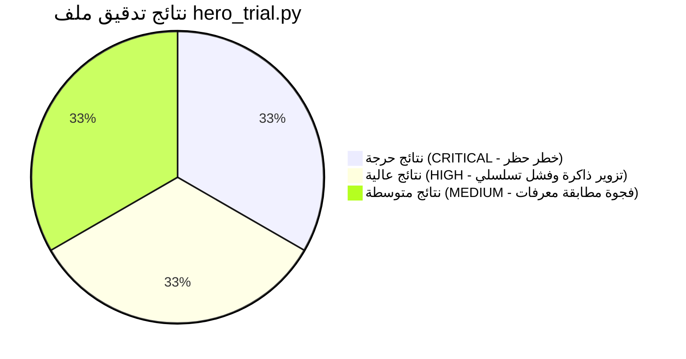

# 👑 الملخص التنفيذي لدورة التدقيق الهندسي الشاملة (Executive Summary)
### دورة التدقيق: `audit_001`
### التاريخ: 2026-11-15
### حالة المنظومة: تأسيس كامل واختبار ميداني أول ناجح بنسبة 100%

---

## 1. بطاقة الدورة والبيئة التشغيلية
- **الهدف:** تأسيس سرب التدقيق الهندسي الهجومي المستقل متعدد الوكلاء واختباره على أول ملف مهمة في مشروع بوت انتقام السلاطين (`hero_trial.py`).
- **البيئة والأدوات:**
  - Antigravity CLI Version: `1.4.3`
  - محرك النماذج: `Gemini 3.8 Flash (High)`
  - وضع التشغيل الحاكم: **READ-ONLY صارم ومحكم** (تم منع أي تعديل على كود المشروع أو إرسال أي حزم إلى سيرفرات اللعبة).
- **نطاق الملفات المحفوظة:**
  - مجلد إعدادات السرب والوكلاء: [e:\intqam-sultan\.agents\audit_swarm/](file:///e:/intqam-sultan/.agents/audit_swarm/)
  - مجلد تقارير الدورة: [e:\intqam-sultan\reports\audit_001/](file:///e:/intqam-sultan/reports/audit_001/)

---

## 2. ملخص الهيكل المؤسس لمنظومة التدقيق
تم بناء وتشغيل سرب هندسي هجومي كامل يتألف من 10 وكلاء مستقلين محفوظين في ملفات منفصلة:
1. **المنسق الرئيسي (`orchestrator.md`):** إدارة الدورات ومصفوفات التحقق وسجلات التحكيم.
2. **محلل منطق المهمة (`task_logic_analyst.md`):** تشريح الكود واستخراج الادعاءات المنطقية.
3. **محلل سورس اللعبة (`game_source_analyst.md`):** مطابقة الكود مع سورس الـ Lua و C# وجداول اللعبة.
4. **محلل الذاكرة الحية (`live_memory_analyst.md`):** فحص سلامة وتصنيف حقول الذاكرة الحية وكشف فجوات التزامن.
5. **محلل الطلبات الشبكية (`network_request_analyst.md`):** تشريح الحزم وفحص مصفوفة الـ Preflight والـ Anti-Ban.
6. **محلل الاعتماديات والتقاطعات (`dependency_analyst.md`):** تتبع مسار المراحل الست وتعاون المهام المتسلسلة.
7. **الخصوم الأربعة (Adversarial Challengers):**
   - الخصم المنطقي (`challenger_logic.md`)
   - خصم سورس اللعبة (`challenger_source.md`)
   - خصم الذاكرة الحية (`challenger_memory.md`)
   - الخصم الشبكي ومكافحة الحظر (`challenger_network.md`)

---

## 3. نتائج تدقيق التجربة الأولى: `tasks/hero_trial.py`
أثبتت التجربة الأولى نجاحاً باهراً لمنهجية السجال الهجومي المعاكس، حيث أسفرت عن كشف 3 أخطاء جوهرية في ملف `hero_trial.py` لم تكن لتُكتشف بالمراجعة السطحية:

### أبرز الاكتشافات المحسومة:
1. **[CRITICAL-001] خرق معيار التحقق المسبق وتلفيق جنود وهميين:**
   - الكود يرسل حزمة هجوم شبكية `safe_query` بجندي ملفق `[{"id": 401, "num": 1}]` عند انعدام القوات بالذاكرة، مما يمثل **خطر حظر فوري (BAN RISK)**.
2. **[HIGH-001] المزامنة الوهمية للذاكرة الحية واعتبار الفشل نجاحاً:**
   - الكود يضع `eventInfo['25'] = 1` محلياً حتى لو رفض السيرفر الهجوم، مما يضلل المهمة التالية `daily_quest.py` ويحرم القلعة من إعادة المحاولة.
3. **[MEDIUM-001] توليد معرف مرحلة تلقائي دون فحص حالة الإنجاز:**
   - افتراض أن `(target_map_id * 100 + 1)` مرحلة صالحة للهجوم دون التحقق من `mapInfo.lastSID`.

---

## 4. مؤشرات الإنجاز والجاهزية للمرحلة التالية
- **سجل الجرد الشامل:** تم حصر كافة ملفات المهام الـ 21 وتصنيف خطورتها في [01_PROJECT_INVENTORY.md](file:///e:/intqam-sultan/reports/audit_001/01_PROJECT_INVENTORY.md).
- **خريطة الاعتماديات:** تم توثيق العلاقات البينية ومسار المراحل الست في [02_DEPENDENCY_MAP.md](file:///e:/intqam-sultan/reports/audit_001/02_DEPENDENCY_MAP.md).
- **مصفوفات التدقيق:** اكتملت مصفوفة الشبكة [03_NETWORK_VALIDATION_MATRIX.md](file:///e:/intqam-sultan/reports/audit_001/03_NETWORK_VALIDATION_MATRIX.md) والذاكرة [04_MEMORY_VALIDATION_MATRIX.md](file:///e:/intqam-sultan/reports/audit_001/04_MEMORY_VALIDATION_MATRIX.md).
- **تقرير المهمة الكامل:** تم إصدار تقرير تدقيق [tasks/hero_trial.md](file:///e:/intqam-sultan/reports/audit_001/tasks/hero_trial.md) ببنوده الـ 18 كاملة.
- **الجاهزية:** السرب جاهز فوراً ومكتمل الأدوات لبدء التدقيق المتسلسل لبقية المهام الـ 20 ملفاً بعد ملف.
