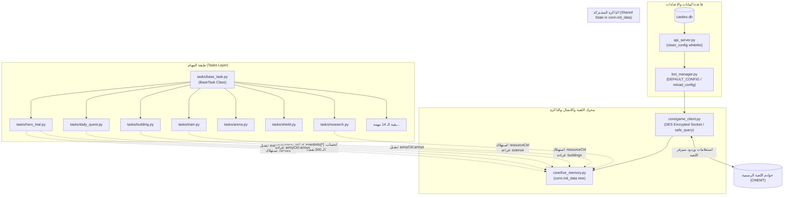

# 🗺️ خريطة الاعتماديات والعلاقات التبادلية (Dependency Map)
### دورة التدقيق رقم: `audit_001`
### تاريخ الإنشاء: 2026-11-15

---

## 1. مخطط التدفق المعماري الشامل للمنظومة

---

## 2. مصفوفة الاعتماديات المتقاطعة (Cross-Task Dependency Matrix)

| المهمة الأساسية | المهام المتقاطعة معها | نوع التقاطع والمورد المشترك | طبيعة الخطر المتبادل |
|---|---|---|---|
| **`hero_trial.py`** | `daily_quest.py` | تشارك حقل `everydayTaskCtrl.eventInfo['25']` | إذا حدثت `hero_trial` الذاكرة كذباً عند الفشل، تقوم `daily_quest` باستلام نقاط غير مستحقة وتفشل على السيرفر. |
| **`hero_trial.py`** | `train.py`, `daily_train.py` | تشارك كائن `armyCtrl.armys` وقوات القلعة | إذا استهلكت `hero_trial` جندياً وهمياً أو أرسلت جنوداً غير متوفرين أثناء تدريب القوات، يفشل طلب الهجوم. |
| **`building.py`** | `research.py`, `train.py` | تنافس على الموارد الحية في `resourceCtrl` | استهلاك الموارد في البناء قد يفرغ المستودع ويمنع تدريب الجنود أو البحوث. |
| **`arena.py`** | `hero_trial.py` | تشارك الأبطال وحالة المسير | تضارب محتمل في انشغال الأبطال أو طوابير السير الخاصة بالفعاليات. |
| **`shield.py`** | كافة المهام | حماية القلعة من الهجمات أثناء دورة البوت | إذا سقط الدرع ولم يُجدد، تتعرض القلعة للهجوم وتفرغ الموارد والمصابين. |

---

## 3. مسار التحقق الإلزامي للمراحل الست (The 6-Stage Pipeline Audit)
لكل مهمة من الـ 21، يتم تدقيق تسجيلها الكامل في الطبقات الست لمنع فقدان البيانات:
1. `tasks/<task>.py` (الكود البرمجي للمهمة).
2. `tasks/__init__.py` (التصدير البرمجي).
3. `bot_manager.py` (التسجيل في `REGISTERED_TASKS`، `DEFAULT_BOT_CONFIG`، `reload_config_from_db`).
4. `api_server.py` (الإدراج في القائمة البيضاء `clean_config`).
5. `database/castles.db` (وجود مفتاح الإعداد في سجلات القلاع).
6. واجهة المستخدم ولوحة التحكم (`TaskTabContent.tsx` ومسار الحفظ الثنائي وترجمات `locales/`).
