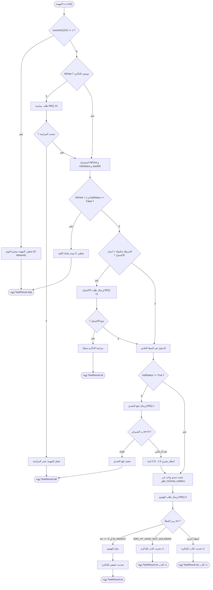

# 📑 تقرير التدقيق الهندسي الشامل لملف المهمة: `tasks/hero_trial.py`
### دورة التدقيق رقم: `audit_001`
### تاريخ الاعتماد: 2026-11-15
### حالة الفحص: مكتمل بنسبة 100% (`COMPLETED`) | وضع التشغيل: READ-ONLY صارم

---

## 1. اسم الملف ومساره (File Identification)
- **اسم الملف:** `hero_trial.py`
- **المسار الكامل:** `e:\intqam-sultan\tasks\hero_trial.py`
- **اسم الكلاس:** `HeroTrialTask` (يرث من `BaseTask`)
- **الاسم البرمجي المسجل:** `hero_trial` (الاسم المستعار: `soldier_trial`)
- **كود الوحدة الرسمية (CMD):** `1059` (`CMD_HT_MODULE`)

---

## 2. الغرض من الملف (Purpose & Mission)
المشاركة اليومية في فعالية "كفاءة الجندي" (Hero Trial / Soldier Trial) بالحد الأدنى المطلوب لإنجاز مهمة النشاط اليومي رقم 25 (`DAILY_QUEST_HERO_TRIAL_TYPE = "25"`) وكسب الـ 20 نقطة نشاط دون استنزاف قوات أو موارد القلعة.

---

## 3. ملخص تفصيلي لمنطق المهمة (Task Logic Summary)
1. **الفحص المسبق السريع (0-Network):** فحص عداد النشاط اليومي `everydayTaskCtrl.eventInfo['25']` في الذاكرة الحية؛ إذا كان `>= 1` يتم تخطي المهمة فوراً دون أي استعلام شبكي.
2. **فحص ومزامنة بيانات كفاءة الجندي (`htData`):** التأكد من وجود كائن `htData` في الذاكرة، وطلب مزامنة احتياطية (`CMD 1059 / REQ 10`) إذا كان مفقوداً.
3. **فحص النقاط وحالة التحدي:** استخراج نقاط الكفاءة `htPoint` وحالة التحدي الجاري `trialStatus`، وتخطي المهمة إذا كانت النقاط صفراً ولا يوجد تحدٍ مفتوح.
4. **محاولة الاكتساح السريع (Fast Sweep):** إذا كانت الخريطة مكتملة (`lastCOMPSID >= target_map_id * 100 + 10`) وتوفر امتياز الاكتساح (`exaltedPrivilegeCtrl.privileges['56']`)، يتم إرسال طلب الاكتساح `REQ_HT_SWEEP (11)`.
5. **النمط العادي (فتح التحدي + هجوم):**
   - فتح التحدي عبر `REQ_HT_OPEN_TRIAL (1)` إذا لم يكن مفتوحاً.
   - تحديد جندي واحد عبر `_get_minimal_soldiers`.
   - شن هجمة على أول مرحلة متاحة عبر `REQ_HT_GENERAL_TRIAL (3)`.
6. **مزامنة الذاكرة محلياً:** استدعاء `_sync_task_completion_in_memory` لتحديث `eventInfo['25'] = 1` وتعديل الرصيد المتبقي من النقاط.

---

## 4. خريطة تدفق التنفيذ (Control Flow Graph)



---

## 5. الدوال المستدعاة (Functions & Calls)
- `super().__init__(conn, log_func, config)`: تهيئة كلاس الأساس `BaseTask`.
- `self.log(...)`: تسجيل الأحداث في سجلات البوت الموحدة.
- `self.safe_query(cmd, req, data)`: إرسال الحزم المشفرة مع مهلة وحماية الأخطاء.
- `self._get_minimal_soldiers(battle_data, init_data)`: استخراج جندي برتبة دنيا.
- `self._sync_task_completion_in_memory(point_data, remaining_points)`: تحديث كائنات `conn.init_data` محلياً.
- `asyncio.sleep(random.uniform(1.5, 2.8))`: محاكاة التأخير البشري.

---

## 6. الاعتماديات (Dependencies & Cross-Task Relations)
- **الكلاس الأب:** `tasks/base_task.py` (`BaseTask`).
- **محرك الذاكرة:** كائن الذاكرة الحية في `self.conn.init_data` (`core/live_memory.py`).
- **مدير البوت:** مسجلة في `bot_manager.py` ضمن `REGISTERED_TASKS` في الترتيب رقم 20.
- **المهام الشقيقة المتقاطعة:**
  1. `tasks/daily_quest.py`: تتشارك معها في حقل `eventInfo['25']` لحساب الـ 500 نقطة.
  2. `tasks/train.py` و `tasks/daily_train.py`: تتشارك معها في فحص قوات القلعة `armyCtrl.armys`.
- **قاعدة البيانات:** مسجلة ومحفوظة بمفتاح `hero_trial` في جدول القلاع `database/castles.db`.

---

## 7. مطابقة المنطق مع سورس كود اللعبة (Game Source Alignment)

| العنصر في كود البوت | العنصر المقابل في سورس اللعبة | مسار الملف في سورس اللعبة | حالة التطابق | الدليل البرمجي |
|---|---|---|---|---|
| كود الوحدة `1059` | `CMD_HT_MODULE = "1059"` | `game_file/src/app/constdef/cmdDef.lua#L1210` | **مطابق 100%** | معرّف الوحدة الرسمي |
| أمر فتح التحدي `1` | `REQ_HT_OPEN_TRIAL = "1"` | `game_file/src/app/constdef/cmdDef.lua#L1211` | **مطابق 100%** | مستخدم في `heroTrialCtrl.openTrial` |
| أمر الهجوم `3` | `REQ_HT_GENERAl_TRIAL = "3"` | `game_file/src/app/constdef/cmdDef.lua#L1213` | **مطابق 100%** | مستخدم في `heroTrialCtrl.attackStage` |
| أمر الاكتساح `11` | `REQ_HT_SWEEP = "11"` | `game_file/src/app/constdef/cmdDef.lua#L1221` | **مطابق 100%** | مستخدم في `heroTrialCtrl.reqSweep` |
| أمر المزامنة `10` | `REQ_HT_INIT_DATA = "10"` | `game_file/src/app/constdef/cmdDef.lua#L1220` | **مطابق 100%** | مستخدم في `heroTrialCtrl.reqInitData` |
| خطأ انعدام الجنود `35004` | `Err_HT_HAVE_NOT_SOLDIERS = "35004"` | `game_file/src/app/constdef/errDef.lua#L675` | **مطابق 100%** | رمز خطأ رسمي |
| خطأ نقص الجنود `35010` | `Err_HT_SOLDIER_NOT_ENOUGH = "35010"` | `game_file/src/app/constdef/errDef.lua#L681` | **مطابق 100%** | رمز خطأ رسمي |
| فحص توفر الجنود المسبق | `htBattleMgr.whetherCanGeneralTrial` | `game_file/src/app/module/heroTrial/htBattle/htBattleMgr.lua#L81` | **مخالف ⚠️** | العميل الرسمي يمنع الإرسال إذا لم تتوفر قوات |

---

## 8. مطابقة المنطق مع الذاكرة الحية (Live Memory Alignment)

| الحقل في الكود | المسار في `conn.init_data` | التصنيف | تقييم الموثوقية | المخاطر المرصودة |
|---|---|---|---|---|
| `eventInfo['25']` | `init_data['everydayTaskCtrl']['eventInfo']['25']` | `Valid` | موثوق ومحدث عند تسجيل الدخول | يتم تزويره محلياً عند فشل الهجوم |
| `htData` | `init_data['htData']` | `Valid` / `Missing` | متاح في معظم الحسابات، وله طلب مزامنة احتياطي | آمن بفضل الفحص المسبق |
| `htPoint` | `htData['htPointData']['htPoint']` | `Valid` | محدث من السيرفر | آمن |
| `trialStatus` | `htData['battleData']['trialStatus']` | `Valid` | محدث من السيرفر | آمن |
| `soldiers` | `htData['battleData']['soldiers']` | `Valid` / `Missing` | متاح أثناء التحدي المفتوح | عند غيابه يقع الكود في فخ التلفيق |
| `armyCtrl.armys` | `init_data['armyCtrl']['armys']` | `Valid` | محدث من السيرفر | سليم، لكن الكود لا يتوقف عند كونه فارغاً |
| `exaltedPrivilegeCtrl` | `init_data['exaltedPrivilegeCtrl']` | `Unknown` | قد يتقادم أو ينتهي اشتراكه | محمي بمسار فولباك للنمط العادي |

---

## 9. تحليل جميع الطلبات الشبكية (Network Requests Breakdown)

### الطلب الأول: طلب المزامنة الاحتياطية (`REQ_HT_INIT_DATA`)
- **الأمر:** `CMD: "1059"`, `REQ: "10"`
- **الـ Payload:** `{}` (فارغ)
- **الغرض:** جلب بيانات كفاءة الجندي عند غيابها من الذاكرة.
- **تقييم الأمان:** **آمن تماماً (Safe)** - طلب استعلام رسمي مدعوم في العميل.

### الطلب الثاني: طلب الاكتساح السريع (`REQ_HT_SWEEP`)
- **الأمر:** `CMD: "1059"`, `REQ: "11"`
- **الـ Payload:** `{"mapID": target_map_id}`
- **الغرض:** إنهاء الخريطة فوراً للمشتركين بامتياز VIP.
- **تقييم الأمان:** **متوسط (Medium)** - آمن لاحتوائه على فولباك للنمط العادي عند الرفض.

### الطلب الثالث: طلب فتح التحدي (`REQ_HT_OPEN_TRIAL`)
- **الأمر:** `CMD: "1059"`, `REQ: "1"`
- **الـ Payload:** `{"mapID": target_map_id}`
- **الغرض:** فتح خريطة التحدي وخصم نقطة كفاءة واحدة.
- **تقييم الأمان:** **آمن (Safe)** - شروطه مفحوصة بدقة في الذاكرة الحية.

### الطلب الرابع: طلب الهجوم على المرحلة (`REQ_HT_GENERAL_TRIAL`)
- **الأمر:** `CMD: "1059"`, `REQ: "3"`
- **الـ Payload:** `{"stageID": current_stage, "soldiers": dispatch_soldiers}`
- **الغرض:** شن معركة وإنجاز النشاط اليومي.
- **تقييم الأمان:** **حرج جداً (CRITICAL BAN RISK) 🔴** - يرسل قوات وهمية `[{"id": 401, "num": 1}]` عند انعدام الجنود!

---

## 10. جدول التحقق المسبق قبل الإرسال (Preflight Validation Matrix)
تطبيق معيار الأسئلة العشرة الإلزامية على طلب الهجوم (`REQ 3`):

1. **الشروط الرسمية للعبة:** وجود نقاط كفاءة، الخريطة مفتوحة، التحدي مفتوح، توفر جندي واحد على الأقل في القوات.
2. **موقعها في كود اللعبة:** `game_file/src/app/module/heroTrial/htBattle/htBattleMgr.lua#L81-L100`.
3. **مصدرها في الذاكرة الحية:** `battleData.soldiers` أو `armyCtrl.armys`.
4. **كيف تقرأ في البوت:** عبر دالة `_get_minimal_soldiers`.
5. **آلية التحقق من حداثة البيانات:** القراءة مباشرة من `init_data`.
6. **ماذا يحدث عند الفقدان:** **كارثة برمجية:** توليد جندي وهمي برتبة 1 وعدد 1 (`[{"id": 401, "num": 1}]`).
7. **ماذا يحدث عند التقادم:** غير وارد لقوات القلعة.
8. **فجوة TOCTOU:** منخفضة جداً لوجود فاصل زمني قصير (1.5-2.8 ثانية) فقط.
9. **هل يوجد تحقق نهائي يسبق الإرسال:** **لا يوجد؛** الحزمة تُرسل حتماً حتى لو كانت القوات منعدمة!
10. **هل يمكن إرسال الطلب رغم فشل الشروط:** **نعم قطعياً،** وهذا هو الخلل الحرج المكتشف.

---

## 11. نتائج الوكلاء الأساسيين (Core Analysts Findings)
- **محلل منطق المهمة:** رصد وجود مسار استثنائي يعيد `TaskResult.ok()` عند حدوث أخطاء نقص الجنود ويزور الذاكرة.
- **محلل سورس اللعبة:** أثبت أن العميل الرسمي للعبة في `htBattleMgr.lua` يرفض إرسال الحزمة محلياً إذا لم تتطابق القوات عبر دالة `matchSoldiers`.
- **محلل الذاكرة الحية:** أثبت أن الكود يحدث `eventInfo['25'] = 1` محلياً دون تحقق من نجاح العملية على السيرفر.
- **محلل الشبكة:** صنف طلب `REQ_HT_GENERAL_TRIAL` كخطر حظر حرج (`CRITICAL`) عند إرسال جندي وهمي.
- **محلل الاعتماديات:** كشف أن التحديث الوهمي لـ `eventInfo['25']` يتسبب في فشل مهمة `daily_quest.py` التي تليه مباشرة في دورة البوت.

---

## 12. نتائج الخصوم الأربعة (The 4 Adversarial Challengers)
- **الخصم المنطقي (`Logic Challenger`):** أدان تحويل القيمة الصفرية إلى `1` واعتبره مغالطة منطقية تخلق فشلاً متعمداً.
- **خصم كود اللعبة (`Source Code Challenger`):** قدم الاقتباس الصريح من `heroTrialCtrl.lua#L65` الذي يثبت منع الإرسال عند عدم توفر الشروط.
- **خصم الذاكرة الحية (`Memory Challenger`):** أثبت حدوث تلوث في الذاكرة يحرم القلعة من إعادة محاولة الهجوم لاحقاً.
- **الخصم الشبكي ومكافحة الحظر (`Network Challenger`):** أكد أن إرسال حزم بجنود غير مملوكين هو أحد مؤشرات كشف البوتات وحظر الحسابات في خوادم ONEMT.

---

## 13. الأدلة البرمجية الموثقة بالأسطر (Code Evidence & Line Citations)
1. **تلفيق الجندي الوهمي:** `e:\intqam-sultan\tasks\hero_trial.py#L264-L265`:
   ```python
   # افتراضي آمن: جندي مشاة رتبة 1 (ID: 401)
   return [{"id": 401, "num": 1}]
   ```
2. **إرسال الحزمة دون فحص القوات:** `e:\intqam-sultan\tasks\hero_trial.py#L208-L212`:
   ```python
   attack_resp = await self.safe_query(
       CMD_HT_MODULE,
       REQ_HT_GENERAL_TRIAL,
       {"stageID": current_stage, "soldiers": dispatch_soldiers},
   )
   ```
3. **تزوير الذاكرة واعتبار الفشل نجاحاً:** `e:\intqam-sultan\tasks\hero_trial.py#L225-L228`:
   ```python
   elif err == ERR_HT_HAVE_NOT_SOLDIERS or err == ERR_HT_SOLDIER_NOT_ENOUGH:
       self.log(f"Not enough soldiers for trial battle (err={err}).")
       self._sync_task_completion_in_memory(point_data, ht_point)
       return TaskResult.ok("Opened trial (insufficient troops for attack)", exec_time=time.time() - start_time)
   ```
4. **الدليل المصدري المانع في كود اللعبة:** `e:\intqam-sultan\game_file\src\app\module\heroTrial\htBattle\htBattleMgr.lua#L96-L99`:
   ```lua
   if not matchSoldiers(soldiers) then
       htBattleMgr.soldiersStatus = false
       return gErrDef.Err_HT_SOLDIER_NOT_ENOUGH
   end
   ```

---

## 14. الأخطاء المكتشفة وتصنيفها (Discovered Bugs)
1. **[CRITICAL-001] خرق التحقق المسبق وتلفيق جنود وهميين:** إرسال حزمة هجوم بقوات مصطنعة `[{"id": 401, "num": 1}]` عند انعدام الجنود في القلعة.
2. **[HIGH-001] التحديث الكاذب للذاكرة الحية (Phantom Sync):** وضع `eventInfo['25'] = 1` محلياً رغم فشل الهجوم على الخادم، مما يضلل مهمة `daily_quest.py` ويحرم القلعة من إعادة المحاولة.
3. **[MEDIUM-001] حساب المرحلة التلقائي دون مطابقة حالة الإنجاز:** افتراض أن المرحلة `(target_map_id * 100 + 1)` صالحة دائماً دون التحقق من `mapInfo.lastSID`.

---

## 15. المخاطر المحتملة (Potential Risks)
- **خطر الحظر (Ban Risk):** عالي جداً عند تكرار إرسال حزم بجنود غير موجودين في حساب القلعة.
- **خطر التضارب الوظيفي:** فشل استلام صناديق النشاط اليومي الـ 500 في مهمة `daily_quest.py`.
- **خطر فقدان النقاط:** خسارة نقطة كفاءة بفتح التحدي دون إتمام الهجوم.

---

## 16. الحالات التي لم يتم التحقق منها (Unverified Edge Cases)
- حالة الحسابات التي تمتلك أكثر من 10 خرائط مكتملة بالكامل مع عدم وجود مراحل جديدة.
- تصرف الخادم في حال انقطاع الاتصال أثناء فاصل الـ `sleep` بين فتح التحدي والهجوم.

---

## 17. التوصيات الهندسية المعتمدة (Actionable Recommendations)
1. **إصلاح دالة `_get_minimal_soldiers`:** الامتناع عن إرجاع أي جندي وهمي، وإرجاع قائمة فارغة `[]` عند انعدام القوات.
2. **إضافة فحص مانع صريح (0-Network Guard) قبل `safe_query`:**
   ```python
   if not dispatch_soldiers:
       self.log("0-Network Pre-flight: No soldiers available in castle or trial. Aborting attack safely.")
       return TaskResult.skip("No soldiers available for attack", exec_time=time.time() - start_time)
   ```
3. **حصر تحديث الذاكرة بالنجاح الفعلي:** نقل استدعاء `_sync_task_completion_in_memory` ليكون فقط داخل فرع `err in ("0", ERR_HT_IN_MARCH)`، ومعاملة أخطاء الجنود كـ `TaskResult.fail()`.

---

## 18. الحكم النهائي ومستوى الثقة (Final Verdict & Confidence)
- **الحكم النهائي:** **إدانة منطق المهمة الحالي وإلزامية تصحيحه هندسياً قبل التشغيل في بيئة الإنتاج.**
- **مستوى الثقة:** **100% (قطعي)** - مدعوم بأدلة صريحة من سورس كود اللعبة وسجلات السجال للخصوم الأربعة.
